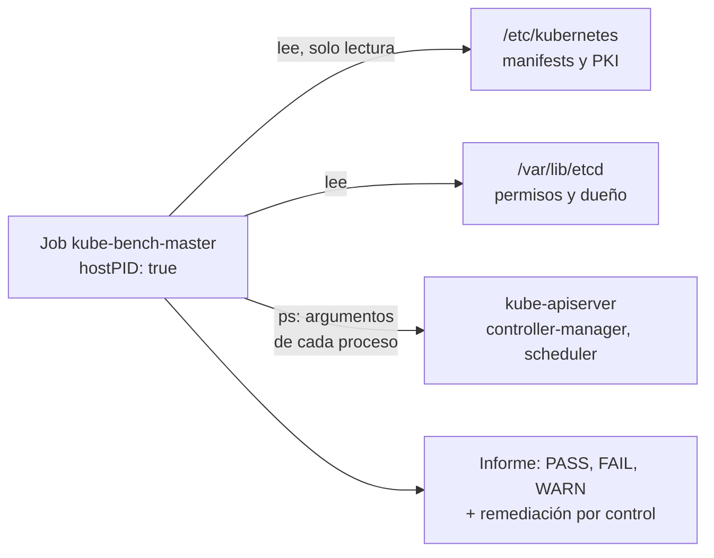
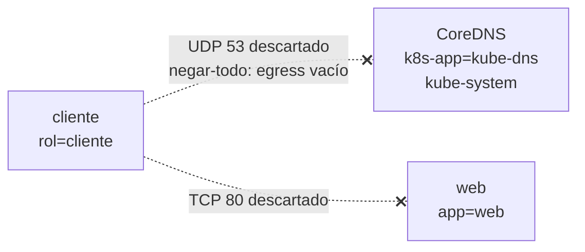
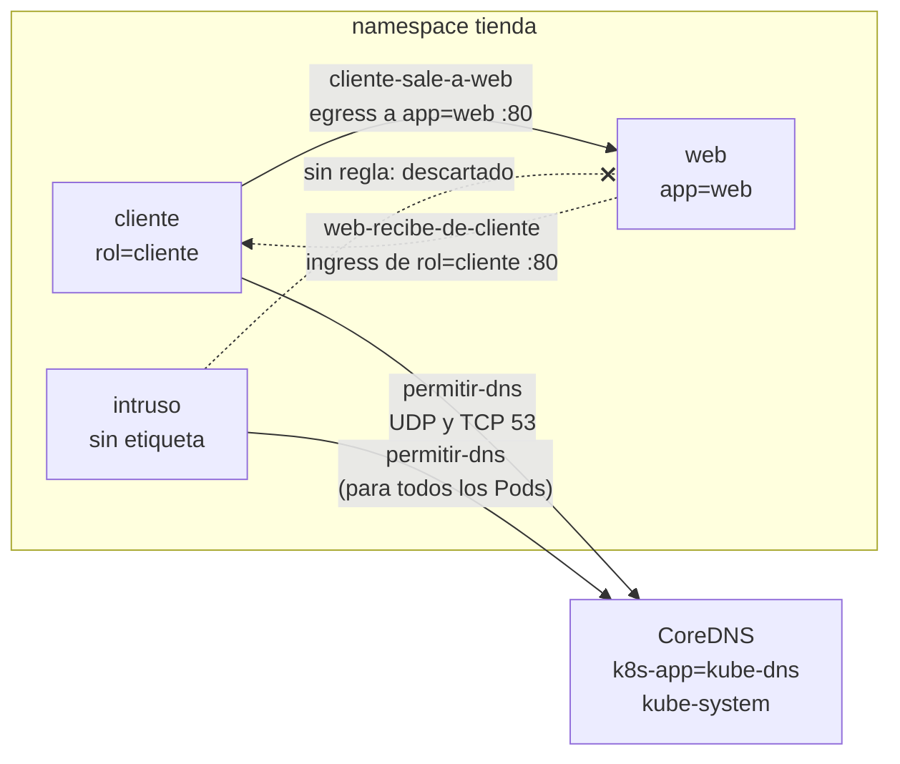
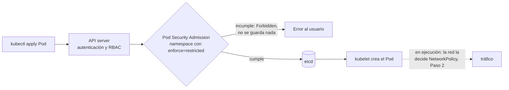
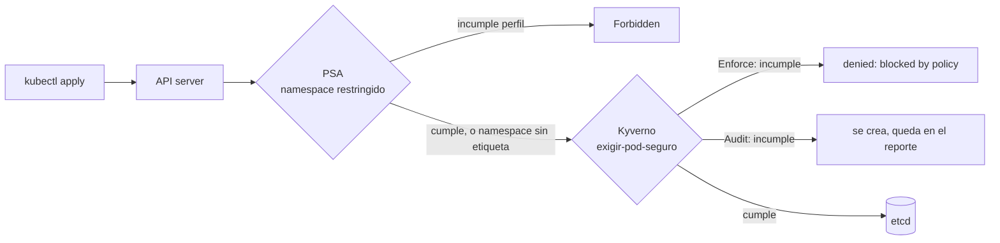
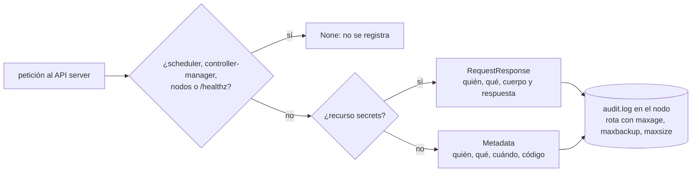
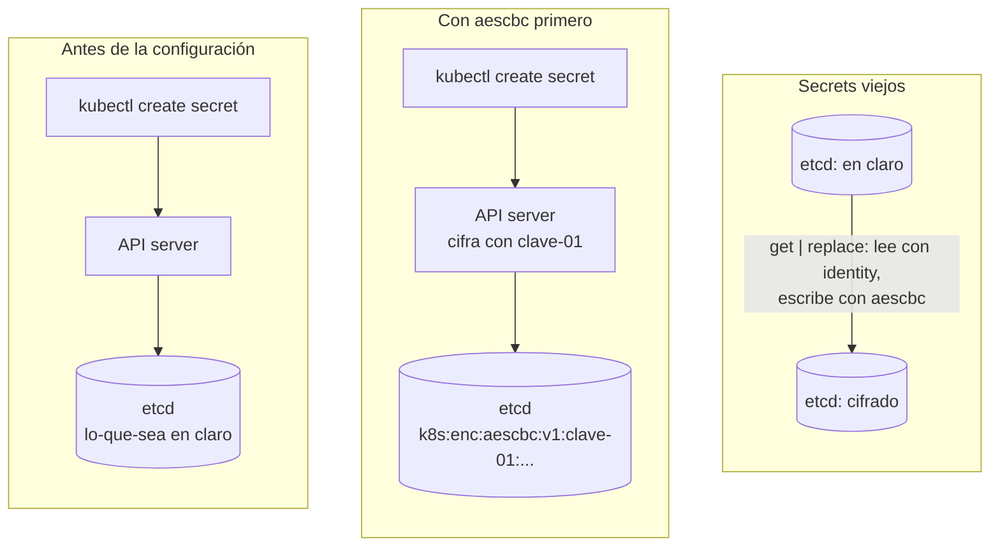

# Laboratorio 1 (Módulo 7) – Endurecer un clúster y las cargas que corren en él

**Módulo 7 · sesión 11 · en clase · 130–150 minutos.** Un clúster de Kubernetes por defecto
no es seguro: es permisivo para que funcione. Hoy lo endureces tú. Vas a medir un clúster
`kind` con el **CIS Benchmark** (`kube-bench`), a bajar sus fallas de 9 a 3, a cerrar la red
con **NetworkPolicies** sin romper el DNS, a exigir un Pod seguro con **Pod Security
Admission** y con **Kyverno**, a dejar evidencia con una **Audit Policy** y a cifrar los
Secrets **en reposo** dentro de `etcd`. Al final, un verificador califica el estado de un
clúster nuevo, igual que el examen.

| Bloque | Paso | Tiempo | ¿Se puede dejar para casa? |
|---|---|---|---|
| Clúster `kind` con auditoría activa y hábitos de examen | 0 | ~8 min | No |
| CIS Benchmark con `kube-bench`: de 9 FAIL a 3 | 1 | ~25 min | No |
| NetworkPolicy: `default-deny` y el DNS que se rompe | 2 | ~20 min | No |
| Pod Security Admission `restricted` | 3 | ~10 min | No |
| Kyverno: políticas como código, `Enforce` frente a `Audit` | 4 | ~20 min | No |
| Audit Policy: quién hizo qué con los Secrets | 5 | ~12 min | No |
| Cifrado de Secrets en reposo con `aescbc` | 6 | ~18 min | No |
| **Reto** estilo examen, calificado por script | 7 | ~25 min | No |

> La idea central de esta sesión cabe en una frase: **un control de seguridad que no puedes
> demostrar con evidencia no existe.** Cada paso de hoy termina con una prueba que pudo salir
> mal y no salió: un tráfico bloqueado, un Pod rechazado, una línea en un log, unos bytes
> cifrados en `etcd`. Si no tienes la prueba, solo tienes una intención.

---

## Cómo trabajar este laboratorio

Este laboratorio está construido con cuatro técnicas de enseñanza que tienen respaldo en la
investigación sobre cómo se aprende a programar y a diagnosticar. No son adorno: cambian
lo que haces en cada paso.

| Técnica | Lo que te pide | De dónde sale |
|---|---|---|
| **Predice, ejecuta, explica** | Antes de cada bloque marcado **🔮 Predice**, escribe en `predicciones.md` qué crees que va a pasar. Después compara. | PRIMM (Sentance y Waite, 2019) y Predict-Observe-Explain (White y Gunstone, 1992) |
| **Fallo productivo** | Varios pasos te hacen romper algo **a propósito** (el DNS, un Pod, un Job) antes de ver la forma correcta. El error es el material. | Productive Failure (Kapur, 2008) |
| **Andamiaje que se retira** | Los pasos 0 a 6 te dan el comando. El Paso 7 solo te da el objetivo y un script que califica el resultado, igual que el examen. | Efecto del ejemplo resuelto y reversión por experticia (Sweller; Kalyuga et al., 2003) |
| **Práctica de recuperación** | Al final respondes de memoria, sin releer. Recordar cuesta más que releer, y por eso fija más. | Test-Enhanced Learning (Roediger y Karpicke, 2006) |

```bash
mkdir -p ~/lab-cks-1 && cd ~/lab-cks-1
echo "# Predicciones del laboratorio 1 (CKS)" > predicciones.md
```

Una predicción equivocada que escribiste vale más que una correcta que solo pensaste: es la
que te obliga a revisar tu modelo mental. Nadie la califica.

---

## Objetivo

Al terminar vas a poder responder, señalando evidencia en tu terminal:

1. ¿Qué mide el CIS Benchmark, por qué un clúster `kind` recién creado falla 9 controles y
   por qué hay 3 que **no debes** «arreglar» a ciegas?
2. ¿Por qué una política `default-deny` rompe el DNS aunque no toques el DNS, y qué
   selector lo arregla?
3. ¿Por qué el tráfico lo decide **la etiqueta** y no la presencia del Pod?
4. ¿Cuáles son los motivos exactos por los que Pod Security Admission rechaza un Pod, y qué
   cuatro campos lo hacen cumplir `restricted`?
5. ¿En qué se diferencia `Enforce` de `Audit` en Kyverno, y por qué una política tuya puede
   bloquear tus propias herramientas?
6. ¿Qué verbo y qué código de respuesta deja el audit log cuando creas un Secret, y por qué
   ese log **también es sensible**?
7. ¿Cómo se ve un Secret **antes** y **después** de cifrarlo en `etcd`, y por qué los Secrets
   viejos no se cifran solos?

**Requisito:** módulos 5 y 6 completos (sabes crear un clúster `kind`, leer `kubectl describe`,
escribir un Pod con `securityContext` y razonar sobre RBAC y ServiceAccounts, como en el
laboratorio 2 del módulo 5).

**Entorno verificado** (el 22 de octubre de 2026, en la máquina donde se capturaron todas las
salidas): Linux con Docker Engine 29.9.2, `kind` v0.33.0, `kubectl` v1.37.0, nodos
`kindest/node:v1.37.0`, Helm v4.3.0 con el chart `kyverno` 3.9.2 (Kyverno v1.19.2),
`kube-bench` v0.16.0 y `etcdctl` v3.5.17. La máquina tiene 24 núcleos (`nproc`) y 62 GiB de
RAM. Cuenta con **4 GiB de RAM libres** (dos nodos `kind`, Kyverno y un Job de `kube-bench`)
y unos **700 MB de descargas** (imagen de `kube-bench`, Kyverno, `nginx`, `busybox` y el
binario de `etcd`).

Comprueba tus versiones antes de empezar; si difieren, las salidas pueden variar en detalle:

```bash
kind version
kubectl version --client | head -1
docker version --format '{{.Server.Version}}'
helm version --short
nproc
free -g | sed -n 2p
```

> Todas las salidas marcadas **«Salida real de esta máquina»** se capturaron ejecutando los
> comandos. Los nombres de Pods, IPs, hashes, claves y tiempos serán **distintos en tu
> máquina**; la forma de la salida no. Después de cada salida hay una o dos frases que dicen
> qué significa **en el modelo de amenaza**: qué ataque habría pasado sin ese control.

---

## Paso 0: Un clúster con auditoría activa y los hábitos del examen (8 min)

La auditoría del API server **no se puede encender después sin reiniciarlo**, y en `kind` el
API server es un Pod estático que se configura al crear el clúster. Por eso hoy el clúster
nace con la Audit Policy ya montada. La política la vas a leer línea a línea en el Paso 5;
por ahora, cópiala:

```bash
cd ~/lab-cks-1
mkdir -p auditoria
cat > auditoria/politica.yaml <<'EOF'
apiVersion: audit.k8s.io/v1
kind: Policy
omitStages:
- "RequestReceived"
rules:
# el ruido de los componentes del plano de control no se registra
- level: None
  users: ["system:kube-scheduler", "system:kube-controller-manager", "system:apiserver"]
- level: None
  userGroups: ["system:nodes"]
- level: None
  nonResourceURLs: ["/healthz*", "/readyz*", "/livez*", "/version", "/openapi*", "/api*"]
# los Secrets: quien, cuando y que, con la respuesta completa
- level: RequestResponse
  resources:
  - group: ""
    resources: ["secrets"]
# todo lo demas: solo metadatos
- level: Metadata
EOF

cat > kind-cks.yaml <<'EOF'
kind: Cluster
apiVersion: kind.x-k8s.io/v1alpha4
name: cks
nodes:
- role: control-plane
  image: kindest/node:v1.37.0
  extraMounts:
  - hostPath: ./auditoria
    containerPath: /etc/kubernetes/auditoria
    readOnly: true
  kubeadmConfigPatches:
  - |
    kind: ClusterConfiguration
    apiServer:
      extraArgs:
      - name: audit-policy-file
        value: /etc/kubernetes/auditoria/politica.yaml
      - name: audit-log-path
        value: /var/log/kubernetes/audit/audit.log
      extraVolumes:
      - name: auditoria-politica
        hostPath: /etc/kubernetes/auditoria/politica.yaml
        mountPath: /etc/kubernetes/auditoria/politica.yaml
        readOnly: true
        pathType: File
      - name: auditoria-bitacora
        hostPath: /var/log/kubernetes/audit
        mountPath: /var/log/kubernetes/audit
        readOnly: false
        pathType: DirectoryOrCreate
- role: worker
  image: kindest/node:v1.37.0
EOF

kind create cluster --config kind-cks.yaml
kubectl wait --for=condition=Ready node --all --timeout=180s
kubectl get nodes
```

`hostPath: ./auditoria` es una ruta **relativa a donde ejecutas el comando**: por eso el
`cd ~/lab-cks-1` de la primera línea no es decorativo.

**Salida real de esta máquina:**

```
NAME                 STATUS   ROLES           AGE   VERSION
cks-control-plane    Ready    control-plane   27s   v1.37.0
cks-worker           Ready    <none>          13s   v1.37.0
```

Dos cosas que debes poder demostrar, no suponer: que el API server **recibió** las banderas
de auditoría y que el archivo de bitácora **existe**. Los nodos de `kind` son contenedores
Docker, así que `docker exec` es tu SSH:

```bash
docker exec cks-control-plane grep -E 'audit|profiling' /etc/kubernetes/manifests/kube-apiserver.yaml
docker exec cks-control-plane ls -la /var/log/kubernetes/audit/
```

**Salida real de esta máquina:**

```
    - --audit-policy-file=/etc/kubernetes/auditoria/politica.yaml
    - --audit-log-path=/var/log/kubernetes/audit/audit.log
    - mountPath: /var/log/kubernetes/audit
      name: auditoria-bitacora
    - mountPath: /etc/kubernetes/auditoria/politica.yaml
      name: auditoria-politica
      path: /var/log/kubernetes/audit
    name: auditoria-bitacora
      path: /etc/kubernetes/auditoria/politica.yaml
    name: auditoria-politica
total 280
drwxr-xr-x 2 root root   4096 Oct 23 02:46 .
drwxr-xr-x 3 root root   4096 Oct 23 02:46 ..
-rw------- 1 root root 274610 Oct 23 02:47 audit.log
```

Fíjate en dos cosas. Las banderas `--audit-policy-file` y `--audit-log-path` están, y **no
aparece ninguna** `--audit-log-maxage`: guárdalo, es una de las fallas del Paso 1. Y el log
es `-rw-------` de `root`: solo el administrador del nodo lo lee. **En el modelo de amenaza:**
sin esa política y esa ruta, un atacante con credenciales válidas actuaría sin dejar rastro en
el API server; con ellas, cada petición queda escrita en un archivo que un usuario normal no
puede alterar.

Trabaja en tu propio namespace y déjalo fijo en el contexto, como harías en un clúster
compartido donde **no eres administrador**:

```bash
kubectl create namespace tienda
kubectl config set-context --current --namespace=tienda
```

Los hábitos que ahorran minutos en el examen (el alias `k` ya viene configurado allí; aquí lo
creas tú):

```bash
alias k=kubectl
export do="--dry-run=client -o yaml"      # consejo de la comunidad, no de la LF
k run prueba --image=busybox:1.37 $do | head -12
```

**Salida real de esta máquina:**

```
apiVersion: v1
kind: Pod
metadata:
  labels:
    run: prueba
  name: prueba
spec:
  containers:
  - image: busybox:1.37
    name: prueba
    resources: {}
  dnsPolicy: ClusterFirst
```

`--dry-run=client` **no toca el API server**: genera el esqueleto y tú lo editas. Y cuando no
recuerdes un campo de seguridad, `kubectl explain` lee el esquema del **propio clúster**, sin
navegador. Pruébalo con el campo que más vas a necesitar hoy:

```bash
kubectl explain pod.spec.securityContext.runAsNonRoot | head -14
```

**Salida real de esta máquina:**

```
KIND:       Pod
VERSION:    v1

FIELD: runAsNonRoot <boolean>


DESCRIPTION:
    Indicates that the container must run as a non-root user. If true, the
    Kubelet will validate the image at runtime to ensure that it does not run as
    UID 0 (root) and fail to start the container if it does. If unset or false,
    no such validation will be performed. May also be set in SecurityContext.
    If set in both SecurityContext and PodSecurityContext, the value specified
    in SecurityContext takes precedence.
    
```

Ya ves un detalle de examen escrito en el esquema: `runAsNonRoot` **valida**, no cambia el
usuario. Si la imagen corre como root y no fijas `runAsUser`, el Pod no arranca. Lo vas a ver
en el Paso 3.

---

## Paso 1: CIS Benchmark con `kube-bench`, de 9 FAIL a 3 (25 min)

El **CIS Kubernetes Benchmark** es una lista de controles de configuración escrita por
expertos y publicada por el Center for Internet Security. `kube-bench` (Aqua Security) la
ejecuta contra tu nodo y dice, control por control, `PASS`, `FAIL`, `WARN` o `INFO`.

| Resultado | Qué significa |
|---|---|
| `[PASS]` | El control se cumple |
| `[FAIL]` | Se evaluó automáticamente y **no** se cumple. Es lo que arreglas |
| `[WARN]` | Control **manual**: `kube-bench` no puede decidir, lo decides tú |
| `[INFO]` | Encabezado de sección |

**En un diagrama:** `kube-bench` no pregunta a la API. Entra al sistema de archivos y a la
lista de procesos **del nodo**, por eso el Job necesita `hostPID` y los montajes de
`hostPath`.



### 1.1 La línea base

El Job oficial vive en el repositorio de `kube-bench`. Lo traemos **fijando la versión**, no
`latest`: una auditoría que cambia de versión entre dos corridas no es comparable.

```bash
cd ~/lab-cks-1
curl -sL https://raw.githubusercontent.com/aquasecurity/kube-bench/v0.16.0/job-master.yaml \
  | sed 's#kube-bench:latest#kube-bench:v0.16.0#' > job-master.yaml
grep -n 'image:' job-master.yaml
```

**Salida real de esta máquina:**

```
29:          image: docker.io/aquasec/kube-bench:v0.16.0
```

🔮 **Predice** (escríbelo en `predicciones.md`): el clúster lo creó `kubeadm` con valores por
defecto y le añadiste auditoría. ¿Cuántos `FAIL` crees que van a salir en el plano de
control, entre 0 y 20? ¿Qué componentes tendrán más?

```bash
kubectl -n default apply -f job-master.yaml
kubectl -n default wait --for=condition=complete job/kube-bench-master --timeout=180s
kubectl -n default logs job/kube-bench-master > kube-bench-master-base.txt
grep -E '^\[FAIL\]' kube-bench-master-base.txt
sed -n '/== Summary master/,/^$/p' kube-bench-master-base.txt | head -6
```

**Salida real de esta máquina:**

```
Warning: spec.template.spec.affinity.nodeAffinity.requiredDuringSchedulingIgnoredDuringExecution.nodeSelectorTerms[1].matchExpressions[0].key: node-role.kubernetes.io/master is use "node-role.kubernetes.io/control-plane" instead
job.batch/kube-bench-master created
job.batch/kube-bench-master condition met
[FAIL] 1.1.12 Ensure that the etcd data directory ownership is set to etcd:etcd (Automated)
[FAIL] 1.2.5 Ensure that the --kubelet-certificate-authority argument is set as appropriate (Automated)
[FAIL] 1.2.15 Ensure that the --profiling argument is set to false (Automated)
[FAIL] 1.2.17 Ensure that the --audit-log-maxage argument is set to 30 or as appropriate (Automated)
[FAIL] 1.2.18 Ensure that the --audit-log-maxbackup argument is set to 10 or as appropriate (Automated)
[FAIL] 1.2.19 Ensure that the --audit-log-maxsize argument is set to 100 or as appropriate (Automated)
[FAIL] 1.2.30 Ensure that the --service-account-extend-token-expiration parameter is set to false (Automated)
[FAIL] 1.3.2 Ensure that the --profiling argument is set to false (Automated)
[FAIL] 1.4.1 Ensure that the --profiling argument is set to false (Automated)
== Summary master ==
40 checks PASS
9 checks FAIL
11 checks WARN
0 checks INFO

```

El aviso del principio no es tuyo: el YAML oficial usa una etiqueta antigua (`master`) junto
a la nueva (`control-plane`). **Nueve FAIL, 40 PASS, 11 WARN.** En el modelo de amenaza, cada
FAIL es una configuración que el estándar de la industria pide cerrar; la línea base te dice
cuántas hay pendientes **antes** de que toques nada.

Cada FAIL, en lenguaje de persona:

| Control | Qué exige | Por qué importa | ¿Se arregla hoy? |
|---|---|---|---|
| 1.2.15, 1.3.2, 1.4.1 | `--profiling=false` en apiserver, controller-manager y scheduler | Por defecto el perfilado está **encendido** y publica `/debug/pprof/` en el puerto del componente: una superficie más que no necesitas | Sí |
| 1.2.17 | `--audit-log-maxage=30` | Por defecto se conservan 366 días de bitácoras, y esas bitácoras son sensibles (Paso 5) | Sí |
| 1.2.18 | `--audit-log-maxbackup=10` | Por defecto se conservan hasta 100 archivos viejos en el disco del nodo | Sí |
| 1.2.19 | `--audit-log-maxsize=100` | El valor por defecto **ya es** 100 MB; el control falla porque exige la bandera **escrita** | Sí |
| 1.1.12 | El directorio de datos de `etcd` pertenece a `etcd:etcd` | Que solo un usuario dedicado lea la base de datos del clúster | **No** (ver 1.3) |
| 1.2.5 | `--kubelet-certificate-authority` | Que el API server **verifique** el certificado del kubelet al hablarle | **No** (ver 1.3) |
| 1.2.30 | `--service-account-extend-token-expiration=false` | Tokens de ServiceAccount con vida más corta | **No** (ver 1.3) |

No me creas lo de la tabla: pregúntale al propio binario del API server qué valen esas
banderas cuando no las escribes.

```bash
kubectl -n kube-system exec kube-apiserver-cks-control-plane -- kube-apiserver --help 2>&1 \
  | grep -E -- '--audit-log-max(age|backup|size) |--profiling '
```

**Salida real de esta máquina:**

```
      --audit-log-maxage int                        The maximum number of days to retain old audit log files based on the timestamp encoded in their filename. Setting a value of 0 means old audit log files are not removed based on age. (default 366)
      --audit-log-maxbackup int                     The maximum number of old audit log files to retain. Setting a value of 0 will mean there's no restriction on the number of files. (default 100)
      --audit-log-maxsize int                       The maximum size in megabytes of the audit log file before it gets rotated. Setting to 0 disables rotation (not recommended). (default 100)
      --profiling                      Enable profiling via web interface host:port/debug/pprof/ (default true)
```

Por defecto: 366 días, 100 copias, rotación a 100 MB y **perfilado encendido**. El caso de
`1.2.19` es instructivo: el valor efectivo ya coincide con lo que pide el CIS, pero
`kube-bench` lee los **argumentos del proceso**, y una bandera ausente es un `FAIL`. Un control
de configuración mide lo que está escrito, no lo que crees que el programa hace por omisión.

Los 11 `WARN` son controles **manuales** (verás `(Manual)` al final de cada línea): no suman
al conteo de fallas. Dos de ellos, `1.2.27` y `1.2.28`, hablan del cifrado de Secrets. Los
cierras de verdad en el Paso 6.

### 1.2 Corregir seis banderas en tres manifiestos

En un clúster `kubeadm`, el API server, el controller-manager y el scheduler son **Pods
estáticos**: el kubelet lee sus manifiestos de `/etc/kubernetes/manifests/` y recrea el Pod
cada vez que el archivo cambia. No hay `kubectl edit` que valga; editas el archivo.

> **Regla de examen:** haz la copia de seguridad **fuera** de `manifests/`. El kubelet
> interpreta todo archivo de ese directorio como un Pod estático; un `.bak` dentro es un
> segundo API server.

```bash
N=cks-control-plane
M=/etc/kubernetes/manifests
docker exec $N sed -i '/- --audit-log-path=/a\    - --audit-log-maxage=30\n    - --audit-log-maxbackup=10\n    - --audit-log-maxsize=100\n    - --profiling=false' $M/kube-apiserver.yaml
docker exec $N sed -i '/- --leader-elect=true/a\    - --profiling=false' $M/kube-controller-manager.yaml $M/kube-scheduler.yaml
docker exec $N sh -c "grep -n 'profiling\|audit-log-max' $M/*.yaml"
```

**Salida real de esta máquina:**

```
/etc/kubernetes/manifests/kube-apiserver.yaml:45:    - --audit-log-maxage=30
/etc/kubernetes/manifests/kube-apiserver.yaml:46:    - --audit-log-maxbackup=10
/etc/kubernetes/manifests/kube-apiserver.yaml:47:    - --audit-log-maxsize=100
/etc/kubernetes/manifests/kube-apiserver.yaml:48:    - --profiling=false
/etc/kubernetes/manifests/kube-controller-manager.yaml:25:    - --profiling=false
/etc/kubernetes/manifests/kube-scheduler.yaml:18:    - --profiling=false
```

Seis líneas, tres archivos. `sed` agrega las líneas **después** de un ancla que ya existe
(`-a` de *append*); en el examen harías lo mismo con `vim`, pero `sed` te deja repetirlo sin
errores de dedo. Ahora el API server se reinicia, y mientras tanto `kubectl` no responde.
Espera a que vuelva:

```bash
sleep 30; until kubectl get --raw /readyz >/dev/null 2>&1; do sleep 3; done
kubectl get --raw /readyz; echo
```

**Salida real de esta máquina:**

```
ok
```

### 1.3 Volver a medir

```bash
kubectl -n default delete job kube-bench-master
kubectl -n default apply -f job-master.yaml 2>&1 | tail -1
kubectl -n default wait --for=condition=complete job/kube-bench-master --timeout=180s
kubectl -n default logs job/kube-bench-master > kube-bench-master-final.txt
grep -E '^\[FAIL\]' kube-bench-master-final.txt
sed -n '/== Summary master/,/^$/p' kube-bench-master-final.txt | head -6
```

**Salida real de esta máquina:**

```
job.batch "kube-bench-master" deleted from default namespace
job.batch/kube-bench-master created
job.batch/kube-bench-master condition met
[FAIL] 1.1.12 Ensure that the etcd data directory ownership is set to etcd:etcd (Automated)
[FAIL] 1.2.5 Ensure that the --kubelet-certificate-authority argument is set as appropriate (Automated)
[FAIL] 1.2.30 Ensure that the --service-account-extend-token-expiration parameter is set to false (Automated)
== Summary master ==
46 checks PASS
3 checks FAIL
11 checks WARN
0 checks INFO

```

**De 9 a 3, de 40 a 46 `PASS`.** Seis controles cerrados con seis líneas. En el modelo de
amenaza: ya no hay endpoints de perfilado publicados en tres componentes, y las bitácoras de
auditoría (que contienen datos sensibles) se conservan 30 días y 10 copias en el nodo, no 366
días y 100 copias, con la política escrita y no supuesta.

### 1.4 Las tres que quedan: por qué NO se arreglan en `kind`

Un `FAIL` no es una orden, es una **pregunta**: ¿el riesgo que describe aplica a mi entorno y
cuánto cuesta cerrarlo? Cada una de las tres restantes tiene un costo, y lo puedes medir.

**1.1.12: el dueño de `/var/lib/etcd`.** El control exige `etcd:etcd`. Mira cómo corre `etcd`
en este nodo:

```bash
docker exec cks-control-plane stat -c '%U:%G %a %n' /var/lib/etcd
docker exec cks-control-plane getent passwd etcd || echo "(no existe el usuario etcd)"
```

**Salida real de esta máquina:**

```
root:root 700 /var/lib/etcd
(no existe el usuario etcd)
```

El directorio es `root:root` con permiso `700` y **el usuario `etcd` ni existe**. Hacer
`chown etcd:etcd` sobre un usuario inexistente falla; para cumplir el control habría que crear
ese usuario en el nodo y ajustar cómo corre `etcd`, un cambio sobre la base de datos del clúster
que no vale la pena en un laboratorio. El permiso `700` (que sí pasa, es el control `1.1.11`)
ya impide que otro usuario del nodo lea el directorio.

**1.2.5: `--kubelet-certificate-authority`.** Esta bandera hace que el API server **verifique**
el certificado del kubelet cuando le pide logs o un `exec`. Mira de quién es ese certificado:

```bash
docker exec cks-control-plane sh -c 'ls /var/lib/kubelet/pki; openssl x509 -in /var/lib/kubelet/pki/kubelet.crt -noout -issuer -subject'
docker exec cks-control-plane sh -c 'grep -c kubelet-certificate-authority /etc/kubernetes/manifests/kube-apiserver.yaml'
```

**Salida real de esta máquina:**

```
kubelet-client-2026-10-23-02-46-37.pem
kubelet-client-current.pem
kubelet.crt
kubelet.key
issuer=CN=cks-control-plane-ca@1792723597
subject=CN=cks-control-plane@1792723597
0
```

El `issuer` es `cks-control-plane-ca@...`, una CA **local al nodo**, no la CA del clúster, y la
bandera no está escrita (`0` coincidencias). Si apuntas la bandera a la CA del clúster, el API
server exigirá que el certificado del kubelet esté firmado por ella, y este no lo está: el
camino a `kubectl logs` y `kubectl exec` quedaría roto. Arreglarlo de verdad exige **reemitir**
los certificados de servicio del kubelet firmados por la CA del clúster (la documentación de
Kubernetes lo describe con `serverTLSBootstrap` y aprobación de solicitudes de certificado).
Es trabajo de producción, no de un laboratorio de dos nodos.

**1.2.30: `--service-account-extend-token-expiration`.** No lo adivines: el propio binario
explica la bandera.

```bash
kubectl -n kube-system exec kube-apiserver-cks-control-plane -- kube-apiserver --help 2>&1 \
  | grep -A4 -E 'service-account-extend-token-expiration' | head -1
```

**Salida real de esta máquina:**

```
      --service-account-extend-token-expiration           Turns on projected service account expiration extension during token generation, which helps safe transition from legacy token to bound service account token feature. If this flag is enabled, admission injected tokens would be extended up to 1 year to prevent unexpected failure during transition, ignoring value of service-account-max-token-expiration. (default true)
```

Por defecto está en `true` **a propósito**: alarga hasta un año los tokens que el admission
controller inyecta en los Pods, «para evitar fallas inesperadas durante la transición». Ponerlo
en `false` acorta esos tokens a su duración declarada, y una carga que aún dependa de un token
de larga vida puede empezar a fallar. Es un cambio con riesgo operativo: se mide primero y se
aplica con una ventana de mantenimiento.

**La lección de examen:** en el examen CKS te piden *«corrige los hallazgos de kube-bench»* y
cada uno trae su remediación, pero hay que **leer qué rompe cada una**. Aquí quedan tres FAIL
con razón documentada, y ese es un resultado correcto, no una tarea a medias. El verificador
del Paso 7 acepta **3 o menos**, precisamente por esto.

---

## Paso 2: NetworkPolicy, `default-deny` y el DNS que se rompe (20 min)

Por defecto, **todos los Pods de un clúster pueden hablar con todos los demás**. Una
NetworkPolicy cambia eso, pero solo si el CNI la aplica (`kindnet`, el CNI de `kind`, ya
implementa NetworkPolicy). Lo importante para el examen: en el momento en que **una** política
selecciona un Pod para un sentido (ingreso o egreso), ese sentido pasa a ser *«lo que no esté
permitido, está denegado»*.

Prepara una aplicación pequeña: un `web`, un `cliente` con la etiqueta `rol=cliente` y un
`intruso` sin ella:

```bash
cd ~/lab-cks-1
kubectl create deployment web --image=nginx:1.29-alpine --port=80
kubectl expose deployment web --port=80
kubectl run cliente --image=busybox:1.37 --labels=rol=cliente -- sleep 3600
kubectl run intruso --image=busybox:1.37 -- sleep 3600
kubectl wait --for=condition=Ready pod --all --timeout=120s
kubectl get pods --show-labels
kubectl exec cliente -- wget -qO- -T 3 http://web | head -4
kubectl exec intruso -- wget -qO- -T 3 http://web | head -4
```

**Salida real de esta máquina:**

```
deployment.apps/web created
service/web exposed
pod/cliente created
pod/intruso created
pod/cliente condition met
pod/intruso condition met
pod/web-d489c9cb5-6v6jf condition met
NAME                  READY   STATUS    RESTARTS   AGE   LABELS
cliente               1/1     Running   0          6s    rol=cliente
intruso               1/1     Running   0          6s    run=intruso
web-d489c9cb5-6v6jf   1/1     Running   0          6s    app=web,pod-template-hash=d489c9cb5
<!DOCTYPE html>
<html>
<head>
<title>Welcome to nginx!</title>
<!DOCTYPE html>
<html>
<head>
<title>Welcome to nginx!</title>
```

Los dos llegan a `web`. **En el modelo de amenaza:** si `intruso` fuera un contenedor
comprometido, ya podría hablarle a cualquier otro servicio del clúster. Esta es la situación
que vas a cerrar.

### 2.1 Fallo productivo: `default-deny` y el DNS

La política de «negar todo» no tiene reglas: selecciona **todos** los Pods (`podSelector: {}`)
y declara los dos sentidos (`Ingress` y `Egress`) sin permitir nada.

```bash
cat > negar-todo.yaml <<'EOF'
apiVersion: networking.k8s.io/v1
kind: NetworkPolicy
metadata:
  name: negar-todo
  namespace: tienda
spec:
  podSelector: {}
  policyTypes:
  - Ingress
  - Egress
EOF
```

🔮 **Predice:** vas a aplicarla y a pedirle a `cliente` que resuelva `web`. Nada de lo que
hiciste toca el DNS. ¿Qué va a pasar con el `nslookup`? ¿Y con el `wget`? ¿Qué mensaje de
error esperas?

```bash
kubectl apply -f negar-todo.yaml
kubectl exec cliente -- nslookup -timeout=3 web.tienda.svc.cluster.local
kubectl exec cliente -- wget -qO- -T 3 http://web
```

**Salida real de esta máquina:**

```
networkpolicy.networking.k8s.io/negar-todo created
;; connection timed out; no servers could be reached

command terminated with exit code 1
wget: bad address 'web'
command terminated with exit code 1
```

**El DNS se murió y tú no lo tocaste.** Resolver un nombre es una petición UDP al puerto 53
de CoreDNS, que es otro Pod (en `kube-system`). Tu política de egreso denegó **todo** lo que
sale de `cliente`, y eso incluye esa petición. Mira el mensaje: no es `connection refused`
(alguien respondió que no), es *«connection timed out»* (nadie respondió, el paquete se
perdió). **Una política de red descarta en silencio.** Es el síntoma que recordarás en una
guardia a las 3 de la mañana.

**En un diagrama:** la petición de DNS nunca sale del Pod.



### 2.2 Abrir solo el DNS, y por etiqueta

Hay que permitir el egreso hacia CoreDNS, y **solo** hacia él. ¿Cómo lo identificas? Por su
etiqueta, que tú puedes leer:

```bash
kubectl get pods -n kube-system -l k8s-app=kube-dns --show-labels | cut -c1-120
kubectl get ns kube-system --show-labels
```

**Salida real de esta máquina:**

```
NAME                       READY   STATUS    RESTARTS   AGE     LABELS
coredns-559f6c778d-h46vz   1/1     Running   0          3m54s   k8s-app=kube-dns,pod-template-hash=559f6c778d
coredns-559f6c778d-pftwc   1/1     Running   0          3m54s   k8s-app=kube-dns,pod-template-hash=559f6c778d
NAME          STATUS   AGE    LABELS
kube-system   Active   4m5s   kubernetes.io/metadata.name=kube-system
```

El Pod de CoreDNS lleva `k8s-app=kube-dns`, y el namespace lleva la etiqueta
`kubernetes.io/metadata.name=kube-system` (la pone Kubernetes sola). Con las dos escribes una
regla que apunta a CoreDNS y a nadie más:

```bash
cat > permitir-dns.yaml <<'EOF'
apiVersion: networking.k8s.io/v1
kind: NetworkPolicy
metadata:
  name: permitir-dns
  namespace: tienda
spec:
  podSelector: {}
  policyTypes:
  - Egress
  egress:
  - to:
    - namespaceSelector:
        matchLabels:
          kubernetes.io/metadata.name: kube-system
      podSelector:
        matchLabels:
          k8s-app: kube-dns
    ports:
    - protocol: UDP
      port: 53
    - protocol: TCP
      port: 53
EOF
```

> **Trampa de examen.** Fíjate en que `namespaceSelector` y `podSelector` están en **el mismo
> elemento** de la lista `to:` (no hay un guion entre ellos). Eso significa **Y**: Pods con esa
> etiqueta *en* ese namespace. Con un guion delante de cada uno serían dos elementos, es decir
> **O**: *cualquier* Pod de `kube-system`, o *cualquier* Pod con esa etiqueta en el namespace
> actual. Un solo guion de diferencia cambia la seguridad.

🔮 **Predice:** con el DNS abierto, ¿resolverá `cliente` el nombre `web`? ¿Y llegará a
descargar la página?

```bash
kubectl apply -f permitir-dns.yaml
kubectl exec cliente -- nslookup web.tienda.svc.cluster.local
kubectl exec cliente -- wget -qO- -T 3 http://web
```

**Salida real de esta máquina:**

```
networkpolicy.networking.k8s.io/permitir-dns created
Server:		10.96.0.10
Address:	10.96.0.10:53


Name:	web.tienda.svc.cluster.local
Address: 10.96.125.241

wget: download timed out
command terminated with exit code 1
```

Mira la diferencia de errores. Ahora `nslookup` **resuelve** (`10.96.125.241` es la IP del
Service), pero `wget` dice `download timed out`, no `bad address`. El nombre ya se conoce; lo
que falta es permiso para **llegar** a `web`: el egreso de `cliente` y el ingreso de `web`
siguen denegados. Cada error te cuenta en qué capa estás parado.

### 2.3 Abrir el tráfico legítimo, y que lo decida la etiqueta

Hacen falta **dos** políticas, una por cada extremo de la conexión: `cliente` debe poder
**salir** a `web` y `web` debe aceptar **entrada** de `cliente`. Ninguna menciona nombres de
Pod; las dos hablan de etiquetas:

```bash
cat > cliente-a-web.yaml <<'EOF'
apiVersion: networking.k8s.io/v1
kind: NetworkPolicy
metadata:
  name: cliente-sale-a-web
  namespace: tienda
spec:
  podSelector:
    matchLabels:
      rol: cliente
  policyTypes:
  - Egress
  egress:
  - to:
    - podSelector:
        matchLabels:
          app: web
    ports:
    - protocol: TCP
      port: 80
---
apiVersion: networking.k8s.io/v1
kind: NetworkPolicy
metadata:
  name: web-recibe-de-cliente
  namespace: tienda
spec:
  podSelector:
    matchLabels:
      app: web
  policyTypes:
  - Ingress
  ingress:
  - from:
    - podSelector:
        matchLabels:
          rol: cliente
    ports:
    - protocol: TCP
      port: 80
EOF
```

🔮 **Predice:** `cliente` y `intruso` están en el mismo namespace, con la misma imagen y
hablando con el mismo Service. ¿Quién llega a `web`? Después, vas a ponerle la etiqueta
`rol=cliente` al intruso: ¿qué cambia? Y al quitársela, ¿qué vuelve a pasar?

```bash
kubectl apply -f cliente-a-web.yaml
kubectl get networkpolicy
kubectl exec cliente -- wget -qO- -T 3 http://web | head -4
kubectl exec intruso -- wget -qO- -T 3 http://web
```

**Salida real de esta máquina:**

```
networkpolicy.networking.k8s.io/cliente-sale-a-web created
networkpolicy.networking.k8s.io/web-recibe-de-cliente created
NAME                    POD-SELECTOR   AGE
cliente-sale-a-web      rol=cliente    2s
negar-todo              <none>         28s
permitir-dns            <none>         5s
web-recibe-de-cliente   app=web        2s
<!DOCTYPE html>
<html>
<head>
<title>Welcome to nginx!</title>
wget: download timed out
command terminated with exit code 1
```

`cliente` entra, `intruso` no. Ahora cámbiale la etiqueta, sin tocar ninguna política:

```bash
kubectl label pod intruso rol=cliente
kubectl exec intruso -- wget -qO- -T 3 http://web | head -4
kubectl label pod intruso rol-
kubectl exec intruso -- wget -qO- -T 3 http://web
```

**Salida real de esta máquina:**

```
pod/intruso labeled
<!DOCTYPE html>
<html>
<head>
<title>Welcome to nginx!</title>
pod/intruso unlabeled
wget: download timed out
command terminated with exit code 1
```

**El tráfico lo decide la etiqueta, no la presencia.** Que un Pod exista, viva en el mismo
namespace y use el mismo Service no le da acceso: se lo da `rol=cliente`. En el modelo de
amenaza esto tiene dos caras. A favor: un contenedor comprometido sin la etiqueta correcta no
puede alcanzar `web`. En contra: **quien pueda ejecutar `kubectl label` sobre un Pod puede
saltarse la política**. Por eso las etiquetas que sostienen una decisión de seguridad se
protegen con RBAC (no concedas `patch` sobre Pods a quien no debe). Déjalo sin etiqueta y
continúa.

**En un diagrama:** la conexión legítima necesita dos permisos, y los dos se calculan con
etiquetas.



---

## Paso 3: Pod Security Admission `restricted` (10 min)

Las NetworkPolicies controlan la **red**. Para controlar **qué Pods pueden existir** (con
qué usuario, qué capacidades, qué perfil de seccomp) Kubernetes trae un admission controller
incorporado: **Pod Security Admission (PSA)**. No instalas nada; lo activas con etiquetas en
el namespace. Hay tres perfiles (`privileged`, `baseline`, `restricted`) y tres modos
(`enforce` rechaza, `audit` registra, `warn` avisa).

```bash
kubectl create namespace restringido
kubectl label namespace restringido pod-security.kubernetes.io/enforce=restricted
kubectl get ns restringido --show-labels
```

**Salida real de esta máquina:**

```
namespace/restringido created
namespace/restringido labeled
NAME          STATUS   AGE   LABELS
restringido   Active   0s    kubernetes.io/metadata.name=restringido,pod-security.kubernetes.io/enforce=restricted
```

🔮 **Predice:** vas a intentar crear un Pod de `nginx` sin ningún `securityContext`, el que
escribirías sin pensar. ¿Lo va a rechazar? Si sí, ¿cuántos motivos crees que va a listar el
error: uno, o todos los que incumple?

```bash
kubectl -n restringido run descuidado --image=nginx:1.29-alpine
echo "exit=$?"
kubectl -n restringido get pods
```

**Salida real de esta máquina:**

```
Error from server (Forbidden): pods "descuidado" is forbidden: violates PodSecurity "restricted:latest": allowPrivilegeEscalation != false (container "descuidado" must set securityContext.allowPrivilegeEscalation=false), unrestricted capabilities (container "descuidado" must set securityContext.capabilities.drop=["ALL"]), runAsNonRoot != true (pod or container "descuidado" must set securityContext.runAsNonRoot=true), seccompProfile (pod or container "descuidado" must set securityContext.seccompProfile.type to "RuntimeDefault" or "Localhost")
exit=1
No resources found in restringido namespace.
```

El admission controller lista **todos** los motivos de una vez (cuatro, separados por comas),
y cada uno dice el campo exacto que debes escribir. No hace falta adivinar ni probar uno por
uno. Tampoco quedó un Pod a medias: `No resources found`. El rechazo ocurre **antes** de
guardar el objeto en `etcd`.

| Motivo en el error | Campo que lo arregla |
|---|---|
| `allowPrivilegeEscalation != false` | `securityContext.allowPrivilegeEscalation: false` |
| `unrestricted capabilities` | `securityContext.capabilities.drop: ["ALL"]` |
| `runAsNonRoot != true` | `runAsNonRoot: true` (Pod o contenedor) |
| `seccompProfile` | `seccompProfile.type: RuntimeDefault` (Pod o contenedor) |

Observa también `restricted:latest` en el mensaje: como solo pusiste `enforce` sin
`enforce-version`, el perfil sigue la versión **más reciente** de los estándares. Para
reproducibilidad en producción se fija la versión con `pod-security.kubernetes.io/enforce-version`.

### 3.1 El Pod mínimo que cumple

Recuerda lo que viste en el Paso 0: `runAsNonRoot` **valida**, no cambia el usuario. Por eso el
Pod trae también `runAsUser: 65532` (el usuario `nonroot` de las imágenes distroless del
módulo 6). Y usamos `busybox` porque corre bien como usuario sin privilegios; cuando se probó el mismo
Pod con `nginx:1.29-alpine` y estas restricciones, el Pod fue admitido pero entró en
`CrashLoopBackOff` (cumplir `restricted` no garantiza que tu imagen arranque).

```bash
cat > pod-seguro.yaml <<'EOF'
apiVersion: v1
kind: Pod
metadata:
  name: seguro
  namespace: restringido
spec:
  securityContext:
    runAsNonRoot: true
    runAsUser: 65532
    seccompProfile:
      type: RuntimeDefault
  containers:
  - name: app
    image: busybox:1.37
    command: ["sleep", "3600"]
    securityContext:
      allowPrivilegeEscalation: false
      capabilities:
        drop: ["ALL"]
EOF
kubectl apply -f pod-seguro.yaml
kubectl -n restringido wait --for=condition=Ready pod/seguro --timeout=60s
kubectl -n restringido get pod seguro
kubectl -n restringido exec seguro -- id
```

**Salida real de esta máquina:**

```
pod/seguro created
pod/seguro condition met
NAME     READY   STATUS    RESTARTS   AGE
seguro   1/1     Running   0          1s
uid=65532 gid=0(root) groups=0(root)
```

Cuatro campos, y el Pod entra. Observa la última línea: el proceso corre con `uid=65532`, no
como root. **En el modelo de amenaza:** un atacante que logre ejecutar código dentro de ese
contenedor ya no es root, no puede ganar privilegios (`allowPrivilegeEscalation: false`),
no tiene capacidades de Linux que abusar (`drop: ALL`) y tiene filtradas las llamadas al
sistema peligrosas (`seccomp RuntimeDefault`). Es la diferencia entre un incidente y una
brecha.

**En un diagrama:** dónde actúa PSA frente a una política de red.



---

## Paso 4: Kyverno, políticas como código (20 min)

PSA tiene tres perfiles fijos. ¿Y si tu regla es *«toda imagen debe venir fijada por digest»*?
No existe en ningún perfil de PSA. Para reglas propias se usa un **admission controller de
políticas**: aquí, **Kyverno**. Se instala con Helm, fijando la versión del chart.

```bash
helm repo add kyverno https://kyverno.github.io/kyverno/
helm repo update kyverno
helm install kyverno kyverno/kyverno --version 3.9.2 -n kyverno --create-namespace \
  --set admissionController.replicas=1 --wait --timeout 5m
helm list -n kyverno
kubectl -n kyverno get pods
```

`admissionController.replicas=1` es una decisión de laboratorio: en producción se usan 3 réplicas
para alta disponibilidad (el propio chart te lo advierte).

**Salida real de esta máquina:**

```
"kyverno" already exists with the same configuration, skipping
Hang tight while we grab the latest from your chart repositories...
...Successfully got an update from the "kyverno" chart repository
Update Complete. ⎈Happy Helming!⎈
NAME: kyverno
LAST DEPLOYED: Thu Oct 22 21:51:49 2026
NAMESPACE: kyverno
STATUS: deployed
REVISION: 1
DESCRIPTION: Install complete
NOTES:
Chart version: 3.9.2
Kyverno version: v1.19.2

Thank you for installing kyverno! Your release is named kyverno.

The following components have been installed in your cluster:
- CRDs
- Admission controller
- Reports controller
- Cleanup controller
- Background controller


⚠️  WARNING: Setting the admission controller replica count below 2 means Kyverno is not running in high availability mode.


⚠️  WARNING: PolicyExceptions are disabled by default. To enable them, set '--enablePolicyException' to true.
⚠️  WARNING: The legacy kyverno.io policy types are deprecated and will be removed in a future release. Migrate to their policies.kyverno.io replacements:
    - ClusterPolicy / Policy → ValidatingPolicy, MutatingPolicy, GeneratingPolicy, ImageValidatingPolicy (and their namespaced variants)
    - ClusterCleanupPolicy / CleanupPolicy → DeletingPolicy / NamespacedDeletingPolicy
    - PolicyException (kyverno.io) → PolicyException (policies.kyverno.io)
    See https://kyverno.io/docs/guides/migration-to-cel/ for the migration guide.

💡 Note: There is a trade-off when deciding which approach to take regarding Namespace exclusions. Please see the documentation at https://kyverno.io/docs/installation/#security-vs-operability to understand the risks.
NAME   	NAMESPACE	REVISION	UPDATED                                	STATUS  	CHART        	APP VERSION
kyverno	kyverno  	1       	2026-10-22 21:51:49.775687386 -0500 -05	deployed	kyverno-3.9.2	v1.19.2    
NAME                                             READY   STATUS    RESTARTS   AGE
kyverno-admission-controller-75c55c6475-mz4vb    1/1     Running   0          49s
kyverno-background-controller-7f5648c454-n8vpt   1/1     Running   0          49s
kyverno-cleanup-controller-6b96f7d9b-9v2jg       1/1     Running   0          49s
kyverno-reports-controller-7866559564-bsk9v      1/1     Running   0          49s
```

Dos avisos para tu criterio. El del tipo de política: `ClusterPolicy` (`kyverno.io/v1`) está
marcado como **obsoleto** y tendrá reemplazo (`ValidatingPolicy` y compañía, basadas en CEL).
Sigue funcionando en esta versión y es lo que más verás en el material del examen y en
producción hoy; pero anótalo: es deuda técnica con fecha. Y el de la última línea de las
notas: excluir namespaces del control es una decisión de seguridad con su propio costo.

### 4.1 La política: dos reglas

```bash
cat > kyverno-exigir-seguridad.yaml <<'EOF'
apiVersion: kyverno.io/v1
kind: ClusterPolicy
metadata:
  name: exigir-pod-seguro
spec:
  validationFailureAction: Enforce
  background: false
  rules:
  - name: capacidades-caen-todas
    match:
      any:
      - resources:
          kinds: [Pod]
    validate:
      message: "Todo contenedor debe hacer drop ALL de capacidades Linux."
      pattern:
        spec:
          containers:
          - securityContext:
              capabilities:
                drop: ["ALL"]
  - name: imagen-con-digest
    match:
      any:
      - resources:
          kinds: [Pod]
    validate:
      message: "La imagen debe venir fijada por digest (nombre@sha256:...)."
      pattern:
        spec:
          containers:
          - image: "*@sha256:*"
EOF
kubectl apply -f kyverno-exigir-seguridad.yaml
sleep 8
kubectl get clusterpolicy
```

**Salida real de esta máquina:**

```
Warning: kyverno.io/v1 ClusterPolicy is deprecated and will be removed in a future release; migrate to ValidatingPolicy, MutatingPolicy, GeneratingPolicy or ImageValidatingPolicy (policies.kyverno.io), see https://kyverno.io/docs/guides/migration-to-cel/
clusterpolicy.kyverno.io/exigir-pod-seguro created
Warning: kyverno.io/v1 ClusterPolicy is deprecated and will be removed in a future release; migrate to ValidatingPolicy, MutatingPolicy, GeneratingPolicy or ImageValidatingPolicy (policies.kyverno.io), see https://kyverno.io/docs/guides/migration-to-cel/
NAME                ADMISSION   BACKGROUND   READY   AGE   MESSAGE
exigir-pod-seguro   true        false        True    9s    Ready
```

`READY True` y `ADMISSION true`: la política ya vigila las creaciones. La política es un
`pattern`: un trozo de YAML que el Pod **debe parecerse**. `"*@sha256:*"` es un comodín que
exige que la imagen contenga `@sha256:`. Por qué importa el digest: una etiqueta como
`busybox:1.37` se puede volver a publicar apuntando a otros bytes; un digest es el hash del
contenido y no cambia.

### 4.2 Tres Pods, tres veredictos

Necesitas un digest real. Tu Pod `cliente` ya lo tiene registrado: el kubelet guarda el digest
exacto de la imagen que descargó.

```bash
kubectl get pod cliente -o jsonpath='{.status.containerStatuses[0].imageID}{"\n"}'
D=$(kubectl get pod cliente -o jsonpath='{.status.containerStatuses[0].imageID}'); D=${D#docker.io/library/}
echo "D=$D"
```

**Salida real de esta máquina:**

```
docker.io/library/busybox@sha256:bdf57e528e45e4433820e045b29b4597825a1c9e38353532d90a01445013f82e
D=busybox@sha256:bdf57e528e45e4433820e045b29b4597825a1c9e38353532d90a01445013f82e
```

🔮 **Predice:** el atajo que usarías sin pensar, `kubectl run movil --image=busybox:1.37`,
incumple **las dos** reglas. ¿El error va a nombrar una, las dos, o solo la primera que
encuentre?

```bash
kubectl run movil --image=busybox:1.37 -- sleep 3600
```

**Salida real de esta máquina:**

```
Error from server: admission webhook "validate.kyverno.svc-fail" denied the request: 

resource Pod/tienda/movil was blocked due to the following policies 

exigir-pod-seguro:
  capacidades-caen-todas: 'validation error: Todo contenedor debe hacer drop ALL de capacidades Linux. rule capacidades-caen-todas failed at path /spec/containers/0/securityContext/'
  imagen-con-digest: 'validation error: La imagen debe venir fijada por digest (nombre@sha256:...). rule imagen-con-digest failed at path /spec/containers/0/image/'
```

Nombra **las dos**, cada una con su mensaje y la ruta exacta del campo que falló. Ahora los
tres casos que importan, uno por regla y uno que pasa. Primero la **etiqueta móvil**, con
`drop ALL` bien puesto:

```bash
cat > p-tag.yaml <<'EOF'
apiVersion: v1
kind: Pod
metadata: { name: tag-movil, namespace: tienda }
spec:
  containers:
  - name: a
    image: busybox:1.37
    command: ["sleep","3600"]
    securityContext: { capabilities: { drop: ["ALL"] } }
EOF
kubectl apply -f p-tag.yaml
```

**Salida real de esta máquina:**

```
Error from server: error when creating "p-tag.yaml": admission webhook "validate.kyverno.svc-fail" denied the request: 

resource Pod/tienda/tag-movil was blocked due to the following policies 

exigir-pod-seguro:
  imagen-con-digest: 'validation error: La imagen debe venir fijada por digest (nombre@sha256:...). rule imagen-con-digest failed at path /spec/containers/0/image/'
```

Solo falla `imagen-con-digest`: la otra regla se cumplió y no aparece. Ahora el **digest sin
`drop ALL`**:

```bash
cat > p-sin-drop.yaml <<EOF
apiVersion: v1
kind: Pod
metadata: { name: sin-drop, namespace: tienda }
spec:
  containers:
  - name: a
    image: $D
    command: ["sleep","3600"]
EOF
kubectl apply -f p-sin-drop.yaml
```

**Salida real de esta máquina:**

```
Error from server: error when creating "p-sin-drop.yaml": admission webhook "validate.kyverno.svc-fail" denied the request: 

resource Pod/tienda/sin-drop was blocked due to the following policies 

exigir-pod-seguro:
  capacidades-caen-todas: 'validation error: Todo contenedor debe hacer drop ALL de capacidades Linux. rule capacidades-caen-todas failed at path /spec/containers/0/securityContext/'
```

Y por fin el que cumple las dos: **digest y `drop ALL`**.

```bash
cat > p-ok.yaml <<EOF
apiVersion: v1
kind: Pod
metadata: { name: ok, namespace: tienda }
spec:
  containers:
  - name: a
    image: $D
    command: ["sleep","3600"]
    securityContext: { capabilities: { drop: ["ALL"] } }
EOF
kubectl apply -f p-ok.yaml
kubectl wait --for=condition=Ready pod/ok --timeout=60s
```

**Salida real de esta máquina:**

```
pod/ok created
pod/ok condition met
```

**En el modelo de amenaza:** esta política cierra dos caminos de la cadena de suministro. Sin la
regla del digest, alguien con acceso al registro puede republicar `busybox:1.37` con código
malicioso y tu clúster lo descargaría en el siguiente reinicio sin cambiar una sola línea de
YAML. Sin `drop ALL`, cada contenedor hereda capacidades de Linux que casi ninguno necesita.

### 4.3 `Enforce` frente a `Audit`

`validationFailureAction` tiene dos valores que cambian por completo el efecto de la misma
política. Cambia a `Audit`, crea el Pod que antes se rechazó, y vuelve a `Enforce`:

```bash
kubectl patch clusterpolicy exigir-pod-seguro --type=merge -p '{"spec":{"validationFailureAction":"Audit"}}'; sleep 5
kubectl apply -f p-sin-drop.yaml
kubectl get pods
kubectl delete pod sin-drop --now
kubectl patch clusterpolicy exigir-pod-seguro --type=merge -p '{"spec":{"validationFailureAction":"Enforce"}}'; sleep 5
kubectl get clusterpolicy exigir-pod-seguro -o jsonpath='{.spec.validationFailureAction}{"\n"}'
kubectl apply -f p-sin-drop.yaml
```

**Salida real de esta máquina** (sin los avisos de obsolescencia, que se repiten en cada
`patch`):

```
clusterpolicy.kyverno.io/exigir-pod-seguro patched
pod/sin-drop created
NAME                  READY   STATUS              RESTARTS   AGE
cliente               1/1     Running             0          3m36s
intruso               1/1     Running             0          3m36s
ok                    1/1     Running             0          6s
sin-drop              0/1     ContainerCreating   0          1s
web-d489c9cb5-6v6jf   1/1     Running             0          3m36s
pod "sin-drop" deleted from tienda namespace
clusterpolicy.kyverno.io/exigir-pod-seguro patched
Enforce
Error from server: error when creating "p-sin-drop.yaml": admission webhook "validate.kyverno.svc-fail" denied the request: 

resource Pod/tienda/sin-drop was blocked due to the following policies 

exigir-pod-seguro:
  capacidades-caen-todas: 'validation error: Todo contenedor debe hacer drop ALL de capacidades Linux. rule capacidades-caen-todas failed at path /spec/containers/0/securityContext/'
```

El mismo Pod, la misma política: en `Audit` **se crea** (y la violación queda en los reportes de
políticas); en `Enforce` se rechaza. `Audit` es la forma responsable de **estrenar** una regla
en un clúster con carga viva: primero mides cuántos Pods la incumplen, y solo después la pasas
a `Enforce`. Pasar directo a `Enforce` es la manera clásica de tumbar un despliegue un viernes.

### 4.4 Tu política también te bloquea a ti

Hay un efecto que casi nadie espera. La política dice `kinds: [Pod]`, pero Kyverno **genera
reglas automáticas** (`autogen`) para los controladores que crean Pods: Deployment, Job,
CronJob y otros. Intenta volver a lanzar el Job de `kube-bench` en el namespace `default`:

```bash
kubectl apply -f job-master.yaml -n default 2>&1 | grep -v '^Warning'
```

**Salida real de esta máquina:**

```
Error from server: error when creating "job-master.yaml": admission webhook "validate.kyverno.svc-fail" denied the request: 

resource Job/default/kube-bench-master was blocked due to the following policies 

exigir-pod-seguro:
  autogen-capacidades-caen-todas: 'validation error: Todo contenedor debe hacer drop ALL de capacidades Linux. rule autogen-capacidades-caen-todas failed at path /spec/template/spec/containers/0/securityContext/'
  autogen-imagen-con-digest: 'validation error: La imagen debe venir fijada por digest (nombre@sha256:...). rule autogen-imagen-con-digest failed at path /spec/template/spec/containers/0/image/'
```

`kube-bench` necesita `hostPID` y un montaje de `hostPath` del nodo, y su imagen va por etiqueta:
tu política lo rechaza, **con razón**. Pero tú sí necesitas auditar. El namespace `kube-system`
lo excluye Kyverno de su vigilancia por defecto (es la decisión de exclusión de la nota de la
instalación), y allí sí corre:

```bash
kubectl -n kube-system apply -f job-master.yaml 2>&1 | grep -v '^Warning'
kubectl -n kube-system delete job kube-bench-master >/dev/null
```

**Salida real de esta máquina:**

```
job.batch/kube-bench-master created
```

Un control de seguridad que no puede convivir con tus herramientas de auditoría se desactiva
tarde o temprano. Por eso las excepciones se diseñan **a propósito** (un namespace de
administración, o `PolicyException`), no se descubren con un error. El verificador del Paso 7
corre `kube-bench` en `kube-system` por esta razón.

**En un diagrama:** el camino de un Pod por las dos barreras de admisión que ya tienes.



---

## Paso 5: Audit Policy, quién hizo qué (12 min)

Hasta aquí, tus controles **previenen**. La auditoría **recuerda**: es el registro que te
permite reconstruir un incidente. Ya la tienes encendida desde el Paso 0. La política que
copiaste decide **cuánto detalle** se guarda por petición, con cuatro niveles:

| Nivel | Qué guarda | Costo |
|---|---|---|
| `None` | Nada | Cero |
| `Metadata` | Quién, cuándo, verbo, recurso y código de respuesta. **Sin cuerpo** | Bajo |
| `Request` | Metadatos + el cuerpo de la petición | Medio |
| `RequestResponse` | Metadatos + petición + **respuesta completa** | Alto |

Las reglas se evalúan **en orden y gana la primera que coincide**. Léela con eso en mente:

- Tres reglas `None` silencian el ruido del plano de control (scheduler, controller-manager,
  los nodos y los endpoints de salud).
- Una regla `RequestResponse` para el recurso `secrets`: de un Secret quieres **todo**.
- La última regla, `Metadata`, es la red de seguridad: **todo lo demás**, solo metadatos.

Crea un Secret y busca su rastro:

🔮 **Predice:** ¿qué **verbo** y qué **código de respuesta** vas a ver en el log para la
creación del Secret? ¿Qué nivel tendrá el evento? Y más difícil: ¿el valor `lo-que-sea`
quedará escrito en el log?

```bash
kubectl create secret generic prueba-auditoria -n tienda --from-literal=valor=lo-que-sea
sleep 2
docker exec cks-control-plane ls -la /var/log/kubernetes/audit/
docker exec cks-control-plane grep '"prueba-auditoria"' /var/log/kubernetes/audit/audit.log \
  | jq -c '{level, verb, user: .user.username, uri: .requestURI, code: .responseStatus.code}'
```

**Salida real de esta máquina:**

```
secret/prueba-auditoria created
total 8960
drwxr-xr-x 2 root root    4096 Oct 23 02:46 .
drwxr-xr-x 3 root root    4096 Oct 23 02:46 ..
-rw------- 1 root root 9162567 Oct 23 02:53 audit.log
{"level":"RequestResponse","verb":"create","user":"kubernetes-admin","uri":"/api/v1/namespaces/tienda/secrets?fieldManager=kubectl-create&fieldValidation=Strict","code":201}
```

Una línea: nivel `RequestResponse`, verbo `create`, usuario `kubernetes-admin`, código **201**
(*Created*). Así se lee un evento de auditoría: **quién** (`user`), **qué** (`verb` + `uri`),
**con qué resultado** (`code`). Ahora la pregunta incómoda:

```bash
docker exec cks-control-plane grep '"prueba-auditoria"' /var/log/kubernetes/audit/audit.log \
  | jq -c 'select(.verb=="create") | {requestObject_data: .requestObject.data, responseObject_data: .responseObject.data}'
echo "valor guardado:"; echo bG8tcXVlLXNlYQ== | base64 -d; echo
```

**Salida real de esta máquina:**

```
{"requestObject_data":{"valor":"bG8tcXVlLXNlYQ=="},"responseObject_data":{"valor":"bG8tcXVlLXNlYQ=="}}
valor guardado:
lo-que-sea
```

**El valor del Secret quedó en el log**, en base64 (que es una codificación, no cifrado), tanto
en la petición como en la respuesta. Esto no es un defecto de la configuración: es el costo de
`RequestResponse`. **En el modelo de amenaza:** el audit log ahora es tan sensible como los
Secrets que registra. Por eso es `-rw-------` de `root`, por eso su ruta no se envía a un SIEM
sin filtrar, y por eso una alternativa habitual es registrar los Secrets en `Metadata` (sabes **quién
tocó qué**, sin copiar el contenido). Elegir `RequestResponse` es elegir la trazabilidad
máxima a cambio de otro lugar donde proteger secretos. Cuenta cuántos eventos hay por nivel:

```bash
echo "## niveles"
docker exec cks-control-plane cat /var/log/kubernetes/audit/audit.log | jq -r '.level' | sort | uniq -c
echo "## nivel por verbo en secrets"
docker exec cks-control-plane cat /var/log/kubernetes/audit/audit.log \
  | jq -r 'select(.objectRef.resource=="secrets") | "\(.level) \(.verb)"' | sort | uniq -c
echo "## verbo por nivel"
docker exec cks-control-plane cat /var/log/kubernetes/audit/audit.log \
  | jq -r '"\(.level) \(.verb)"' | sort | uniq -c | sort -rn | head -12
```

**Salida real de esta máquina:**

```
## niveles
   1750 Metadata
     66 RequestResponse
## nivel por verbo en secrets
      8 RequestResponse create
     48 RequestResponse get
      2 RequestResponse list
      1 RequestResponse update
      7 RequestResponse watch
## verbo por nivel
    571 Metadata get
    457 Metadata create
    289 Metadata update
    246 Metadata watch
    108 Metadata patch
     70 Metadata list
     48 RequestResponse get
      9 Metadata delete
      8 RequestResponse create
      7 RequestResponse watch
      2 RequestResponse list
      1 RequestResponse update
```

Lee la proporción: **1 750 eventos `Metadata` contra 66 `RequestResponse`**. La política cumplió
su diseño: casi todo el tráfico del API se registra barato, y el costo alto se concentra en
los 66 eventos que tocan Secrets (incluidos los que crearon Kyverno y Helm al instalarse).
**En el modelo de amenaza:** si alguien lista o lee un Secret mañana, ese `get` o `list` queda
escrito con su nombre de usuario, y puedes demostrarlo ante un auditor o un equipo forense.

**En un diagrama:** el camino de una petición por la política de auditoría.



---

## Paso 6: Cifrado de Secrets en reposo (18 min)

Un Secret de Kubernetes **no está cifrado por defecto**: se guarda en `etcd` codificado en
base64 (o ni eso, como verás). Quien consiga un respaldo de `etcd` o lea el disco del nodo
de control tiene todos los Secrets del clúster. El cifrado en reposo hace que el API server
cifre cada Secret **antes** de escribirlo en `etcd`.

### 6.1 Leer `etcd` directamente

Para ver los bytes reales necesitas `etcdctl`. La imagen del nodo de `kind` no lo trae, así
que lo descargas (versión fija, la misma de `etcd` de este clúster) y lo copias al nodo:

```bash
cd ~/lab-cks-1
curl -sL -o etcd.tgz https://github.com/etcd-io/etcd/releases/download/v3.5.17/etcd-v3.5.17-linux-amd64.tar.gz
tar xzf etcd.tgz --strip-components=1 etcd-v3.5.17-linux-amd64/etcdctl
docker cp etcdctl cks-control-plane:/usr/local/bin/etcdctl
docker exec cks-control-plane etcdctl version
```

**Salida real de esta máquina:**

```
etcdctl version: 3.5.17
API version: 3.5
```

El acceso a `etcd` exige los certificados de cliente del plano de control. Un script corto te
evita repetir cinco banderas:

```bash
cat > etcd-leer.sh <<'EOF'
#!/usr/bin/env bash
# uso: ./etcd-leer.sh <namespace> <secret>
docker exec cks-control-plane etcdctl --endpoints=https://127.0.0.1:2379 \
  --cacert=/etc/kubernetes/pki/etcd/ca.crt \
  --cert=/etc/kubernetes/pki/etcd/server.crt \
  --key=/etc/kubernetes/pki/etcd/server.key \
  get /registry/secrets/$1/$2 --print-value-only | strings
EOF
chmod +x etcd-leer.sh
```

🔮 **Predice:** vas a leer, directamente de `etcd`, el Secret `prueba-auditoria` que creaste en
el Paso 5, **antes** de activar ningún cifrado. ¿Qué bytes esperas ver? ¿Verás el texto
`lo-que-sea`?

```bash
./etcd-leer.sh tienda prueba-auditoria
echo "## kubectl"
kubectl -n tienda get secret prueba-auditoria -o jsonpath='{.data.valor}' | base64 -d; echo
```

**Salida real de esta máquina:**

```
Secret
prueba-auditoria
tienda"
*$feb6f72a-9aa6-4f9b-a351-0477966983ab2
kubectl-create
Update
FieldsV1:.
,{"f:data":{".":{},"f:valor":{}},"f:type":{}}B
valor
lo-que-sea
Opaque
## kubectl
lo-que-sea
```

Ahí está, en **texto plano**, en medio de los metadatos: `lo-que-sea`. Ni siquiera base64:
`etcd` guarda el objeto serializado y el valor se lee a simple vista con `strings`. **En el
modelo de amenaza:** cualquiera que copie el directorio `/var/lib/etcd`, un respaldo o un
snapshot de disco se lleva **todos** los Secrets del clúster (contraseñas, tokens, claves TLS)
sin pasar por el API server, sin RBAC y sin dejar rastro en el audit log. Es justo lo que el
audit log del Paso 5 **no** puede ver.

### 6.2 La `EncryptionConfiguration`

El archivo le dice al API server **qué recursos cifrar** y **con qué proveedor y clave**. Genera
una clave de 32 bytes aleatorios (es la longitud que exige `aescbc` de 256 bits) y escribe la
configuración con ella:

```bash
CLAVE=$(head -c 32 /dev/urandom | base64)
cat > cifrado.yaml <<EOF
apiVersion: apiserver.config.k8s.io/v1
kind: EncryptionConfiguration
resources:
- resources: [secrets]
  providers:
  - aescbc:
      keys:
      - name: clave-01
        secret: $CLAVE
  - identity: {}
EOF
chmod 600 cifrado.yaml
```

> **El orden de `providers` importa, y es la trampa más común.** El **primero** cifra las
> escrituras nuevas; para **leer**, el API server prueba todos en orden hasta que uno descifra.
> Por eso `aescbc` va primero y `identity: {}` (sin cifrar) va después: así los Secrets viejos,
> que siguen en texto plano, **todavía se pueden leer**. Si pones `identity` primero, el
> clúster seguirá guardando todo sin cifrar y tú creerás que está protegido.
>
> Y la clave de `cifrado.yaml` **es el secreto de los secretos**: nunca la subas a Git. Quien
> tenga el archivo y una copia de `etcd` lo descifra todo.

### 6.3 Aplicar la configuración en el API server

Son tres cambios en el manifiesto del API server: la **bandera**, el **montaje** del archivo
dentro del Pod y el **volumen** `hostPath` que lo trae del nodo. Si olvidas el montaje, el
API server no encuentra el archivo y **no arranca**: te quedas sin `kubectl`. Por eso la
copia de seguridad va primero, y fuera de `manifests/`:

```bash
N=cks-control-plane
docker cp cifrado.yaml $N:/etc/kubernetes/cifrado.yaml
docker exec $N chown root:root /etc/kubernetes/cifrado.yaml
docker exec $N cp /etc/kubernetes/manifests/kube-apiserver.yaml /root/kube-apiserver.yaml.bak
docker exec $N sed -i '/- --profiling=false/a\    - --encryption-provider-config=/etc/kubernetes/cifrado.yaml' /etc/kubernetes/manifests/kube-apiserver.yaml
docker exec $N sed -i '/^    volumeMounts:$/a\    - name: cifrado\n      mountPath: /etc/kubernetes/cifrado.yaml\n      readOnly: true' /etc/kubernetes/manifests/kube-apiserver.yaml
docker exec $N sed -i '/^  volumes:$/a\  - name: cifrado\n    hostPath:\n      path: /etc/kubernetes/cifrado.yaml\n      type: File' /etc/kubernetes/manifests/kube-apiserver.yaml
docker exec $N diff /root/kube-apiserver.yaml.bak /etc/kubernetes/manifests/kube-apiserver.yaml
sleep 30; until kubectl get --raw /readyz >/dev/null 2>&1; do sleep 3; done
```

**Salida real de esta máquina:**

```
48a49
>     - --encryption-provider-config=/etc/kubernetes/cifrado.yaml
88a90,92
>     - name: cifrado
>       mountPath: /etc/kubernetes/cifrado.yaml
>       readOnly: true
115a120,123
>   - name: cifrado
>     hostPath:
>       path: /etc/kubernetes/cifrado.yaml
>       type: File
```

El `diff` es tu evidencia de que el cambio fue exactamente el que querías: **una** bandera,
**un** montaje y **un** volumen, nada más. Ese es el hábito de examen: nunca des por buena una
edición de un manifiesto crítico sin un `diff` contra la copia.

### 6.4 Un Secret nuevo, un Secret viejo

🔮 **Predice:** vas a crear un Secret nuevo y a leerlo de `etcd`. ¿Qué verás? Y el Secret
`prueba-auditoria`, el viejo: ¿también se cifró solo al activar la configuración?

```bash
kubectl create secret generic cifrado-nuevo -n tienda --from-literal=valor=desde-ahora
./etcd-leer.sh tienda cifrado-nuevo | head -3
echo "## inicio bytes"
docker exec cks-control-plane etcdctl --endpoints=https://127.0.0.1:2379 \
  --cacert=/etc/kubernetes/pki/etcd/ca.crt --cert=/etc/kubernetes/pki/etcd/server.crt \
  --key=/etc/kubernetes/pki/etcd/server.key get /registry/secrets/tienda/cifrado-nuevo \
  --print-value-only | head -c 48 | xxd | head -3
echo "## viejo"
./etcd-leer.sh tienda prueba-auditoria | tail -4
```

**Salida real de esta máquina:**

```
secret/cifrado-nuevo created
k8s:enc:aescbc:v1:clave-01:
GN;2'
3sc@
## inicio bytes
00000000: 6b38 733a 656e 633a 6165 7363 6263 3a76  k8s:enc:aescbc:v
00000010: 313a 636c 6176 652d 3031 3af7 e5f5 142e  1:clave-01:.....
00000020: 4691 7cbe b847 4e3b 3227 f998 c955 64aa  F.|..GN;2'...Ud.
## viejo
,{"f:data":{".":{},"f:valor":{}},"f:type":{}}B
valor
lo-que-sea
Opaque
```

Dos hallazgos, y el segundo es el que cae en el examen.

- **El nuevo empieza con `k8s:enc:aescbc:v1:clave-01:`**: ese prefijo es la etiqueta del API
  server que dice *«cifrado con `aescbc`, versión 1, clave `clave-01`»*. Después vienen bytes
  que no significan nada sin la clave. El texto `desde-ahora` no aparece por ningún lado.
- **El viejo sigue en texto plano.** Activar el cifrado **no reescribe** lo que ya está en
  `etcd`. Hasta que cada Secret viejo sea escrito de nuevo, la protección es parcial, y el
  clúster entero sigue mostrando `lo-que-sea` a quien lea el disco.

### 6.5 Re-cifrar todo lo que ya existe

La forma estándar (la de la documentación de Kubernetes) es leer todos los Secrets y
reemplazarlos: cada `replace` es una escritura, y las escrituras ya se cifran.

```bash
echo "## reencriptar"
kubectl get secrets --all-namespaces -o json | kubectl replace -f - | tail -4
echo "## viejo despues"
./etcd-leer.sh tienda prueba-auditoria | head -2
echo "## lee igual"
kubectl -n tienda get secret prueba-auditoria -o jsonpath='{.data.valor}' | base64 -d; echo
echo "## grep"
docker exec cks-control-plane grep -c encryption-provider-config /etc/kubernetes/manifests/kube-apiserver.yaml
```

**Salida real de esta máquina:**

```
## reencriptar
secret/kyverno-svc.kyverno.svc.kyverno-tls-pair replaced
secret/sh.helm.release.v1.kyverno.v1 replaced
secret/cifrado-nuevo replaced
secret/prueba-auditoria replaced
## viejo despues
k8s:enc:aescbc:v1:clave-01:
6fi?g
## lee igual
lo-que-sea
## grep
1
```

El Secret que estaba en claro ahora empieza con `k8s:enc:aescbc:v1:clave-01:`, y para ti, que
usas el API, **nada cambió**: `kubectl` lo sigue entregando como `lo-que-sea`. El cifrado es
transparente para quien tiene acceso legítimo y opaco para quien lee el disco. Mira también la
lista de `replaced`: incluye los Secrets del propio Kyverno y el de Helm. **Todos** los
Secrets del clúster, de todos los namespaces.

**Lo que este cifrado NO protege.** Es una defensa contra el robo de `etcd` o de su disco. No
protege contra:

- alguien con RBAC para leer Secrets por el API (el API server descifra para él: vuelve al
  Paso 5, el audit log te dirá quién fue);
- alguien con acceso `root` al nodo de control, porque la clave está en `/etc/kubernetes/cifrado.yaml`
  **en el mismo disco**. Para separar la clave de los datos, la documentación de Kubernetes
  describe el proveedor **KMS**, donde la clave vive en un servicio externo.

**En un diagrama:** qué se escribe en `etcd` antes y después, y por qué hay que re-escribir.



---

## Paso 7: Reto estilo examen (25 min)

**Este paso es un laboratorio estilo examen.** No hay comandos: hay un objetivo, un clúster
nuevo sin endurecer y un script que califica **el estado final**, no lo que tecleaste. Si te
atascas, es el punto, no un error del laboratorio. La solución está al final del documento.

Primero, el verificador. Es un script de Bash que **no se fía de lo que dices**: lee el
clúster, corre `kube-bench` de verdad, crea un Secret y lo busca en `etcd`, intenta crear un Pod
prohibido y prueba el tráfico con `wget`. Léelo antes de ejecutarlo: es parte de lo que
aprendes.

```bash
cd ~/lab-cks-1
cat > verifier-reto1.sh <<'EOF'
#!/usr/bin/env bash
# Verificador del Reto 1 (CKS): califica el ESTADO FINAL del clúster, no los comandos que usaste.
# Uso: bash verifier-reto1.sh        (desde la carpeta que contiene job-master.yaml)
# Salida: una línea [OK]/[FALLA] por chequeo y "Resultado: X/10".
# Código de salida: 0 si sacas 10/10, 1 si no.
set -uo pipefail

command -v kubectl >/dev/null || { echo "ERROR: falta kubectl"; exit 2; }
command -v docker  >/dev/null || { echo "ERROR: falta docker";  exit 2; }
command -v python3 >/dev/null || { echo "ERROR: falta python3"; exit 2; }
kubectl get nodes >/dev/null 2>&1 || { echo "ERROR: kubectl no alcanza el clúster"; exit 2; }

# El nodo de control es "<clúster>-control-plane", y el clúster sale del contexto actual.
CTX=$(kubectl config current-context); CLUSTER=${CTX#kind-}
NODO="${CLUSTER}-control-plane"
docker inspect "$NODO" >/dev/null 2>&1 || { echo "ERROR: no encuentro el nodo $NODO"; exit 2; }
NS=tienda
AUDIT=/var/log/kubernetes/audit/audit.log
MAX_FAIL=3
OK=0; TOTAL=0

chequeo() {  # $1 = descripción, resto = comando que sale con 0 si el mundo está bien
  local desc=$1; shift
  TOTAL=$((TOTAL+1))
  if "$@" >/dev/null 2>&1; then echo "  [OK]    $desc"; OK=$((OK+1)); else echo "  [FALLA] $desc"; fi
}

# ---------- funciones de comprobación ----------
bench_ok() {  # corre kube-bench v0.16.0 sobre el plano de control y cuenta los FAIL
  # Corre en kube-system: tu propia ClusterPolicy de Kyverno rechazaría este Job en otros namespaces.
  [ -f job-master.yaml ] || return 1
  kubectl -n kube-system delete job kube-bench-master --ignore-not-found >/dev/null 2>&1
  kubectl -n kube-system apply -f job-master.yaml >/dev/null 2>&1 || return 1
  kubectl -n kube-system wait --for=condition=complete job/kube-bench-master --timeout=180s >/dev/null 2>&1 || return 1
  local n; n=$(kubectl -n kube-system logs job/kube-bench-master 2>/dev/null | grep -c '^\[FAIL\]')
  kubectl -n kube-system delete job kube-bench-master --ignore-not-found >/dev/null 2>&1
  [ "$n" -le "$MAX_FAIL" ]
}
politica_json() { kubectl -n "$NS" get networkpolicy -o json 2>/dev/null; }
default_deny() {  # una política sin reglas que selecciona todos los Pods y cubre Ingress y Egress
  politica_json | python3 -c '
import json,sys
for p in json.load(sys.stdin)["items"]:
    s=p["spec"]
    if s.get("podSelector",{})=={} and set(s.get("policyTypes",[]))>={"Ingress","Egress"} \
       and not s.get("ingress") and not s.get("egress"): sys.exit(0)
sys.exit(1)'
}
permite_dns() {  # egreso a kube-dns de kube-system, puerto 53
  politica_json | python3 -c '
import json,sys
for p in json.load(sys.stdin)["items"]:
    for r in p["spec"].get("egress") or []:
        puertos={x.get("port") for x in r.get("ports",[])}
        for t in r.get("to",[]):
            ns=t.get("namespaceSelector",{}).get("matchLabels",{})
            po=t.get("podSelector",{}).get("matchLabels",{})
            if po.get("k8s-app")=="kube-dns" and ns.get("kubernetes.io/metadata.name")=="kube-system" and 53 in puertos:
                sys.exit(0)
sys.exit(1)'
}
psa_restricted() {
  [ -n "$(kubectl get ns -l pod-security.kubernetes.io/enforce=restricted -o name 2>/dev/null)" ]
}
kyverno_enforce() {
  kubectl get clusterpolicy exigir-pod-seguro -o json 2>/dev/null | python3 -c '
import json,sys
p=json.load(sys.stdin); s=p["spec"]
reglas={r["name"] for r in s.get("rules",[])}
ok = s.get("validationFailureAction") in ("Enforce","enforce") and len(reglas)>=2 \
     and "capacidades-caen-todas" in reglas and "imagen-con-digest" in reglas
sys.exit(0 if ok else 1)'
}
audit_secretos() {  # el log existe y trae al menos un evento RequestResponse sobre secrets
  docker exec "$NODO" sh -c "test -s $AUDIT && grep '\"level\":\"RequestResponse\"' $AUDIT | grep -q '\"resource\":\"secrets\"'"
}
cifrado_montado() {  # la bandera y el montaje existen en el Pod del apiserver
  local pod="kube-apiserver-$NODO" cmd mnt
  cmd=$(kubectl -n kube-system get pod "$pod" -o jsonpath='{.spec.containers[0].command}' 2>/dev/null)
  mnt=$(kubectl -n kube-system get pod "$pod" -o jsonpath='{.spec.containers[0].volumeMounts[*].mountPath}' 2>/dev/null)
  echo "$cmd" | grep -q -- '--encryption-provider-config=' &&
  echo "$mnt" | tr ' ' '\n' | grep -qx "$(echo "$cmd" | grep -o -- '--encryption-provider-config=[^"]*' | head -1 | cut -d= -f2)"
}
secreto_cifrado() {  # crea un Secret nuevo y lee sus bytes en etcd
  local nombre="verificador-$$"
  kubectl -n default create secret generic "$nombre" --from-literal=valor=texto-claro >/dev/null 2>&1 || return 1
  local cabecera
  cabecera=$(docker exec "$NODO" etcdctl --endpoints=https://127.0.0.1:2379 \
    --cacert=/etc/kubernetes/pki/etcd/ca.crt --cert=/etc/kubernetes/pki/etcd/server.crt \
    --key=/etc/kubernetes/pki/etcd/server.key get "/registry/secrets/default/$nombre" --print-value-only 2>/dev/null | head -c 12)
  kubectl -n default delete secret "$nombre" >/dev/null 2>&1
  [ "$cabecera" = "k8s:enc:aescbc" ] || [ "${cabecera:0:7}" = "k8s:enc" ]
}
kyverno_rechaza() {  # un Pod con tag móvil debe ser rechazado POR KYVERNO (dry-run en el servidor)
  local salida
  salida=$(kubectl -n "$NS" run verificador-movil --image=busybox:1.37 --dry-run=server -- sleep 5 2>&1) && return 1
  echo "$salida" | grep -q 'exigir-pod-seguro'
}
red_bloquea_sin_etiqueta() {  # cliente entra a web; intruso (sin la etiqueta) no
  kubectl -n "$NS" exec cliente -- wget -qO- -T 3 http://web >/dev/null 2>&1 || return 1
  [ -z "$(kubectl -n "$NS" get pod intruso -o jsonpath='{.metadata.labels.rol}' 2>/dev/null)" ] || return 1
  ! kubectl -n "$NS" exec intruso -- wget -qO- -T 3 http://web >/dev/null 2>&1
}

# ---------- calificación ----------
echo "Reto 1 (CKS) en el clúster ${CLUSTER}"
chequeo "kube-bench v0.16.0 sobre el plano de control: ${MAX_FAIL} FAIL o menos"         bench_ok
chequeo "Existe una NetworkPolicy default-deny de Ingress y Egress en ${NS}"             default_deny
chequeo "permitir-dns: egreso a k8s-app=kube-dns en kube-system, puerto 53"              permite_dns
chequeo "Un namespace tiene Pod Security Admission en enforce=restricted"                psa_restricted
chequeo "ClusterPolicy exigir-pod-seguro en Enforce con sus dos reglas"                  kyverno_enforce
chequeo "El audit log existe y registra Secrets en nivel RequestResponse"                audit_secretos
chequeo "La EncryptionConfiguration está montada en el kube-apiserver"                   cifrado_montado
chequeo "Un Secret recién creado aparece cifrado (k8s:enc) en etcd"                      secreto_cifrado
chequeo "Kyverno rechaza un Pod con tag móvil"                                           kyverno_rechaza
chequeo "La red deja pasar a rol=cliente y bloquea al Pod sin la etiqueta"               red_bloquea_sin_etiqueta
echo "Resultado: $OK/$TOTAL"
[ "$OK" = "$TOTAL" ]
EOF
```

### 7.1 Calibra el verificador contra el clúster que acabas de endurecer

Un verificador que nunca viste dar `10/10` no es de fiar. Ejecútalo contra el clúster `cks`,
que terminó el Paso 6 con todos los controles puestos:

```bash
bash verifier-reto1.sh
```

**Salida real de esta máquina:**

```
Reto 1 (CKS) en el clúster cks
  [OK]    kube-bench v0.16.0 sobre el plano de control: 3 FAIL o menos
  [OK]    Existe una NetworkPolicy default-deny de Ingress y Egress en tienda
  [OK]    permitir-dns: egreso a k8s-app=kube-dns en kube-system, puerto 53
  [OK]    Un namespace tiene Pod Security Admission en enforce=restricted
  [OK]    ClusterPolicy exigir-pod-seguro en Enforce con sus dos reglas
  [OK]    El audit log existe y registra Secrets en nivel RequestResponse
  [OK]    La EncryptionConfiguration está montada en el kube-apiserver
  [OK]    Un Secret recién creado aparece cifrado (k8s:enc) en etcd
  [OK]    Kyverno rechaza un Pod con tag móvil
  [OK]    La red deja pasar a rol=cliente y bloquea al Pod sin la etiqueta
Resultado: 10/10
```

`10/10`: el clúster que construiste en los pasos 0 a 6 cumple todo lo que el verificador sabe
pedir. Ahora vas a **reconstruirlo desde cero**, esta vez sin comandos.

### 7.2 El clúster del reto

Libera memoria borrando el clúster anterior y crea uno nuevo, llamado `reto`, con la **misma
configuración** de `kind` (la auditoría ya viene incluida). Después instala la aplicación del
reto con un script:

```bash
kind delete cluster --name cks
kind create cluster --config kind-cks.yaml --name reto
kubectl wait --for=condition=Ready node --all --timeout=180s

cat > preparar-reto1.sh <<'EOF'
#!/usr/bin/env bash
# Instala la aplicación del Reto 1 en el clúster actual: namespace tienda con web, cliente e intruso.
set -euo pipefail
kubectl create namespace tienda
kubectl -n tienda create deployment web --image=nginx:1.29-alpine --port=80
kubectl -n tienda expose deployment web --port=80
kubectl -n tienda run cliente --image=busybox:1.37 --labels=rol=cliente -- sleep 3600
kubectl -n tienda run intruso --image=busybox:1.37 -- sleep 3600
kubectl -n tienda wait --for=condition=Ready pod --all --timeout=120s
EOF
bash preparar-reto1.sh
bash verifier-reto1.sh
```

**Salida real de esta máquina**, justo después de crear el clúster y la aplicación, sin
endurecer nada:

```
namespace/tienda created
deployment.apps/web created
service/web exposed
pod/cliente created
pod/intruso created
pod/cliente condition met
pod/intruso condition met
pod/web-d489c9cb5-twldn condition met
Reto 1 (CKS) en el clúster reto
  [FALLA] kube-bench v0.16.0 sobre el plano de control: 3 FAIL o menos
  [FALLA] Existe una NetworkPolicy default-deny de Ingress y Egress en tienda
  [FALLA] permitir-dns: egreso a k8s-app=kube-dns en kube-system, puerto 53
  [FALLA] Un namespace tiene Pod Security Admission en enforce=restricted
  [FALLA] ClusterPolicy exigir-pod-seguro en Enforce con sus dos reglas
  [OK]    El audit log existe y registra Secrets en nivel RequestResponse
  [FALLA] La EncryptionConfiguration está montada en el kube-apiserver
  [FALLA] Un Secret recién creado aparece cifrado (k8s:enc) en etcd
  [FALLA] Kyverno rechaza un Pod con tag móvil
  [FALLA] La red deja pasar a rol=cliente y bloquea al Pod sin la etiqueta
Resultado: 1/10
```

`1/10`: el único punto que ya tienes es la auditoría, porque el archivo `kind-cks.yaml` la
trae de fábrica. Todo lo demás es tuyo.

### El objetivo

En el clúster `reto`, namespace `tienda`, deja el clúster en este estado. **Tienes 25
minutos.** Reutiliza los archivos YAML de los pasos anteriores (están en `~/lab-cks-1`): en el
examen también tendrás tus notas y la documentación oficial.

1. `kube-bench` sobre el plano de control: **3 `FAIL` o menos**.
2. Una NetworkPolicy `default-deny` de ingreso y egreso en `tienda`, y otra que permita el DNS
   hacia `kube-dns` en `kube-system`.
3. La app sigue funcionando para quien debe: `cliente` (con `rol=cliente`) llega a `web`, y el
   Pod `intruso` (sin la etiqueta) **no**.
4. Un namespace con Pod Security Admission en `enforce=restricted`.
5. La `ClusterPolicy` `exigir-pod-seguro` en `Enforce`, con sus **dos** reglas.
6. El audit log registra Secrets en `RequestResponse`.
7. Los Secrets se cifran en reposo: la configuración está **montada** en el API server y un
   Secret recién creado aparece con el prefijo `k8s:enc` en `etcd`.

**Trampas que el verificador detecta y castiga:** dejar la política de Kyverno en `Audit` (la
creas, pero no bloquea nada), poner la etiqueta `rol=cliente` al intruso «para que funcione», o
pasar `kube-bench` sin haber corregido nada en los manifiestos. Los tres hacen desaparecer el
síntoma y dejan el clúster peor protegido de lo que parece. Eso no es arreglar.

Cuando creas que terminaste:

```bash
bash verifier-reto1.sh
```

El objetivo es `Resultado: 10/10`. Recuerda que el API server tarda unos 30 a 60 segundos en
volver cada vez que editas su manifiesto; **espera a que responda** antes de verificar. Método
sugerido: empieza por lo que reinicia el plano de control (los manifiestos de `/etc/kubernetes/manifests/`,
todos juntos), y deja para el final lo que depende de un API server estable.

---

## Limpieza (3 min)

```bash
kind delete cluster --name reto
docker ps -a --filter "label=io.x-k8s.kind.cluster=reto" --format '{{.Names}}'
rm -f etcd.tgz
```

`docker ps -a` no debe listar nada. Conserva la carpeta `~/lab-cks-1` (los YAML, el script
`etcd-leer.sh`, el binario `etcdctl` y el verificador): el módulo 7 los vuelve a usar en la
sesión 12.

---

## Síntesis: qué hiciste y qué demostraste

| Lo que hiciste | Lo que demuestra |
|---|---|
| 9 `FAIL` y 40 `PASS`, luego 3 `FAIL` y 46 `PASS` | Seis banderas en tres manifiestos cierran seis controles del CIS |
| `etcd` sin usuario `etcd`; `kubelet.crt` de una CA local; bandera con `default true` | Un `FAIL` es una pregunta: cada uno de los tres restantes tiene un costo que se mide |
| `nslookup`: `connection timed out`; `wget`: `bad address 'web'` | `default-deny` rompe el DNS aunque no lo toques, y descarta en silencio |
| `permitir-dns`: `nslookup` resuelve, `wget` sigue en `download timed out` | Cada error nombra la capa: resolver el nombre no es poder llegar |
| `cliente` entra, `intruso` no; al etiquetarlo, entra | El tráfico lo decide la etiqueta, no la presencia |
| Cuatro motivos en un solo `Forbidden`, y `uid=65532` en el Pod mínimo | PSA lista todo lo que incumples, y `restricted` cabe en cuatro campos |
| Kyverno rechaza tag móvil, rechaza sin `drop ALL`, acepta digest + `drop ALL` | Una política propia cierra lo que PSA no define: la inmutabilidad de la imagen |
| `Audit` crea el Pod; `Enforce` lo rechaza | `Audit` es la forma responsable de estrenar una regla |
| `autogen-...` rechaza el Job de `kube-bench` | Una política sin excepciones diseñadas bloquea tus propias herramientas |
| `RequestResponse create 201` y `lo-que-sea` en base64 dentro del log | Trazabilidad máxima: el audit log también es sensible |
| 1 750 `Metadata` frente a 66 `RequestResponse` | La política concentra el costo donde está el riesgo |
| `lo-que-sea` en claro en `etcd` frente a `k8s:enc:aescbc:v1:clave-01:` | El cifrado en reposo protege el disco, no al usuario con RBAC |
| El Secret viejo en claro hasta `get \| replace` | Activar el cifrado no reescribe lo que ya existe |
| `1/10` y luego `10/10` en el verificador | El estado final es lo que se califica, no los comandos |

---

## Recupera sin mirar (5 min, en clase o en casa)

Responde en `predicciones.md`, **sin volver a leer el laboratorio**. Recordar cuesta más que
releer, y por eso fija más (efecto de práctica de recuperación, Roediger y Karpicke, 2006).

1. Escribe de memoria el bloque `egress` de la NetworkPolicy que permite el DNS: qué dos
   selectores lleva, en qué elemento van y qué puertos abre.
2. ¿Qué cuatro campos hacen que un Pod cumpla `restricted`? ¿Cuál de ellos **valida** en vez
   de cambiar algo?
3. ¿En qué orden van `aescbc` e `identity: {}` en una `EncryptionConfiguration`, y qué pasa si
   los inviertes?
4. Un Secret creado antes de activar el cifrado: ¿cómo lo ves en `etcd`, y qué comando lo
   re-cifra?
5. Una política de Kyverno en `Audit` y otra en `Enforce`: ¿cuál usas para estrenar una regla
   en un clúster con carga viva, y por qué?
6. ¿Por qué `1.1.12`, `1.2.5` y `1.2.30` quedan en `FAIL` en este clúster, y por qué eso no
   es un error?

---

## Cómo conecta con el resto del curso

- **Módulo 1:** el fortalecimiento del sistema operativo del nodo (permisos, dueños de
  archivos, el usuario `etcd` del control 1.1.12) empieza en Linux.
- **Módulo 3:** la regla de Kyverno que exige imágenes por digest es la continuación de
  construir imágenes con `Dockerfile`: una imagen mínima no sirve de nada si luego se
  referencia con una etiqueta que se puede volver a publicar.
- **Módulo 5:** editar manifiestos de Pods estáticos en `/etc/kubernetes/manifests/` y
  recuperar un API server caído es CKA. Aquí lo haces tres veces seguidas.
- **Módulo 6:** `nonroot`, distroless y los `securityContext` del laboratorio 2 son lo que PSA
  `restricted` y Kyverno obligan a escribir.
- **Sesión 12 de este módulo:** Tetragon, Falco y el cifrado entre Pods con Cilium y
  WireGuard completan la defensa en runtime sobre este mismo endurecimiento.
- **Módulo 8:** el RBAC restrictivo del agente de IA en el clúster es una aplicación directa
  de lo que viste con el audit log y con `kubectl label`: quien puede escribir una etiqueta o
  leer un Secret puede saltarse un control. Un agente con permisos de escritura es un
  hallazgo de CKS.

---

## Para profundizar

- CIS Kubernetes Benchmark: <https://www.cisecurity.org/benchmark/kubernetes>
- `kube-bench` (Aqua Security): <https://github.com/aquasecurity/kube-bench>
- Referencia de `kube-apiserver` (todas las banderas): <https://kubernetes.io/docs/reference/command-line-tools-reference/kube-apiserver/>
- Pods estáticos: <https://kubernetes.io/docs/tasks/configure-pod-container/static-pod/>
- NetworkPolicies: <https://kubernetes.io/docs/concepts/services-networking/network-policies/>
- Pod Security Admission: <https://kubernetes.io/docs/concepts/security/pod-security-admission/>
- Pod Security Standards: <https://kubernetes.io/docs/concepts/security/pod-security-standards/>
- Aplicar los estándares con etiquetas de namespace: <https://kubernetes.io/docs/tasks/configure-pod-container/enforce-standards-namespace-labels/>
- Kyverno: <https://kyverno.io/docs/>
- Kyverno, reglas `validate` en una `ClusterPolicy`: <https://kyverno.io/docs/policy-types/cluster-policy/validate/>
- Auditoría en Kubernetes: <https://kubernetes.io/docs/tasks/debug/debug-cluster/audit/>
- Cifrar datos confidenciales en reposo: <https://kubernetes.io/docs/tasks/administer-cluster/encrypt-data/>
- `etcd` v3.5.17: <https://github.com/etcd-io/etcd/releases/tag/v3.5.17>
- Currículo CKS (CNCF): <https://github.com/cncf/curriculum>

**Pedagogía usada en este laboratorio:**

- Sentance, S., Waite, J. y Kallia, M. (2019). *Teaching computer programming with PRIMM: a
  sociocultural perspective*. Computer Science Education, 29(2-3), 136–176.
- White, R. y Gunstone, R. (1992). *Probing Understanding*. Falmer Press (Predict-Observe-Explain).
- Kapur, M. (2008). *Productive Failure*. Cognition and Instruction, 26(3), 379–424.
- Kalyuga, S., Ayres, P., Chandler, P. y Sweller, J. (2003). *The Expertise Reversal Effect*.
  Educational Psychologist, 38(1), 23–31.
- Roediger, H. L. y Karpicke, J. D. (2006). *Test-Enhanced Learning*. Psychological Science,
  17(3), 249–255.

---

## Solución del reto (no la leas antes de intentarlo)

<details>
<summary>Mostrar la solución</summary>

El reto es el laboratorio entero, sin guía. El orden que evita reinicios de más es este: **un
solo bloque de ediciones a los manifiestos**, luego lo que vive en la API, y la configuración
de cifrado al final (porque necesita el `etcdctl` del nodo para que el verificador la pruebe).

**1. `kube-bench`, tres `FAIL` o menos.** Las seis banderas del Paso 1.2: `--audit-log-maxage`,
`--audit-log-maxbackup`, `--audit-log-maxsize` y `--profiling=false` en el API server, y
`--profiling=false` en el controller-manager y el scheduler. Quedan `1.1.12`, `1.2.5` y
`1.2.30`, y está bien.

**2 a 5. Lo que vive en la API.** Las tres NetworkPolicies de los archivos que ya tienes, el
namespace con la etiqueta de PSA y Kyverno con su política. **No** pongas la etiqueta
`rol=cliente` al intruso.

**6. El audit log.** Ya viene en `kind-cks.yaml`. Crea al menos un Secret para que haya un
evento `RequestResponse` que el verificador pueda encontrar.

**7. El cifrado.** El archivo, el `etcdctl` en el nodo y los tres cambios al manifiesto del
API server del Paso 6.3.

Todo junto, como un solo script. La función `espera` bloquea hasta que el API server
responde; sin ella, el primer `kubectl` después de editar el manifiesto falla porque el API
server está reiniciando.

```bash
cd ~/lab-cks-1
set -euo pipefail
NODO=${NODO:-reto-control-plane}
M=/etc/kubernetes/manifests
espera() { sleep 30; until kubectl get --raw /readyz >/dev/null 2>&1; do sleep 3; done; }
# 1. kube-bench: flags de auditoría y profiling
docker exec $NODO sed -i '/- --audit-log-path=/a\    - --audit-log-maxage=30\n    - --audit-log-maxbackup=10\n    - --audit-log-maxsize=100\n    - --profiling=false' $M/kube-apiserver.yaml
docker exec $NODO sed -i '/- --leader-elect=true/a\    - --profiling=false' $M/kube-controller-manager.yaml $M/kube-scheduler.yaml
espera
# 2. NetworkPolicies
kubectl apply -f negar-todo.yaml -f permitir-dns.yaml -f cliente-a-web.yaml
# 3. PSA
kubectl create namespace restringido
kubectl label namespace restringido pod-security.kubernetes.io/enforce=restricted
# 4. Kyverno
helm install kyverno kyverno/kyverno --version 3.9.2 -n kyverno --create-namespace --set admissionController.replicas=1 --wait --timeout 5m
kubectl apply -f kyverno-exigir-seguridad.yaml
# 5. Cifrado en reposo
CLAVE=$(head -c 32 /dev/urandom | base64)
cat > cifrado.yaml <<EOT
apiVersion: apiserver.config.k8s.io/v1
kind: EncryptionConfiguration
resources:
- resources: [secrets]
  providers:
  - aescbc:
      keys:
      - name: clave-01
        secret: $CLAVE
  - identity: {}
EOT
docker cp cifrado.yaml $NODO:/etc/kubernetes/cifrado.yaml
docker cp etcdctl $NODO:/usr/local/bin/etcdctl
docker exec $NODO sed -i '/- --profiling=false/a\    - --encryption-provider-config=/etc/kubernetes/cifrado.yaml' $M/kube-apiserver.yaml
docker exec $NODO sed -i '/^    volumeMounts:$/a\    - name: cifrado\n      mountPath: /etc/kubernetes/cifrado.yaml\n      readOnly: true' $M/kube-apiserver.yaml
docker exec $NODO sed -i '/^  volumes:$/a\  - name: cifrado\n    hostPath:\n      path: /etc/kubernetes/cifrado.yaml\n      type: File' $M/kube-apiserver.yaml
espera
```

Después, y con el API server ya respondiendo, crea un Secret y verifica:

```bash
kubectl -n tienda create secret generic prueba --from-literal=valor=lo-que-sea
bash verifier-reto1.sh
```

**Salida real de esta máquina:**

```
secret/prueba created
Reto 1 (CKS) en el clúster reto
  [OK]    kube-bench v0.16.0 sobre el plano de control: 3 FAIL o menos
  [OK]    Existe una NetworkPolicy default-deny de Ingress y Egress en tienda
  [OK]    permitir-dns: egreso a k8s-app=kube-dns en kube-system, puerto 53
  [OK]    Un namespace tiene Pod Security Admission en enforce=restricted
  [OK]    ClusterPolicy exigir-pod-seguro en Enforce con sus dos reglas
  [OK]    El audit log existe y registra Secrets en nivel RequestResponse
  [OK]    La EncryptionConfiguration está montada en el kube-apiserver
  [OK]    Un Secret recién creado aparece cifrado (k8s:enc) en etcd
  [OK]    Kyverno rechaza un Pod con tag móvil
  [OK]    La red deja pasar a rol=cliente y bloquea al Pod sin la etiqueta
Resultado: 10/10
```

Y la prueba de que el verificador no se deja engañar. Con todo lo anterior en su sitio, deja la
política de Kyverno en `Audit` (existe, pero no bloquea nada) y verifica de nuevo:

```bash
kubectl patch clusterpolicy exigir-pod-seguro --type=merge -p '{"spec":{"validationFailureAction":"Audit"}}'
bash verifier-reto1.sh
```

**Salida real de esta máquina:**

```
clusterpolicy.kyverno.io/exigir-pod-seguro patched
Reto 1 (CKS) en el clúster reto
  [OK]    kube-bench v0.16.0 sobre el plano de control: 3 FAIL o menos
  [OK]    Existe una NetworkPolicy default-deny de Ingress y Egress en tienda
  [OK]    permitir-dns: egreso a k8s-app=kube-dns en kube-system, puerto 53
  [OK]    Un namespace tiene Pod Security Admission en enforce=restricted
  [FALLA] ClusterPolicy exigir-pod-seguro en Enforce con sus dos reglas
  [OK]    El audit log existe y registra Secrets en nivel RequestResponse
  [OK]    La EncryptionConfiguration está montada en el kube-apiserver
  [OK]    Un Secret recién creado aparece cifrado (k8s:enc) en etcd
  [FALLA] Kyverno rechaza un Pod con tag móvil
  [OK]    La red deja pasar a rol=cliente y bloquea al Pod sin la etiqueta
Resultado: 8/10
```

Una sola decisión cambió dos chequeos: la política ya no está en `Enforce` y el Pod con tag
móvil **se admite**. Y el otro atajo, etiquetar al intruso para «arreglar» la red:

```bash
kubectl patch clusterpolicy exigir-pod-seguro --type=merge -p '{"spec":{"validationFailureAction":"Enforce"}}'
kubectl label pod intruso -n tienda rol=cliente
bash verifier-reto1.sh | grep -E 'red deja|Resultado'
kubectl label pod intruso -n tienda rol-
```

**Salida real de esta máquina:**

```
clusterpolicy.kyverno.io/exigir-pod-seguro patched
pod/intruso labeled
  [FALLA] La red deja pasar a rol=cliente y bloquea al Pod sin la etiqueta
Resultado: 9/10
pod/intruso unlabeled
```

El síntoma («el intruso no llega a `web`») desapareció, y la calificación bajó. **Arreglar es
devolver el sistema a su contrato, no callar la alarma.**

</details>

---

_Creado con ❤️ por Luis Felipe Ariza Vesga._
