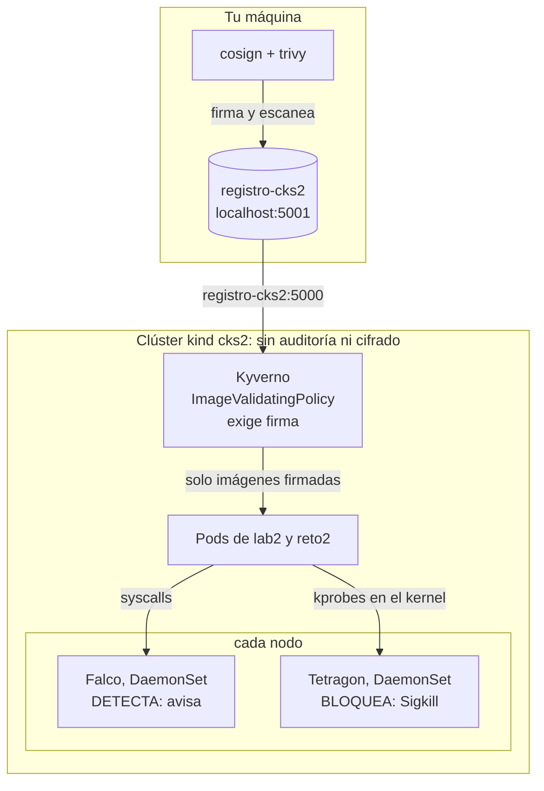
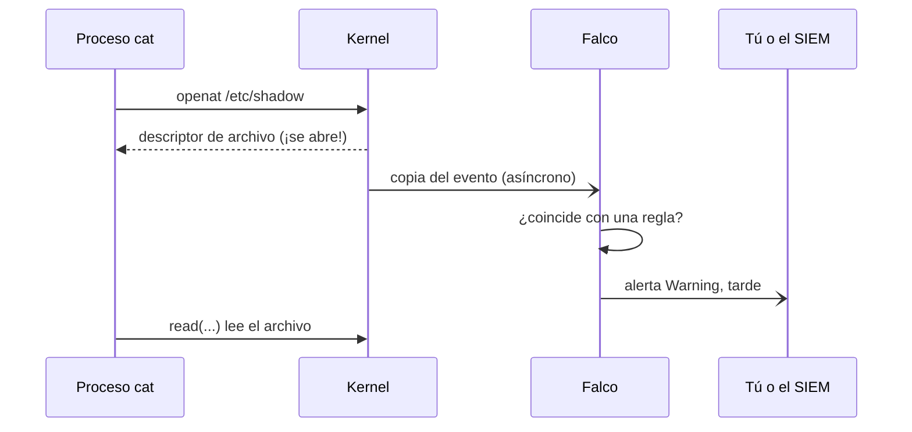
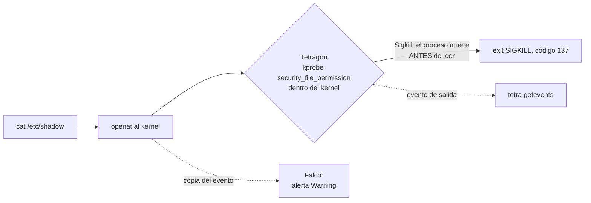
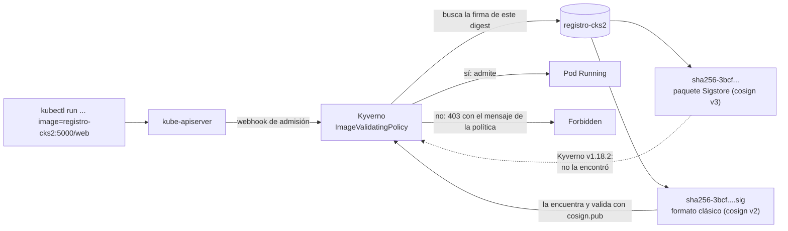
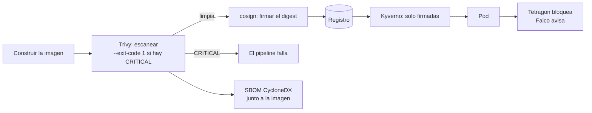

# Laboratorio 2 (Módulo 7) – Defensa en runtime y cadena de suministro

**Módulo 7 · sesión 12 · en clase · 130–150 minutos.** En el Laboratorio 1 endureciste el
plano de control: auditoría, cifrado de Secrets, Pod Security y políticas con Kyverno. Hoy
asumes que el atacante **ya está dentro de un contenedor** y que la imagen que desplegaste
pudo venir **envenenada**. Instalas un detector de comportamiento (Falco), un bloqueador en el
kernel (Tetragon), firmas criptográficas de imágenes (cosign), un portero que exige esas firmas
(Kyverno) y un escáner de vulnerabilidades (Trivy). Cierras con un reto estilo examen.

| Bloque | Paso | Tiempo | ¿Se puede dejar para casa? |
|---|---|---|---|
| Clúster `kind` limpio, registro local y hábitos del examen | 0 | ~10 min | No |
| Falco con `modern_ebpf` como DaemonSet | 1 | ~15 min | No |
| Disparar reglas de Falco: detectar no es bloquear | 2 | ~15 min | No |
| Tetragon: una `TracingPolicy` que mata procesos con `Sigkill` | 3 | ~20 min | No |
| Firmar una imagen con cosign y verificarla | 4 | ~15 min | En parte |
| Kyverno `ImageValidatingPolicy`: el portero de las firmas | 5 | ~20 min | No |
| Trivy: vulnerabilidades, puerta de pipeline y SBOM | 6 | ~15 min | Sí |
| **Reto** estilo examen, calificado por script | 7 | ~25 min | No |

> La idea central de esta sesión: **detectar, bloquear y probar procedencia son tres cosas
> distintas, y cada una falla en silencio si no la mides.** Falco avisa tarde, Tetragon mata
> a tiempo, una firma solo prueba quién firmó (no que la imagen sea buena) y un escáner solo
> sabe lo que su base de datos sabe. Hoy no confías en que algo «esté instalado»: **lo
> disparas y miras qué pasa**.

---

## Cómo trabajar este laboratorio

Las mismas reglas de los laboratorios anteriores, que siguen valiendo:

| Técnica | Lo que te pide | De dónde sale |
|---|---|---|
| **Predice, ejecuta, explica** | En cada **🔮 Predice**, escribe tu predicción en `predicciones.md` antes de ejecutar | PRIMM (Sentance, Waite y Kallia, 2019); Predict-Observe-Explain (White y Gunstone, 1992) |
| **Fallo productivo** | Varios pasos fallan **de verdad** (una bandera que cambió entre versiones, una política que se acepta pero no carga, un guion en un nombre). Lee el error antes de seguir | Kapur (2008) |
| **Medir en vez de creer** | Una regla, una política o una firma se prueban **disparándolas**, no con `kubectl get` | Jonassen y Hung (2006): diagnosticar es formular y probar hipótesis |
| **Andamiaje que se retira** | Pasos 0 a 6 con comandos; Paso 7 solo con objetivo y verificador | Kalyuga et al. (2003) |

```bash
mkdir -p ~/lab-cks-2 && cd ~/lab-cks-2
echo "# Predicciones del laboratorio 2 (CKS)" > predicciones.md
```

---

## Objetivo

Al terminar vas a poder responder, señalando evidencia en tu terminal:

1. ¿Por qué Falco mostró la alerta de `cat /etc/shadow` y aun así el comando **funcionó**?
2. ¿Por qué una `TracingPolicy` puede estar `created` en el clúster y **no estar cargada**?
3. ¿Qué alcance tiene una `TracingPolicyNamespaced` y por qué una política con `Sigkill` sobre
   todo el clúster es peligrosa?
4. ¿Qué prueba una firma de cosign, y qué **no** prueba?
5. ¿Por qué Kyverno rechazó una imagen que `cosign verify` aceptaba?
6. ¿Qué hace `--exit-code 1` en Trivy, y por qué `alpine:3.22` **no** rompe el pipeline?
7. ¿Qué es un SBOM y qué puedes hacer con él sin volver a descargar la imagen?

**Requisito:** el Laboratorio 1 de este módulo (conservas su clúster `cks`; **no lo borres**,
este laboratorio crea uno nuevo llamado `cks2`) y el módulo 6 completo.

**Entorno verificado** (el 22 de octubre de 2026, en la máquina donde se capturaron todas las
salidas): Linux con kernel 6.17.0-1033-oem, Docker Engine 29.9.2, `kind` v0.33.0, `kubectl`
v1.37.0, Helm v4.3.0, `jq`, nodos `kindest/node:v1.37.0` (containerd 2.3.4), Falco 0.45.1
(chart `falcosecurity/falco` 9.2.1), Tetragon v1.7.1 (chart `cilium/tetragon` 1.7.1), Kyverno
v1.18.2 (chart `kyverno/kyverno` 3.8.2), cosign v3.1.3 en el host y cosign v2.6.0 en un
contenedor, Trivy 0.74.0, `registry:2`. Cuenta con **8 GiB de RAM libres** y unos 2 GB de
descargas. Los nodos de `kind` comparten el kernel del anfitrión: necesitas un kernel con BTF
(`ls /sys/kernel/btf/vmlinux` debe existir).

```bash
kind version; kubectl version --client | head -1; helm version --short
cosign version 2>&1 | grep GitVersion; trivy --version | head -1
docker version --format 'docker {{.Server.Version}}'; ls /sys/kernel/btf/vmlinux
```

> Todas las salidas marcadas **«Salida real de esta máquina»** se capturaron ejecutando los
> comandos. Los nombres de Pods, IPs, hashes, digests, claves y horas serán **distintos en tu
> máquina**; la forma de la salida no.

---

## Paso 0: Un clúster limpio, un registro y los hábitos del examen (10 min)

### 0.1 El clúster `cks2`, sin auditoría ni cifrado

Empiezas de cero a propósito: sin los flags del Laboratorio 1, para que cada herramienta de hoy
sea lo único que cambia. El `containerdConfigPatches` le dice a containerd dónde buscar la
configuración de registros; lo usarás en 0.2.

```bash
cd ~/lab-cks-2
cat > kind-cks2.yaml <<'EOF'
kind: Cluster
apiVersion: kind.x-k8s.io/v1alpha4
name: cks2
containerdConfigPatches:
- |-
  [plugins."io.containerd.grpc.v1.cri".registry]
    config_path = "/etc/containerd/certs.d"
nodes:
- role: control-plane
  image: kindest/node:v1.37.0
- role: worker
  image: kindest/node:v1.37.0
EOF

kind create cluster --config kind-cks2.yaml
kubectl wait --for=condition=Ready node --all --timeout=180s
kubectl get nodes
```

**Salida real de esta máquina:**

```
Creating cluster "cks2" ...
 • Ensuring node image (kindest/node:v1.37.0) 🖼️  ...
 ✓ Ensuring node image (kindest/node:v1.37.0) 🖼️
 • Preparing nodes 📦 📦   ...
 ✓ Preparing nodes 📦 📦 
 • Writing configuration 📜  ...
 ✓ Writing configuration 📜
 • Starting control-plane 🕹️  ...
 ✓ Starting control-plane 🕹️
 • Installing CNI 🔌  ...
 ✓ Installing CNI 🔌
 • Installing StorageClass 💾  ...
 ✓ Installing StorageClass 💾
 • Joining worker nodes 🚜  ...
 ✓ Joining worker nodes 🚜
Set kubectl context to "kind-cks2"
You can now use your cluster with:

kubectl cluster-info --context kind-cks2

Have a nice day! 👋
node/cks2-control-plane condition met
node/cks2-worker condition met
NAME                 STATUS   ROLES           AGE   VERSION
cks2-control-plane   Ready    control-plane   56s   v1.37.0
cks2-worker          Ready    <none>          42s   v1.37.0
```

Comprueba que el clúster está **de verdad** sin auditoría ni cifrado (cuenta las coincidencias
en los argumentos del API server; debe dar `0`):

```bash
kubectl -n kube-system get pod kube-apiserver-cks2-control-plane \
  -o jsonpath='{.spec.containers[0].command}' | tr ',' '\n' | grep -cE 'audit|encryption'
```

**Salida real de esta máquina:**

```
0
```

### 0.2 Fallo productivo: el contexto que cambió solo

Con dos clústeres en la máquina (`cks` del Laboratorio 1 y `cks2`) hay un riesgo que el examen
CKS también tiene: el examen te pide cambiar de contexto con `kubectl config use-context` en cada tarea.
Mientras se capturaron las salidas de este laboratorio, el contexto activo de `kubectl` **pasó
solo de `kind-cks2` a `kind-cks`**: otro proceso de esta máquina reescribió `~/.kube/config`.
Un `kubectl delete` lanzado en ese momento habría caído en el clúster equivocado.

```bash
kubectl config current-context
kind get clusters
```

**Salida real de esta máquina**, al detectar el cambio:

```
kind-cks
cks
cks2
cks3
examen-cka-ckad
```

El remedio es un hábito y una cerca. El hábito: **antes de cada comando que cambia algo,
mira el contexto.** La cerca: un archivo de configuración solo para este laboratorio, que
nadie más reescribe.

```bash
kind get kubeconfig --name cks2 > ~/lab-cks-2/kubeconfig && chmod 600 ~/lab-cks-2/kubeconfig
export KUBECONFIG=~/lab-cks-2/kubeconfig      # ponlo en CADA terminal que abras hoy
kubectl config current-context
kubectl create namespace lab2
kubectl config set-context --current --namespace=lab2
```

**Salida real de esta máquina:**

```
kind-cks2
namespace/lab2 created
Context "kind-cks2" modified.
```

> Cada vez que veas un comando de `helm` o `kubectl` en este laboratorio, da por hecho que
> `KUBECONFIG` apunta a `~/lab-cks-2/kubeconfig`. Si abres una terminal nueva y se te olvida,
> el síntoma es el contrario de un error: **el comando funciona, en el clúster equivocado**.

### 0.3 Un registro local, para firmar imágenes

Firmar una imagen exige un registro donde guardar la firma junto a ella. Levantas uno (`registry:2`)
en la red de `kind`, lo publicas en `localhost:5001` para tu máquina y le enseñas a containerd
de cada nodo que `registro-cks2:5000` habla HTTP (es un laboratorio, no producción):

```bash
docker run -d --restart=always --network kind -p 127.0.0.1:5001:5000 --name registro-cks2 registry:2
for n in $(kind get nodes --name cks2); do
  docker exec $n mkdir -p /etc/containerd/certs.d/registro-cks2:5000
  printf '[host."http://registro-cks2:5000"]\n' | \
    docker exec -i $n tee /etc/containerd/certs.d/registro-cks2:5000/hosts.toml >/dev/null
done
curl -s localhost:5001/v2/_catalog
```

**Salida real de esta máquina:**

```
{"repositories":[]}
```

El registro tiene **dos nombres para la misma cosa**: `localhost:5001` desde tu máquina (donde
firmas y escaneas) y `registro-cks2:5000` desde dentro del clúster (donde los Pods descargan).

### 0.4 Hábitos del examen

```bash
alias k=kubectl
export do="--dry-run=client -o yaml"      # consejo de la comunidad, no de la LF
k run prueba --image=busybox:1.37 $do | head -8
```

**Salida real de esta máquina:**

```
apiVersion: v1
kind: Pod
metadata:
  labels:
    run: prueba
  name: prueba
spec:
  containers:
```

Y cuando no recuerdes un campo de un recurso de **terceros** (una `TracingPolicy`, una política
de Kyverno), `kubectl explain` también lee el esquema del propio clúster. Lo usarás en el
Paso 3 y en el Paso 5.

**En un diagrama:** lo que vas a construir en la sesión.



---

## Paso 1: Falco como DaemonSet (15 min)

Falco mira las **llamadas al sistema** de todos los contenedores del nodo y las compara con
reglas. Para ver las llamadas necesita una sonda en el kernel. El chart ofrece dos:
`kmod` (un módulo del kernel) y `modern_ebpf` (un programa eBPF que no requiere compilar nada).
Usarás `modern_ebpf` porque tu kernel trae BTF.

### 1.1 Instalar

```bash
helm repo add falcosecurity https://falcosecurity.github.io/charts
helm repo update falcosecurity
helm install falco falcosecurity/falco --version 9.2.1 \
  --namespace falco --create-namespace \
  --set driver.kind=modern_ebpf --set tty=true --set falcosidekick.enabled=false \
  --wait --timeout 8m
```

**Salida real de esta máquina** (tardó 26 s):

```
NAME: falco
LAST DEPLOYED: Thu Oct 22 21:47:06 2026
NAMESPACE: falco
STATUS: deployed
REVISION: 1
DESCRIPTION: Install complete
TEST SUITE: None
NOTES:
Falco agents are spinning up on each node in your cluster. After a few
seconds, they are going to start monitoring your containers looking for
security issues.

TIP:
You can easily forward Falco events to Slack, Kafka, AWS Lambda and more with falcosidekick.
Full list of outputs: https://github.com/falcosecurity/charts/tree/master/charts/falcosidekick.
You can enable its deployment with `--set falcosidekick.enabled=true` or in your values.yaml.
See: https://github.com/falcosecurity/charts/blob/master/charts/falcosidekick/values.yaml for configuration values.
```

### 1.2 Lo que no funcionó: el «Falco Driver Loader» y el modo userspace

El plan de este laboratorio contemplaba el **Falco Driver Loader** y, como respaldo, el modo
userspace. Ninguno de los dos aparece en esta versión del chart:

- El **Driver Loader** (`falco-driver-loader`) es el contenedor de inicio que **compila o
  descarga** el módulo del kernel (`kmod`). Con `modern_ebpf` no hace falta: la sonda ya viene
  dentro del binario de Falco. Compruébalo: el único contenedor de inicio es `falcoctl`, que
  descarga reglas, no drivers.
- Las opciones de `driver.kind` documentadas en el `values.yaml` del chart 9.2.1 son `kmod` y
  `modern_ebpf` (más `auto`). No hay un valor `userspace`.

Es decir: lo que usaste hoy es `modern_ebpf`, y **funcionó a la primera en `kind`** sobre el
kernel 6.17. Si tu kernel no tiene BTF, este paso fallará y el remedio sería `kmod` (con
cabeceras del kernel), que no se practica aquí.

### 1.3 Verificar que es un DaemonSet

```bash
kubectl -n falco get daemonset falco
kubectl -n falco get pods -o wide
kubectl -n falco get ds falco -o jsonpath='{.spec.template.spec.initContainers[*].name}{"\n"}'
```

**Salida real de esta máquina:**

```
NAME    DESIRED   CURRENT   READY   UP-TO-DATE   AVAILABLE   NODE SELECTOR   AGE
falco   2         2         2       2            2           <none>          19m
NAME          READY   STATUS    RESTARTS   AGE   IP           NODE                 NOMINATED NODE   READINESS GATES
falco-2xjhq   2/2     Running   0          17m   10.244.1.6   cks2-worker          <none>           <none>
falco-t6r7t   2/2     Running   0          17m   10.244.0.6   cks2-control-plane   <none>           <none>
falcoctl-artifact-install
```

`DESIRED 2`: un Pod por nodo, uno de ellos en el plano de control. Es lo que quieres de un
agente de seguridad: **un ojo por nodo**, porque un atacante elige en qué nodo cae.

### 1.4 Leer el registro

```bash
kubectl -n falco logs daemonset/falco -c falco | grep -E 'Falco version|Loaded event sources|Opening|Starting health|rules.d'
```

**Salida real de esta máquina** (la salida de este comando se capturó después del Paso 2.3, que
añade el archivo de reglas propio; en este punto de tu laboratorio no verás la línea de
`rules.d`):

```
Found 2 pods, using pod/falco-t6r7t
Fri Oct 23 02:49:05 2026: Falco version: 0.45.1 (x86_64)
Fri Oct 23 02:49:05 2026:    /etc/falco/rules.d/reglas-lab2.yaml | schema validation: ok
Fri Oct 23 02:49:05 2026: Starting health webserver with threadiness 24, listening on 0.0.0.0:8765
Fri Oct 23 02:49:05 2026: Loaded event sources: syscall
Fri Oct 23 02:49:05 2026: Opening 'syscall' source with modern BPF probe.
```

`Opening 'syscall' source with modern BPF probe`: la sonda está abierta. `Found 2 pods, using
pod/...`: `kubectl logs` sobre un DaemonSet elige **un** Pod; para ver el otro nodo usa el
nombre del Pod.

> **Qué hace Falco con los eventos.** Cada llamada al sistema pasa por un motor de reglas
> escritas en YAML (`condition`, `output`, `priority`). Las 25 reglas que trae el chart están en
> `/etc/falco/falco_rules.yaml` dentro del contenedor. Si el evento no coincide con ninguna
> regla, **no pasa nada**: lo comprobarás en el Paso 2.

---

## Paso 2: Disparar reglas de Falco (15 min)

### 2.1 Leer un archivo sensible

🔮 **Predice:** un Pod de `busybox` ejecuta `cat /etc/shadow`. ¿El comando se completa o falla?
¿Qué ve Falco?

```bash
kubectl -n lab2 run lector --image=busybox:1.37 --restart=Never -- sh -c 'cat /etc/shadow | head -2; sleep 5'
sleep 12
kubectl -n lab2 logs lector
```

**Salida real de esta máquina:**

```
pod/lector created
root:*:::::::
daemon:*:::::::
```

El comando **funcionó**: leyó el archivo. Ahora, lo que vio Falco. Cada nodo tiene su propio
registro, así que consulta los dos Pods:

```bash
for p in $(kubectl -n falco get pods -o name); do
  kubectl -n falco logs $p -c falco | grep 'Sensitive file' | grep 'k8s_pod_name=lector' | cut -c1-330
done
```

**Salida real de esta máquina:**

```
03:06:52.306577514: Warning Sensitive file opened for reading by non-trusted program | file=/etc/shadow gparent=containerd-shim ggparent=<NA> gggparent=<NA> evt_type=openat user=root user_uid=0 user_loginuid=-1 process=cat proc_exepath=/bin/cat parent=sh command=cat /etc/shadow terminal=0 container_id=e0af220a873a container_name
```

(El `cut` recorta la línea; el final contiene `container_image_repository=docker.io/library/busybox`,
`k8s_pod_name=lector` y `k8s_ns_name=lab2`.) La alerta llegó con **quién** (`process=cat`,
`user=root`), **qué** (`file=/etc/shadow`) y **dónde** (Pod, namespace, imagen). Esa es la
regla *Read sensitive file untrusted*, que Falco muestra con el texto de su campo `output`.

### 2.2 Detectar no es bloquear

Mira las dos salidas juntas: el `cat` imprimió `root:*:::::::` **y** Falco emitió una alerta.
Falco observa una copia del evento **después** de que ocurre; no está en el camino de la
llamada al sistema y no puede detenerla. Para él, `Warning` es una línea de texto; lo que
suceda con esa línea (un Slack, un SIEM, una persona) es cosa tuya.



### 2.3 Fallo productivo: un `nc` que Falco no vio

Segunda prueba. Un atacante abre un puerto a la escucha dentro del Pod con `nc`:

🔮 **Predice:** `nc -lp 4444` dentro de un contenedor es sospechoso. ¿Lo detecta Falco con las
reglas por defecto?

```bash
kubectl -n lab2 run puerta-trasera --image=busybox:1.37 --restart=Never -- sh -c 'nc -lp 4444 & sleep 25'
sleep 8
for p in $(kubectl -n falco get pods -o name); do
  kubectl -n falco logs $p -c falco | grep 'k8s_pod_name=puerta-trasera' | grep -v 'Executing binary'
done
```

**Salida real de esta máquina:**

```
pod/puerta-trasera created
```

**Ninguna alerta.** (El `grep -v 'Executing binary'` descarta unas alertas de ruido que `kind`
genera al arrancar cada contenedor con sus propios scripts.) Las reglas por defecto no
consideran sospechoso un `nc` que solo escucha. Sí consideran sospechoso uno que **ejecuta
una shell** al recibir una conexión, que es lo que hace una puerta trasera de verdad:

```bash
kubectl -n lab2 run puerta-2 --image=busybox:1.37 --restart=Never -- sh -c 'nc -lp 4445 -e /bin/sh & sleep 25'
sleep 8
for p in $(kubectl -n falco get pods -o name); do
  kubectl -n falco logs $p -c falco | grep -E 'k8s_pod_name=puerta-2' | grep -v 'Executing binary' | cut -c1-330
done
```

**Salida real de esta máquina:**

```
pod/puerta-2 created
03:07:12.751250205: Warning Netcat runs inside container that allows remote code execution | evt_type=execve user=root user_uid=0 user_loginuid=-1 process=nc proc_exepath=/bin/nc parent=sleep command=nc -lp 4445 -e /bin/sh terminal=0 exe_flags=EXE_WRITABLE|EXE_LOWER_LAYER container_id=74fc0ef32b72 container_name=puerta-2 contain
```

La lección es de método: **Falco solo ve lo que sus reglas describen.** Una herramienta de
detección con la configuración por defecto tiene huecos, y el trabajo del defensor es llenarlos.

### 2.4 Tu propia regla

Escribe una regla para el hueco que acabas de encontrar: cualquier `nc` con `-l` dentro del
namespace `lab2`. El chart acepta reglas propias en `customRules`; `helm upgrade` reinicia los
Pods de Falco.

```bash
cat > falco-valores.yaml <<'EOF'
driver:
  kind: modern_ebpf
tty: true
falcosidekick:
  enabled: false
customRules:
  reglas-lab2.yaml: |-
    - rule: Escucha en puerto en contenedor de lab2
      desc: Un proceso nc con -l dentro del namespace lab2 abre un puerto a la escucha
      condition: >
        spawned_process and container and k8s.ns.name = "lab2"
        and proc.name in (nc, ncat, netcat) and proc.args contains "-l"
      output: >
        Puerto a la escucha en lab2 (pod=%k8s.pod.name cmd=%proc.cmdline user=%user.name)
      priority: WARNING
      tags: [lab2, red]
EOF

helm upgrade falco falcosecurity/falco --version 9.2.1 -n falco -f falco-valores.yaml --wait --timeout 5m
kubectl -n falco rollout status ds/falco --timeout=120s
sleep 20
kubectl -n lab2 run puerta-1 --image=busybox:1.37 --restart=Never -- sh -c 'nc -lp 4444 & sleep 25'
sleep 8
for p in $(kubectl -n falco get pods -o name); do
  kubectl -n falco logs $p -c falco | grep 'pod=puerta-1' | cut -c1-260
done
```

**Salida real de esta máquina:**

```
Release "falco" has been upgraded. Happy Helming!
NAME: falco
LAST DEPLOYED: Thu Oct 22 21:48:45 2026
NAMESPACE: falco
STATUS: deployed
REVISION: 2
DESCRIPTION: Install complete
TEST SUITE: None
daemon set "falco" successfully rolled out
pod/puerta-1 created
03:07:04.550263295: Warning Puerto a la escucha en lab2 (pod=puerta-1 cmd=nc -lp 4444 user=root) container_id=06afc07aea1e container_name=puerta-1 container_image_repository=docker.io/library/busybox container_image_tag=1.37 k8s_pod_name=puerta-1 k8s_ns_name=l
```

Falco confirma que cargó tu archivo (`/etc/falco/rules.d/reglas-lab2.yaml | schema validation:
ok`, la línea que viste en el 1.4). Detección ampliada. Limpia:

```bash
kubectl -n lab2 delete pod lector puerta-trasera puerta-1 puerta-2 --now
```

---

## Paso 3: Tetragon, del aviso al bloqueo (20 min)

Tetragon también usa eBPF, pero con una diferencia que cambia todo: puede **actuar dentro del
kernel**, en el momento de la llamada. Si una política dice `Sigkill`, el proceso muere
**antes** de que la llamada termine.

### 3.1 Instalar

```bash
helm repo add cilium https://helm.cilium.io
helm repo update cilium
helm install tetragon cilium/tetragon --version 1.7.1 -n kube-system --wait --timeout 6m
kubectl -n kube-system get ds,pods -l app.kubernetes.io/name=tetragon -o wide
kubectl get crd | grep -i tetragon
```

**Salida real de esta máquina:**

```
NAME: tetragon
LAST DEPLOYED: Thu Oct 22 21:50:13 2026
NAMESPACE: kube-system
STATUS: deployed
REVISION: 1
DESCRIPTION: Install complete
TEST SUITE: None
NAME                      DESIRED   CURRENT   READY   UP-TO-DATE   AVAILABLE   NODE SELECTOR   AGE   CONTAINERS               IMAGES                                                                      SELECTOR
daemonset.apps/tetragon   2         2         2       2            2           <none>          19s   export-stdout,tetragon   quay.io/cilium/hubble-export-stdout:v1.1.1,quay.io/cilium/tetragon:v1.7.1   app.kubernetes.io/instance=tetragon,app.kubernetes.io/name=tetragon

NAME                 READY   STATUS    RESTARTS   AGE   IP           NODE                 NOMINATED NODE   READINESS GATES
pod/tetragon-g8nfs   2/2     Running   0          19s   172.18.0.6   cks2-worker          <none>           <none>
pod/tetragon-wgt7d   2/2     Running   0          19s   172.18.0.7   cks2-control-plane   <none>           <none>
```

(El último `grep` no imprime nada sobre CRDs de Tetragon porque su grupo de API es
`cilium.io`; el comando útil es el siguiente.)

```bash
kubectl get crd | grep -E 'tracingpolic'
```

**Salida real de esta máquina:**

```
tracingpolicies.cilium.io             Cluster      v1alpha1(storage)   2026-10-23T02:50:21Z
tracingpoliciesnamespaced.cilium.io   Namespaced   v1alpha1(storage)   2026-10-23T02:50:22Z
```

Dos tipos: `TracingPolicy` (todo el clúster) y `TracingPolicyNamespaced` (solo un namespace).
**Esa diferencia importa más de lo que parece.**

> **Cuidado con el alcance.** En `kind` los «nodos» son contenedores de tu máquina y **todos
> comparten el kernel del anfitrión**. Durante la preparación de este laboratorio, Tetragon
> mostraba los procesos de **otros contenedores de la máquina** (otros clústeres de `kind`,
> comandos de `docker exec`). Una `TracingPolicy` de todo el clúster con `Sigkill` sobre
> `/etc/shadow` mataría **cualquier** proceso del anfitrión que lea ese archivo, no solo los de
> tus Pods. Por eso aquí solo se usa `TracingPolicyNamespaced`.

### 3.2 Fallo productivo: «creada» no es «cargada»

La política: dentro de `lab2`, si un proceso abre `/etc/shadow`, `Sigkill`. Se engancha a la
función del kernel `security_file_permission`, que se ejecuta cada vez que se comprueba el
permiso de un archivo. Esta es la **primera versión**, con un error que es fácil de cometer
porque el campo existe, pero no vale para esta acción:

```bash
cat > tetragon-bloquear-shadow.yaml <<'EOF'
apiVersion: cilium.io/v1alpha1
kind: TracingPolicyNamespaced
metadata:
  name: bloquear-shadow
  namespace: lab2            # solo vigila los Pods de lab2
spec:
  kprobes:
  - call: "security_file_permission"
    syscall: false
    return: true
    args:
    - index: 0
      type: "file"
    - index: 1
      type: "int"
    returnArg:
      index: 0
      type: "int"
    returnArgAction: "Post"
    selectors:
    - matchArgs:
      - index: 0
        operator: "Equal"
        values:
        - "/etc/shadow"
      matchActions:
      - action: Sigkill
EOF

kubectl apply -f tetragon-bloquear-shadow.yaml
kubectl -n lab2 get tracingpolicynamespaced
```

**Salida real de esta máquina:**

```
tracingpolicynamespaced.cilium.io/bloquear-shadow created
NAME              AGE
bloquear-shadow   0s
```

Todo en verde: el objeto se creó. 🔮 **Predice:** ¿está la política protegiendo algo? ¿Dónde
lo averiguas, si `kubectl get` no dice nada de errores?

```bash
kubectl -n kube-system logs ds/tetragon -c tetragon --tail=30 | grep -iE 'bloquear|error|fail' | cut -c1-300
kubectl -n kube-system exec ds/tetragon -c tetragon -- tetra tracingpolicy list
```

**Salida real de esta máquina:**

```
level=info msg="adding namespaced tracing policy" name=bloquear-shadow info="bloquear-shadow (object:1/010fba74-2f9d-45ff-9984-047e24e95143) (type:/)" namespace=lab2
level=warn msg="adding tracing policy failed" error="policy handler 'tracing' failed loading policy 'bloquear-shadow': ReturnArgAction type 'Post' unsupported; omit returnArgAction or use 'TrackSock'/'UntrackSock'"
ID   NAME              STATE        FILTERID   NAMESPACE   SENSORS   KERNELMEMORY   MODE      NPOST   NENFORCE   NMONITOR
2    bloquear-shadow   load_error   2          lab2                  0 B            unknown   0       0          0
```

**El API server aceptó el objeto; el agente no pudo cargarlo.** El estado real está en
`tetra tracingpolicy list`: `load_error`, `SENSORS` vacío, `KERNELMEMORY 0 B`. El mensaje dice
la causa: `returnArgAction: Post` no se admite. Es el mismo patrón del módulo 6 («un objeto
aceptado no es un comportamiento garantizado») ahora en seguridad: **una política de bloqueo
que no cargó es peor que no tener política, porque crees que estás protegido.**

Corrige quitando `return`, `returnArg` y `returnArgAction` (no los necesitas: `Sigkill` actúa
al entrar a la función):

```bash
cat > tetragon-bloquear-shadow.yaml <<'EOF'
apiVersion: cilium.io/v1alpha1
kind: TracingPolicyNamespaced
metadata:
  name: bloquear-shadow
  namespace: lab2            # solo vigila los Pods de lab2
spec:
  kprobes:
  - call: "security_file_permission"
    syscall: false
    args:
    - index: 0
      type: "file"
    - index: 1
      type: "int"
    selectors:
    - matchArgs:
      - index: 0
        operator: "Equal"
        values:
        - "/etc/shadow"
      matchActions:
      - action: Sigkill
EOF

kubectl apply -f tetragon-bloquear-shadow.yaml
sleep 4
kubectl -n kube-system exec ds/tetragon -c tetragon -- tetra tracingpolicy list
```

**Salida real de esta máquina:**

```
tracingpolicynamespaced.cilium.io/bloquear-shadow configured
ID   NAME              STATE     FILTERID   NAMESPACE   SENSORS          KERNELMEMORY   MODE      NPOST   NENFORCE   NMONITOR
3    bloquear-shadow   enabled   3          lab2        generic_kprobe   2.20 MB        enforce   0       0          0
```

`STATE enabled`, `SENSORS generic_kprobe`, `MODE enforce`. **Esa** es la línea que debes
verificar, no la del `kubectl get`. Si quieres ver los campos válidos de una acción, lee el
esquema del clúster:

```bash
kubectl explain tracingpolicynamespaced.spec.kprobes.selectors.matchActions.action --api-version=cilium.io/v1alpha1 | head -14
```

**Salida real de esta máquina:**

```
GROUP:      cilium.io
KIND:       TracingPolicyNamespaced
VERSION:    v1alpha1

FIELD: action <string>
ENUM:
    Post
    FollowFD
    UnfollowFD
    Sigkill
    CopyFD
    Override
    GetUrl
    DnsLookup
```

### 3.3 Fallo productivo: el atacante que vivió menos de un segundo

Lanza el ataque del Paso 2 otra vez, ahora con la política activa:

🔮 **Predice:** `cat /etc/shadow` en un Pod nuevo de `lab2`, con Tetragon en modo `enforce`.
¿Muere el `cat`?

```bash
kubectl -n lab2 run atacante --image=busybox:1.37 --restart=Never -- sh -c 'echo antes; cat /etc/shadow | head -2; echo despues'
sleep 10
kubectl -n lab2 get pod atacante
kubectl -n lab2 logs atacante
```

**Salida real de esta máquina:**

```
pod/atacante created
NAME       READY   STATUS      RESTARTS   AGE
atacante   0/1     Completed   0          10s
antes
root:*:::::::
daemon:*:::::::
despues
```

**No lo mató.** El `cat` leyó `/etc/shadow` con la política en `enabled`. La política estaba
cargada; algo más pasó. La observación que reproduje varias veces: Tetragon sí veía los
procesos del Pod (`lab2/atacante`) y, con una política **de todo el clúster** que solo
observaba (sin `Sigkill`), también veía las lecturas del archivo. Con la política
**namespaced** no actuó sobre un Pod que nació, ejecutó el ataque y terminó en menos de un
segundo. La explicación más probable (**no la verifiqué en el código**) es una carrera: para
filtrar por namespace, Tetragon debe asociar los contenedores del Pod con la política, y esa
asociación llega **después** de que el contenedor ya arrancó y terminó. Los registros de
Tetragon traen líneas `failed to find cgroup id. Skipping container.` del subsistema
`policy-filter`, coherentes con esa idea.

Un ataque real no vive un milisegundo: se instala, espera y ejecuta. Reproduce eso: un Pod
que **sigue vivo** y un `exec` contra él.

```bash
kubectl -n lab2 delete pod atacante --now
kubectl -n lab2 run atacante --image=busybox:1.37 --restart=Never -- sleep 3600
kubectl -n lab2 wait --for=condition=Ready pod/atacante --timeout=60s
sleep 3
kubectl -n lab2 exec atacante -- sh -c 'echo antes; cat /etc/shadow; echo despues'
kubectl -n lab2 get pod atacante
```

**Salida real de esta máquina:**

```
pod "atacante" deleted from lab2 namespace
pod/atacante created
pod/atacante condition met
antes
Killed
despues
NAME       READY   STATUS    RESTARTS   AGE
atacante   1/1     Running   0          3s
```

**`Killed`.** El `cat` murió antes de imprimir nada; la shell que lo lanzó siguió viva
(`despues`) porque la política solo mata al proceso que abre el archivo. Mira el código de
salida y lo que registró cada herramienta:

```bash
( timeout 15 kubectl -n kube-system exec $(kubectl -n kube-system get pods -l app.kubernetes.io/name=tetragon \
    -o jsonpath='{.items[?(@.spec.nodeName=="cks2-worker")].metadata.name}') -c tetragon -- \
    tetra getevents -o compact --namespace lab2 --pod atacante > eventos-tetragon.txt 2>&1 & )
sleep 3
kubectl -n lab2 exec atacante -- sh -c 'cat /etc/shadow; echo "codigo de salida de cat: $?"'
sleep 13
cut -c1-120 eventos-tetragon.txt
kubectl -n kube-system exec ds/tetragon -c tetragon -- tetra tracingpolicy list
```

**Salida real de esta máquina:**

```
codigo de salida de cat: 137
Killed
🚀 process lab2/atacante /proc/self/fd/6 init
💥 exit    lab2/atacante /proc/self/fd/6 init 0
🚀 process lab2/atacante /bin/sh "-c \"cat /etc/shadow; echo \"codigo de salida de cat: $?\"\""
🚀 process lab2/atacante /bin/cat /etc/shadow
📚 read    lab2/atacante /bin/cat /etc/shadow
📚 read    lab2/atacante /bin/cat /etc/shadow
💥 exit    lab2/atacante /bin/cat /etc/shadow SIGKILL
💥 exit    lab2/atacante /bin/sh "-c \"cat /etc/shadow; echo \"codigo de salida de cat: $?\"\"" 0
ID   NAME              STATE     FILTERID   NAMESPACE   SENSORS          KERNELMEMORY   MODE      NPOST   NENFORCE   NMONITOR
8    bloquear-shadow   enabled   8          lab2        generic_kprobe   2.20 MB        enforce   4       4          0
```

Lee la secuencia: `process` (el `cat` nace), `read` (intentó leer `/etc/shadow`), `exit ...
SIGKILL` (Tetragon lo mató). `137 = 128 + 9`, la señal 9. Y en la política, `NENFORCE 4` es el contador de
veces que actuó; el valor exacto en tu máquina depende de cuántas veces ejecutaste el ataque.

### 3.4 Falco también lo registra

Falco observó el mismo `openat`, aunque Tetragon ya hubiera matado al proceso:

```bash
for p in $(kubectl -n falco get pods -o name); do
  kubectl -n falco logs $p -c falco --since=2m | grep 'k8s_pod_name=atacante' | grep -v 'Executing binary' | cut -c1-420
done | tail -1
```

**Salida real de esta máquina:**

```
02:57:08.134255554: Warning Sensitive file opened for reading by non-trusted program | file=/etc/shadow gparent=containerd-shim ggparent=<NA> gggparent=<NA> evt_type=openat user=root user_uid=0 user_loginuid=-1 process=cat proc_exepath=/bin/cat parent=sh command=cat /etc/shadow terminal=0 container_id=0e699504c021 container_name=atacante container_image_repository=docker.io/library/busybox container_image_tag=1.37 k8
```

(Sin el `tail -1` habrá varias líneas, una por cada intento; los 420 caracteres cortan la línea en `k8`, el comienzo de `k8s_pod_name=atacante`.) Se complementan: **Tetragon impide, Falco
cuenta la historia.** Con Falco sabes qué se intentó, con quién y en qué Pod; con Tetragon el
intento ya no tiene efecto.

### 3.5 El control: otro namespace no se toca

Una política de bloqueo se valida también por lo que **no** hace. Lee el mismo archivo desde
`default`:

```bash
kubectl -n default run control --image=busybox:1.37 --restart=Never -- sleep 3600
kubectl -n default wait --for=condition=Ready pod/control --timeout=60s
kubectl -n default exec control -- sh -c 'cat /etc/shadow | head -1; echo "codigo de salida: $?"'
kubectl -n default delete pod control --now
```

**Salida real de esta máquina:**

```
pod/control created
pod/control condition met
root:*:::::::
codigo de salida: 0
pod "control" deleted from default namespace
```

Sin `Killed`, código `0`: la política es **quirúrgica**. Eso es un objetivo, pero también una
advertencia: una política de bloqueo mal escrita mata procesos legítimos (por ejemplo el
`unix_chkpwd` de un servicio de autenticación que sí necesita leer ese archivo).

### 3.6 La segunda sonda: módulos del kernel

El plan del laboratorio pedía también bloquear `security_kernel_module_request`, la función
que se llama cuando un proceso provoca la carga automática de un módulo del kernel. Añade la
segunda sonda a la misma política:

```bash
cat >> tetragon-bloquear-shadow.yaml <<'EOF'
  - call: "security_kernel_module_request"
    syscall: false
    args:
    - index: 0
      type: "string"
    selectors:
    - matchActions:
      - action: Sigkill
EOF

kubectl apply -f tetragon-bloquear-shadow.yaml
sleep 6
kubectl -n kube-system exec ds/tetragon -c tetragon -- tetra tracingpolicy list
kubectl -n lab2 exec atacante -- sh -c 'cat /etc/shadow; echo "salida: $?"'
```

**Salida real de esta máquina:**

```
tracingpolicynamespaced.cilium.io/bloquear-shadow configured
ID   NAME              STATE     FILTERID   NAMESPACE   SENSORS          KERNELMEMORY   MODE      NPOST   NENFORCE   NMONITOR
9    bloquear-shadow   enabled   9          lab2        generic_kprobe   2.21 MB        enforce   0       0          0
salida: 137
Killed
```

**Lo que no funcionó:** la política con las dos sondas cargó (`enabled`, `enforce`) y la
primera sigue matando, pero **no logré disparar `security_kernel_module_request`** desde un Pod
sin privilegios: provocar la carga automática de un módulo exige, por ejemplo, abrir un
socket de una familia cuyo módulo no está cargado, y `busybox` no trae una herramienta para eso.
Esa mitad de la política queda **cargada pero sin demostrar**; en el examen sería un paso más:
no basta con que cargue, hay que provocarla. (Observa también que el contador `NENFORCE`
volvió a `0` al recargar la política: los contadores son de la versión cargada.)

**En un diagrama:** tres vigilantes, tres momentos.



---

## Paso 4: Firmar una imagen con cosign (15 min)

Una imagen sin firmar es una promesa sin remitente: no sabes quién la construyó ni si cambió
en el camino. Con cosign firmas el **digest** de la imagen (su huella SHA-256) con una clave
privada, y cualquiera con la clave pública verifica que esa huella fue firmada por ti.

### 4.1 Una imagen de prueba, en tu registro

```bash
cd ~/lab-cks-2
docker tag nginx:1.29-alpine localhost:5001/web:1.0
docker push localhost:5001/web:1.0 | tail -3
docker tag nginx:1.29-alpine localhost:5001/web-sinfirma:1.0
docker push localhost:5001/web-sinfirma:1.0 | tail -1
curl -s localhost:5001/v2/_catalog
```

**Salida real de esta máquina:**

```
 Info -> Not all multiplatform-content is present and only the available single-platform image was pushed
         sha256:5616878291a2eed594aee8db4dade5878cf7edcb475e59193904b198d9b830de -> sha256:3bcf852aed06467cf075c6105892e4d5a6ebbbafa0ce22d35062db9e90ddef4c
         sha256:5616878291a2eed594aee8db4dade5878cf7edcb475e59193904b198d9b830de -> sha256:3bcf852aed06467cf075c6105892e4d5a6ebbbafa0ce22d35062db9e90ddef4c
{"repositories":["web","web-sinfirma"]}
```

Es la misma `nginx:1.29-alpine` con dos nombres: `web` la vas a firmar; `web-sinfirma` no.
El digest que el registro le asignó (`sha256:3bcf...`) es el que se firma; guárdalo:

```bash
D=$(curl -sI -H 'Accept: application/vnd.oci.image.index.v1+json,application/vnd.docker.distribution.manifest.v2+json,application/vnd.oci.image.manifest.v1+json' \
    localhost:5001/v2/web/manifests/1.0 | grep -i docker-content-digest | awk '{print $2}' | tr -d '\r')
echo $D
```

**Salida real de esta máquina:**

```
sha256:3bcf852aed06467cf075c6105892e4d5a6ebbbafa0ce22d35062db9e90ddef4c
```

> **Firmar por digest, no por etiqueta.** `web:1.0` es un nombre movible: alguien puede
> publicar otra imagen con esa etiqueta mañana. El digest identifica un contenido exacto.

### 4.2 El par de claves

El modo *keyless* (Fulcio) emite un certificado de vida corta contra una identidad OIDC (una
cuenta de GitHub o Google). En el aula no tienes esa identidad ni salida a los servicios
públicos de Sigstore, así que usas el modo clásico: un par de claves local, **sin contraseña**
(solo en un laboratorio; en producción la clave privada va en un KMS o en un token).

```bash
COSIGN_PASSWORD="" cosign generate-key-pair
ls -l cosign.key cosign.pub
```

**Salida real de esta máquina:**

```
Private key written to cosign.key
Public key written to cosign.pub
-rw------- 1 lfarizav lfarizav 653 Oct 22 21:57 cosign.key
-rw-r--r-- 1 lfarizav lfarizav 178 Oct 22 21:57 cosign.pub
```

Nunca subas `cosign.key` a Git. `cosign.pub` sí es compartible: es lo que usarán Kyverno y
cualquiera que quiera verificar.

### 4.3 Fallo productivo: la bandera que ya no vale

La receta de los tutoriales de cosign 2.x es `--tlog-upload=false` (no subir la firma al
registro público de transparencia Rekor). Con cosign v3 ya no basta:

```bash
COSIGN_PASSWORD="" cosign sign --key cosign.key --tlog-upload=false --yes localhost:5001/web@$D
```

**Salida real de esta máquina:**

```
Flag --tlog-upload has been deprecated, prefer using a --signing-config file with no transparency log services
Error: --tlog-upload=false is not supported with --signing-config or --use-signing-config. Provide a signing config with --signing-config without a transparency log service, which can be created with `cosign signing-config create` or `curl https://raw.githubusercontent.com/sigstore/root-signing/refs/heads/main/targets/signing_config.v0.2.json | jq 'del(.rekorTlogUrls)'` for the public instance
error during command execution: --tlog-upload=false is not supported with --signing-config or --use-signing-config. Provide a signing config with --signing-config without a transparency log service, which can be created with `cosign signing-config create` or `curl https://raw.githubusercontent.com/sigstore/root-signing/refs/heads/main/targets/signing_config.v0.2.json | jq 'del(.rekorTlogUrls)'` for the public instance
```

El mensaje es largo pero exacto: en v3 `--use-signing-config` está activo por defecto y choca con
`--tlog-upload=false`. Para una firma local, sin Rekor, desactiva el signing config:

```bash
COSIGN_PASSWORD="" cosign sign --key cosign.key --use-signing-config=false --tlog-upload=false --yes localhost:5001/web@$D
curl -s localhost:5001/v2/web/tags/list
```

**Salida real de esta máquina:**

```
Flag --tlog-upload has been deprecated, prefer using a --signing-config file with no transparency log services
Signing artifact...
Pushing signature to: localhost:5001/web
{"name":"web","tags":["sha256-3bcf852aed06467cf075c6105892e4d5a6ebbbafa0ce22d35062db9e90ddef4c","1.0"]}
```

La firma se guardó **en el registro**, como una etiqueta nueva derivada del digest
(`sha256-3bcf...`). La imagen no cambió; la firma es un objeto aparte que apunta a ella.

### 4.4 Verificar

🔮 **Predice:** ejecutas `cosign verify --key cosign.pub` sobre la imagen que acabas de firmar.
¿Pasa?

```bash
cosign verify --key cosign.pub localhost:5001/web@$D
```

**Salida real de esta máquina:**

```
Error: no matching attestations: failed to verify log inclusion: not enough verified log entries from transparency log: 0 < 1
error during command execution: no matching attestations: failed to verify log inclusion: not enough verified log entries from transparency log: 0 < 1
```

**Falla**, y la causa es la misma: firmaste sin Rekor y `verify` exige por defecto una entrada
en el registro de transparencia. Dile explícitamente que la ignore (nota la palabra
`insecure`: lo que haces es **aceptar que esa propiedad no se comprueba**):

```bash
cosign verify --key cosign.pub --insecure-ignore-tlog localhost:5001/web@$D
```

**Salida real de esta máquina:**

```
WARNING: Skipping tlog verification is an insecure practice that lacks transparency and auditability verification for the signature.

Verification for localhost:5001/web@sha256:3bcf852aed06467cf075c6105892e4d5a6ebbbafa0ce22d35062db9e90ddef4c --
The following checks were performed on each of these signatures:
  - The cosign claims were validated
  - Existence of the claims in the transparency log was verified offline
  - The signatures were verified against the specified public key

[{"critical":{"identity":{"docker-reference":"localhost:5001/web@sha256:3bcf852aed06467cf075c6105892e4d5a6ebbbafa0ce22d35062db9e90ddef4c"},"image":{"docker-manifest-digest":"sha256:3bcf852aed06467cf075c6105892e4d5a6ebbbafa0ce22d35062db9e90ddef4c"},"type":"https://sigstore.dev/cosign/sign/v1"},"optional":{}}]
```

Ahora las dos pruebas negativas, que son las que importan:

```bash
cosign verify --key cosign.pub --insecure-ignore-tlog localhost:5001/web-sinfirma:1.0 2>&1 | tail -2
COSIGN_PASSWORD="" cosign generate-key-pair --output-key-prefix /tmp/otra >/dev/null 2>&1
cosign verify --key /tmp/otra.pub --insecure-ignore-tlog localhost:5001/web@$D 2>&1 | tail -2
```

**Salida real de esta máquina:**

```
Error: no signatures found
error during command execution: no signatures found
Error: no matching attestations: failed to verify signature: could not verify envelope: accepted signatures do not match threshold, Found: 0, Expected 1
error during command execution: no matching attestations: failed to verify signature: could not verify envelope: accepted signatures do not match threshold, Found: 0, Expected 1
```

- Imagen **sin firma**: `no signatures found`.
- Imagen firmada, pero verificada con **otra clave**: la firma no coincide.

> **Qué prueba una firma y qué no.** Prueba que **quien tiene esa clave privada** firmó **ese
> digest**. No prueba que la imagen no tenga vulnerabilidades, ni que el código sea honesto,
> ni que la clave no haya sido robada. Por eso el Paso 6 (Trivy) y el reto combinan firma
> **y** escaneo: son controles distintos.

---

## Paso 5: Kyverno, el portero que exige la firma (20 min)

### 5.1 Instalar Kyverno y buscar la API correcta

El plan decía `kyverno.io/v2alpha1`. Antes de escribir una línea, pregunta al clúster qué
ofrece:

```bash
helm repo add kyverno https://kyverno.github.io/kyverno/
helm repo update kyverno
helm install kyverno kyverno/kyverno --version 3.8.2 -n kyverno --create-namespace --wait --timeout 8m
kubectl -n kyverno get pods
kubectl api-resources | grep -iE 'imagevalidating|clusterpolicies'
kubectl api-versions | grep kyverno
```

**Salida real de esta máquina:**

```
NAME                                             READY   STATUS    RESTARTS   AGE
kyverno-admission-controller-6f9b4c8dbb-hcmdw    1/1     Running   0          49s
kyverno-background-controller-6c7b8777b6-kfwws   1/1     Running   0          49s
kyverno-cleanup-controller-d4d48bb4d-6pk5d       1/1     Running   0          49s
kyverno-reports-controller-6877866688-nns58      1/1     Running   0          49s
clusterpolicies                     cpol         kyverno.io/v1                     false        ClusterPolicy
imagevalidatingpolicies             ivpol        policies.kyverno.io/v1            false        ImageValidatingPolicy
namespacedimagevalidatingpolicies   nivpol       policies.kyverno.io/v1            true         NamespacedImageValidatingPolicy
kyverno.io/v1
kyverno.io/v2
kyverno.io/v2alpha1
kyverno.io/v2beta1
policies.kyverno.io/v1
policies.kyverno.io/v1alpha1
policies.kyverno.io/v1beta1
reports.kyverno.io/v1
```

**Lo que no coincidió con el plan:** en Kyverno v1.18.2 el `ImageValidatingPolicy` **no**
vive en `kyverno.io/v2alpha1`. Ese grupo existe, pero es para otros recursos; la política de
validación de imágenes está en **`policies.kyverno.io/v1`** (también sirve `v1alpha1` y
`v1beta1`). La alternativa clásica (`ClusterPolicy` con `verifyImages`) sigue existiendo, pero
no la usas hoy. Mira los campos que necesitas, sin navegador:

```bash
kubectl explain imagevalidatingpolicy.spec.credentials --api-version=policies.kyverno.io/v1 | tail -14
```

**Salida real de esta máquina:**

```
FIELDS:
  allowInsecureRegistry	<boolean>
    AllowInsecureRegistry allows insecure access to a registry.

  providers	<[]string>
    Providers specifies a list of OCI Registry names, whose authentication
    providers are provided.
    It can be of one of these values: default,google,azure,amazon,github.

  secrets	<[]string>
    Secrets specifies a list of secrets that are provided for credentials.
    Secrets must live in the Kyverno namespace.
```

### 5.2 La política, primera versión

La política: a todo Pod cuya imagen venga de `registro-cks2:5000`, exígele una firma válida
con tu clave pública. Construyes el archivo insertando `cosign.pub` con la sangría correcta:

```bash
cd ~/lab-cks-2
{ cat <<'EOF'
apiVersion: policies.kyverno.io/v1
kind: ImageValidatingPolicy
metadata:
  name: exigir-firma-cosign
spec:
  validationActions: [Deny]
  failurePolicy: Fail
  evaluation:
    background:
      enabled: false
  matchConstraints:
    resourceRules:
    - apiGroups: [""]
      apiVersions: ["v1"]
      operations: ["CREATE", "UPDATE"]
      resources: ["pods"]
  matchImageReferences:
  - glob: "registro-cks2:5000/*"
  attestors:
  - name: clave-lab
    cosign:
      ctlog:
        insecureIgnoreTlog: true
        insecureIgnoreSCT: true
      key:
        data: |
EOF
sed 's/^/          /' cosign.pub
cat <<'EOF'
  validations:
  - expression: >-
      images.containers.map(image, verifyImageSignatures(image, [attestors.clave-lab])).all(e, e > 0)
    message: "la imagen debe estar firmada con la clave cosign del laboratorio"
EOF
} > kyverno-ivp.yaml

kubectl apply -f kyverno-ivp.yaml
```

**Salida real de esta máquina:**

```
Error from server: error when creating "kyverno-ivp.yaml": admission webhook "validate-policy.kyverno.svc" denied the request: spec.validations[0].expression: Invalid value: "images.containers.map(image, verifyImageSignatures(image, [attestors.clave-lab])).all(e, e > 0)": ERROR: <input>:1:76: undeclared reference to 'lab' (in container '')
 | images.containers.map(image, verifyImageSignatures(image, [attestors.clave-lab])).all(e, e > 0)
 | ...........................................................................^
```

**Fallo productivo 1.** La expresión es **CEL**, y en CEL `clave-lab` es «`clave` menos `lab`»:
el guion es una resta. El error apunta a la columna exacta (`:1:76`, `undeclared reference to
'lab'`). Un nombre de atestor no puede llevar guion. Renómbralo y reaplica:

```bash
sed -i 's/clave-lab/clavelab/g' kyverno-ivp.yaml
kubectl apply -f kyverno-ivp.yaml
sleep 6
kubectl get ivpol
```

**Salida real de esta máquina:**

```
imagevalidatingpolicy.policies.kyverno.io/exigir-firma-cosign created
NAME                  AGE   READY
exigir-firma-cosign   6s    true
```

### 5.3 Fallo productivo 2: el registro que habla HTTP

Prueba con la imagen **firmada** (`web`), que debería pasar:

```bash
kubectl -n lab2 run firmada --image=registro-cks2:5000/web:1.0
```

**Salida real de esta máquina:**

```
Error from server: admission webhook "ivpol.validate.kyverno.svc-fail" denied the request: Policy exigir-firma-cosign error: failed to evaluate policy: Get "https://registro-cks2:5000/v2/": http: server gave HTTP response to HTTPS client
```

Kyverno intenta HTTPS contra tu registro, que habla HTTP. La política tiene un campo propio
para esto (el que viste en el `explain`), y es un campo **de la política**, no del
instalador. Añádelo:

```bash
kubectl patch ivpol exigir-firma-cosign --type=merge -p '{"spec":{"credentials":{"allowInsecureRegistry":true}}}'
sleep 6
kubectl -n lab2 run firmada --image=registro-cks2:5000/web:1.0
```

**Salida real de esta máquina:**

```
imagevalidatingpolicy.policies.kyverno.io/exigir-firma-cosign patched
Error from server: admission webhook "ivpol.validate.kyverno.svc-fail" denied the request: Policy exigir-firma-cosign failed: la imagen debe estar firmada con la clave cosign del laboratorio
```

> **Qué dicen los dos errores.** El primero es *«error: failed to evaluate policy»* (Kyverno no
> pudo evaluar). El segundo es *«failed: la imagen debe estar firmada...»* (evaluó y la imagen
> **no pasó**). Distinguir `error` de `failed` te dice si el problema es la infraestructura o
> la imagen.

### 5.4 Fallos productivos 3 y 4: leer el registro de Kyverno

Ahora rechaza una imagen que sí firmaste. El mensaje de la política es genérico; el motivo real
está en el registro del admission controller (y esta es **la** habilidad del paso: cuando un
portero dice «no», pregunta por qué en sus logs):

```bash
kubectl -n kyverno logs deploy/kyverno-admission-controller --since=30s | sed 's/\x1b\[[0-9;]*m//g' | grep ERR | grep -v status-controller | cut -c1-420
```

**Salida real de esta máquina:**

```
2026-10-23T03:01:34Z ERR github.com/kyverno/kyverno/pkg/image/verifiers/ivpol/cosign/verifier.go:59 > image verification failed error="failed to build cosign verification opts: getting Rekor public keys:  rekor URL must be provided" attestor=clavelab digest=sha256:3bcf852aed06467cf075c6105892e4d5a6ebbbafa0ce22d35062db9e90ddef4c image=registro-cks2:5000/web:1.0 logger=Cosign
```

Aunque ignoras el *tlog*, el verificador necesita una URL de Rekor para construir sus
opciones. No se va a contactar (firmaste sin Rekor), pero el campo debe existir:

```bash
kubectl patch ivpol exigir-firma-cosign --type=json \
  -p '[{"op":"add","path":"/spec/attestors/0/cosign/ctlog/url","value":"https://rekor.sigstore.dev"}]'
sleep 8
kubectl -n lab2 run firmada --image=registro-cks2:5000/web:1.0
kubectl -n kyverno logs deploy/kyverno-admission-controller --since=30s | sed 's/\x1b\[[0-9;]*m//g' | grep ERR | grep -v status-controller | cut -c1-420
```

**Salida real de esta máquina:**

```
Error from server: admission webhook "ivpol.validate.kyverno.svc-fail" denied the request: Policy exigir-firma-cosign failed: la imagen debe estar firmada con la clave cosign del laboratorio
2026-10-23T03:02:03Z ERR github.com/kyverno/kyverno/pkg/image/verifiers/ivpol/cosign/verifier.go:80 > image verification failed error="failed to verify cosign signatures: no signatures found" attestor=clavelab digest=sha256:3bcf852aed06467cf075c6105892e4d5a6ebbbafa0ce22d35062db9e90ddef4c image=registro-cks2:5000/web:1.0 logger=Cosign
```

`no signatures found`: el mismo mensaje que le diste a `cosign verify` sobre la imagen **sin**
firma. Pero esta sí está firmada: tu `cosign verify` de 4.4 lo demuestra. Aquí está la clave
del paso. La firma de cosign v3 se guarda como un **paquete Sigstore** (un objeto OCI de tipo
`application/vnd.dev.sigstore.bundle.v0.3+json`, la etiqueta `sha256-3bcf...` que viste en
4.3). Esta versión de Kyverno (v1.18.2) **no encontró** la firma con ese formato. Cosign 2.x,
en cambio, guardaba la firma como una etiqueta con sufijo **`.sig`**. Eso es lo que Kyverno
sí encuentra. (Es lo observado; no leí el código de Kyverno para confirmar el mecanismo.)

### 5.5 Firmar con cosign v2.6.0 (el formato `.sig`)

El curso nombra cosign v2.6.0. No hace falta instalarlo: Sigstore publica la imagen oficial.
Firmas con él, desde un contenedor, con tu clave y tu registro (la red del anfitrión para
llegar a `localhost:5001`; tu usuario para poder leer `cosign.key`, que tiene permisos 600):

```bash
C="docker run --rm --user $(id -u) --network host -v $PWD:/w -w /w -e COSIGN_PASSWORD= ghcr.io/sigstore/cosign/cosign:v2.6.0"
$C version | grep GitVersion
$C sign --key cosign.key --tlog-upload=false --yes localhost:5001/web@$D
curl -s localhost:5001/v2/web/tags/list
```

**Salida real de esta máquina:**

```
GitVersion:    v2.6.0
Pushing signature to: localhost:5001/web
{"name":"web","tags":["sha256-3bcf852aed06467cf075c6105892e4d5a6ebbbafa0ce22d35062db9e90ddef4c.sig","sha256-3bcf852aed06467cf075c6105892e4d5a6ebbbafa0ce22d35062db9e90ddef4c","1.0"]}
```

(Una primera ejecución con `docker run` sin `--user` falló con `reading key: open cosign.key:
permission denied`: el usuario del contenedor no era el dueño de la clave.) Ahora hay **las
dos** etiquetas: `sha256-3bcf...` (paquete v3) y `sha256-3bcf....sig` (formato clásico). Prueba
el portero con una imagen firmada y una sin firmar:

```bash
kubectl -n lab2 run firmada --image=registro-cks2:5000/web:1.0
kubectl -n lab2 run sin-firma --image=registro-cks2:5000/web-sinfirma:1.0
sleep 10
kubectl -n lab2 get pods
```

**Salida real de esta máquina:**

```
pod/firmada created
Error from server: admission webhook "ivpol.validate.kyverno.svc-fail" denied the request: Policy exigir-firma-cosign failed: la imagen debe estar firmada con la clave cosign del laboratorio
NAME      READY   STATUS    RESTARTS   AGE
firmada   1/1     Running   0          8s
```

**Aceptado y rechazado** con la misma imagen de base (`nginx:1.29-alpine`): lo único que las
distingue es la firma. Ese es el control de la cadena de suministro en una frase.

La política final, para que la compares con la tuya:

```bash
kubectl get ivpol exigir-firma-cosign -o jsonpath='{.spec.attestors[0].cosign.ctlog}{"\n"}{.spec.credentials}{"\n"}{.spec.validationActions}{"\n"}'
```

**Salida real de esta máquina:**

```
{"insecureIgnoreSCT":true,"insecureIgnoreTlog":true,"url":"https://rekor.sigstore.dev"}
{"allowInsecureRegistry":true}
["Deny"]
```

> **Tres líneas «inseguras» y por qué están aquí.** `insecureIgnoreTlog` e
> `insecureIgnoreSCT` existen porque firmaste sin Sigstore público; `allowInsecureRegistry`,
> porque tu registro es HTTP. **En producción las tres desaparecen**: firma con *keyless* o un
> KMS, publica en Rekor, y usa un registro con TLS.

**En un diagrama:** el portero y los dos formatos de firma.



---

## Paso 6: Trivy, vulnerabilidades, puerta de pipeline y SBOM (15 min)

Una firma no dice nada del contenido. Trivy compara los paquetes de la imagen con bases de
datos de vulnerabilidades.

### 6.1 Escanear `nginx:1.29-alpine`

```bash
trivy image --severity HIGH,CRITICAL nginx:1.29-alpine
```

La salida completa es larga (una tabla con una fila por vulnerabilidad: biblioteca, CVE,
severidad, versión instalada, versión corregida, título y enlace). Para verla ordenada:

```bash
trivy image --skip-version-check -q --severity HIGH,CRITICAL nginx:1.29-alpine | head -14
trivy image --skip-version-check -q --severity HIGH,CRITICAL --format json nginx:1.29-alpine > nginx.json
jq -r '[.Results[].Vulnerabilities[]?] | group_by(.Severity)[] | "\(.[0].Severity) \(length)"' nginx.json
```

**Salida real de esta máquina:**

```
Report Summary

┌───────────────────────────────────┬────────┬─────────────────┬─────────┐
│              Target               │  Type  │ Vulnerabilities │ Secrets │
├───────────────────────────────────┼────────┼─────────────────┼─────────┤
│ nginx:1.29-alpine (alpine 3.23.4) │ alpine │       45        │    -    │
└───────────────────────────────────┴────────┴─────────────────┴─────────┘
Legend:
- '-': Not scanned
- '0': Clean (no security findings detected)


HIGH 45
```

45 hallazgos `HIGH`, **ninguno `CRITICAL`**. Lee dos columnas de la tabla completa antes de
asustarte: `Fixed Version` (si hay versión corregida, el remedio es reconstruir la imagen
con una base más reciente) y `Installed Version`. Los nombres que verás son de la base
(`util-linux`, `pcre2`, `libxml2`...), no de nginx.

🔮 **Predice:** `--ignore-unfixed` oculta lo que aún no tiene parche. ¿Cuántos de los 45
quedan?

```bash
trivy image --skip-version-check -q --severity HIGH,CRITICAL --ignore-unfixed --format json nginx:1.29-alpine | jq '[.Results[].Vulnerabilities[]?]|length'
```

**Salida real de esta máquina:**

```
45
```

Los 45 tienen parche: son deuda de actualización, no de «sin solución». En un pipeline eso se
traduce en una regla: **reconstruir cuando haya versión corregida.**

### 6.2 La bandera que rompe el pipeline

`trivy` devuelve código de salida `0` aunque encuentre vulnerabilidades, a menos que le pidas
otra cosa. `--exit-code 1` convierte los hallazgos en un fallo:

🔮 **Predice:** `trivy image --exit-code 1 --severity CRITICAL alpine:3.22`. ¿Rompe el pipeline?

```bash
trivy image --skip-version-check --exit-code 1 --severity CRITICAL alpine:3.22 2>/dev/null | tail -9
echo "codigo de salida: ${PIPESTATUS[0]}"
```

**Salida real de esta máquina:**

```
┌─────────────────────────────┬────────┬─────────────────┬─────────┐
│           Target            │  Type  │ Vulnerabilities │ Secrets │
├─────────────────────────────┼────────┼─────────────────┼─────────┤
│ alpine:3.22 (alpine 3.22.6) │ alpine │        0        │    -    │
└─────────────────────────────┴────────┴─────────────────┴─────────┘
Legend:
- '-': Not scanned
- '0': Clean (no security findings detected)

codigo de salida: 0
```

**No rompe**: `alpine:3.22` no tiene ningún `CRITICAL` hoy, y el código de salida es `0`.
La bandera funciona, pero con una imagen limpia no tiene nada que romper. (En la preparación de
este laboratorio, `nginx:1.29-alpine` tampoco tenía ningún `CRITICAL`; tampoco `alpine:3.18` a
`3.21`.) Para ver el mecanismo hace falta una imagen que sí tenga: `nginx:1.27-alpine`, una
versión antigua.

```bash
trivy image --skip-version-check -q --exit-code 1 --severity CRITICAL nginx:1.27-alpine > /dev/null 2>&1
echo "codigo de salida: $?"
trivy image --skip-version-check -q --severity CRITICAL --format json nginx:1.27-alpine | \
  jq -r '.Results[].Vulnerabilities[] | "\(.PkgName) \(.VulnerabilityID) \(.Severity) \(.InstalledVersion) -> \(.FixedVersion)"'
```

**Salida real de esta máquina:**

```
codigo de salida: 1
libcrypto3 CVE-2026-31789 CRITICAL 3.3.3-r0 -> 3.3.7-r0
libssl3 CVE-2026-31789 CRITICAL 3.3.3-r0 -> 3.3.7-r0
```

Código de salida `1`: en un pipeline de CI el paso falla y la imagen no llega al registro. El
mismo CVE aparece en dos paquetes (`libcrypto3` y `libssl3`), ambos del mismo origen
(OpenSSL), y tiene versión corregida (`3.3.7-r0`).

> **Tu escaneo hoy puede dar otras cifras.** Trivy usa una base de datos que se actualiza a
> diario: esta se descargó el 16 de octubre de 2026. Lo que no cambia es la mecánica: un
> `CRITICAL` con `--exit-code 1` devuelve `1`.

### 6.3 SBOM: el inventario de la imagen

Un **SBOM** (*Software Bill of Materials*) es la lista de ingredientes de la imagen: cada
paquete y su versión. Se genera una vez y se puede **re-escanear sin volver a descargar la
imagen**, útil cuando sale un CVE nuevo y quieres saber «¿cuáles de mis imágenes lo tienen?».

```bash
trivy image --skip-version-check -q --format cyclonedx --output sbom.cdx.json nginx:1.29-alpine
ls -l sbom.cdx.json
jq '{bomFormat,specVersion,componentes:(.components|length)}' sbom.cdx.json
jq -r '.components[]|select(.name=="nginx" or .name=="musl")|"\(.type) \(.name) \(.version)"' sbom.cdx.json
trivy sbom --skip-version-check -q --severity HIGH,CRITICAL sbom.cdx.json 2>/dev/null | head -7
```

**Salida real de esta máquina:**

```
-rw-rw-r-- 1 lfarizav lfarizav 127184 Oct 22 22:03 sbom.cdx.json
{
  "bomFormat": "CycloneDX",
  "specVersion": "1.7",
  "componentes": 73
}
library musl 1.2.5-r23
library nginx 1.29.8-r1
Report Summary

┌───────────────────────────────┬────────┬─────────────────┐
│            Target             │  Type  │ Vulnerabilities │
├───────────────────────────────┼────────┼─────────────────┤
│ sbom.cdx.json (alpine 3.23.4) │ alpine │       45        │
└───────────────────────────────┴────────┴─────────────────┘
```

73 componentes, en formato **CycloneDX**. Y el escaneo del SBOM da **los mismos 45 hallazgos**
que el de la imagen: el inventario contiene todo lo que Trivy necesita. Guarda ese archivo
junto a cada imagen que publiques: es lo que te pedirá un cliente, una auditoría o la
normativa de cadena de suministro.

**En un diagrama:** dónde encaja cada control en la vida de una imagen.



---

## Paso 7: Reto estilo examen (25 min)

**Este paso es un laboratorio estilo examen.** Hay un objetivo y un script que califica **el
estado final**. La solución está al final del documento.

El reto instala dos versiones de la imagen de `pagos` en tu registro, **ambas sin firmar**.
Una de ellas tiene vulnerabilidades críticas.

```bash
cd ~/lab-cks-2
cat > preparar-reto2.sh <<'EOF'
#!/usr/bin/env bash
# Prepara el Reto 2: dos versiones de la imagen de pagos en el registro, ambas sin firmar.
set -e
docker tag nginx:1.27-alpine localhost:5001/tienda-pagos:1.0
docker tag nginx:1.29-alpine localhost:5001/tienda-pagos:2.0
docker push -q localhost:5001/tienda-pagos:1.0 >/dev/null
docker push -q localhost:5001/tienda-pagos:2.0 >/dev/null
kubectl create namespace reto2 --dry-run=client -o yaml | kubectl apply -f - >/dev/null
EOF
chmod +x preparar-reto2.sh && ./preparar-reto2.sh

cat > verificar-reto2.sh <<'EOF'
#!/usr/bin/env bash
# Verificador del Reto 2: califica el ESTADO FINAL, no los comandos que usaste.
NS=reto2; OK=0; TOTAL=0
chequeo() {  # $1 = descripcion, $2 = comando que sale con 0 si el mundo esta bien
  TOTAL=$((TOTAL+1))
  if bash -c "$2" >/dev/null 2>&1; then echo "  [OK]    $1"; OK=$((OK+1)); else echo "  [FALLA] $1"; fi
}
POD=$(kubectl -n $NS get pod -l app=pagos -o jsonpath='{.items[0].metadata.name}' 2>/dev/null)
IMG=$(kubectl -n $NS get deploy pagos -o jsonpath='{.spec.template.spec.containers[0].image}' 2>/dev/null)
HOSTIMG=${IMG/registro-cks2:5000/localhost:5001}      # la misma imagen, vista desde tu maquina
TETRA="kubectl -n kube-system exec ds/tetragon -c tetragon -- tetra"

chequeo "Falco corre en todos los nodos (DaemonSet listo)" \
  "[ \"\$(kubectl -n falco get ds falco -o jsonpath='{.status.numberReady}')\" = \"\$(kubectl -n falco get ds falco -o jsonpath='{.status.desiredNumberScheduled}')\" ]"
chequeo "Falco DETECTA: leer /etc/shadow en pagos deja una alerta con el nombre del Pod" \
  "kubectl -n $NS exec $POD -- sh -c 'cat /etc/shadow >/dev/null' ; sleep 6; for p in \$(kubectl -n falco get pods -o name); do kubectl -n falco logs \$p -c falco --since=40s; done | grep -q \"Sensitive file opened.*k8s_pod_name=$POD\""
chequeo "Hay una TracingPolicyNamespaced activa en $NS, en modo enforce" \
  "$TETRA tracingpolicy list | grep -E ' $NS ' | grep -q 'enabled.*enforce'"
chequeo "Tetragon BLOQUEA: cat /etc/shadow dentro de pagos muere con SIGKILL (137)" \
  "[ \"\$(kubectl -n $NS exec $POD -- sh -c 'cat /etc/shadow >/dev/null; echo \$?' | tail -1)\" = 137 ]"
chequeo "No hay ninguna TracingPolicy de todo el clúster (el alcance es el namespace)" \
  "[ -z \"\$(kubectl get tracingpolicy -o name)\" ]"
chequeo "El Deployment pagos tiene 2 replicas listas" \
  "[ \"\$(kubectl -n $NS get deploy pagos -o jsonpath='{.status.readyReplicas}')\" = 2 ]"
chequeo "La imagen de pagos tiene una firma cosign valida con cosign.pub" \
  "docker run --rm --user \$(id -u) --network host -v \$PWD:/w -w /w ghcr.io/sigstore/cosign/cosign:v2.6.0 verify --key cosign.pub --insecure-ignore-tlog $HOSTIMG"
chequeo "La imagen de pagos pasa la puerta de trivy: 0 CRITICAL" \
  "trivy image --skip-version-check -q --exit-code 1 --severity CRITICAL $HOSTIMG"
chequeo "La ImageValidatingPolicy sigue en pie y en modo Deny (no vale bajarla a Audit)" \
  "kubectl get ivpol exigir-firma-cosign -o jsonpath='{.spec.validationActions}' | grep -q Deny"
chequeo "Kyverno rechaza una imagen sin firmar" \
  "! kubectl -n $NS run intruso --image=registro-cks2:5000/web-sinfirma:1.0 --dry-run=server"
chequeo "trivy sigue encontrando al menos 1 CRITICAL en la imagen vulnerable tienda-pagos:1.0" \
  "[ \"\$(trivy image --skip-version-check -q --severity CRITICAL --format json localhost:5001/tienda-pagos:1.0 | jq '[.Results[].Vulnerabilities[]?]|length')\" -ge 1 ]"
echo "Resultado: $OK/$TOTAL"
[ "$OK" = "$TOTAL" ]
EOF
chmod +x verificar-reto2.sh
```

### El objetivo

En el namespace `reto2` debe correr el Deployment **`pagos`**, de **2 réplicas**, con una
imagen de `registro-cks2:5000/tienda-pagos` que cumpla **todo** lo siguiente:

- está **firmada** con tu `cosign.pub`;
- **no tiene ninguna vulnerabilidad `CRITICAL`** según Trivy;
- fue admitida por Kyverno **sin tocar su política**.

Además, dentro de los Pods de `pagos`, leer `/etc/shadow` debe **matar** el proceso (Tetragon) y
dejar una **alerta** (Falco), sin afectar a ningún otro namespace.

**Trampas que el verificador castiga:** firmar la versión vulnerable, bajar la política de
Kyverno a `Audit` o borrarla, usar una `TracingPolicy` de todo el clúster, o desplegar
una imagen sin firmar de otro nombre.

```bash
./verificar-reto2.sh
```

**Salida real de esta máquina**, justo después de instalar el reto (Falco, la política de
Kyverno y el registro ya existen de los pasos anteriores; por eso algunas líneas ya pasan):

```
  [OK]    Falco corre en todos los nodos (DaemonSet listo)
  [FALLA] Falco DETECTA: leer /etc/shadow en pagos deja una alerta con el nombre del Pod
  [FALLA] Hay una TracingPolicyNamespaced activa en reto2, en modo enforce
  [FALLA] Tetragon BLOQUEA: cat /etc/shadow dentro de pagos muere con SIGKILL (137)
  [OK]    No hay ninguna TracingPolicy de todo el clúster (el alcance es el namespace)
  [FALLA] El Deployment pagos tiene 2 replicas listas
  [FALLA] La imagen de pagos tiene una firma cosign valida con cosign.pub
  [FALLA] La imagen de pagos pasa la puerta de trivy: 0 CRITICAL
  [OK]    La ImageValidatingPolicy sigue en pie y en modo Deny (no vale bajarla a Audit)
  [OK]    Kyverno rechaza una imagen sin firmar
  [OK]    trivy sigue encontrando al menos 1 CRITICAL en la imagen vulnerable tienda-pagos:1.0
Resultado: 5/11
```

El objetivo es `Resultado: 11/11`. Tienes 25 minutos y los comandos de los Pasos 3 a 6.

---

## Limpieza (3 min)

```bash
kind delete cluster --name cks2
docker rm -f registro-cks2
docker ps -a --filter "label=io.x-k8s.kind.cluster=cks2" --format '{{.Names}}'
rm -f cosign.key          # la clave privada no se queda en disco
```

`docker ps -a` no debe listar nada. **No borres el clúster `cks`** del Laboratorio 1.

---

## Síntesis: qué hiciste y qué demostraste

| Lo que hiciste | Lo que demuestra |
|---|---|
| Contexto de `kubectl` cambiado solo | Antes de cada comando que cambia algo, mira el contexto |
| Falco con `modern_ebpf`, sin Driver Loader | La sonda eBPF moderna no compila nada en el nodo |
| `cat /etc/shadow` funcionó y Falco alertó | Detectar no es bloquear: Falco va detrás |
| `nc -lp` sin alerta, `nc -e` con alerta | Falco solo ve lo que sus reglas describen |
| Regla propia en `customRules` | El defensor llena los huecos de las reglas por defecto |
| Política `created` pero `load_error` | Un objeto aceptado no es una política cargada |
| Atacante de un segundo no muerto, atacante vivo sí | El filtro por namespace llega después del arranque del contenedor |
| `Killed` y código 137 con `NENFORCE` | Tetragon impide dentro del kernel, antes de la lectura |
| El mismo `cat` desde `default` sin efecto | Una política de bloqueo se prueba también por lo que no toca |
| `--tlog-upload=false` rechazado en cosign v3 | Las banderas cambian entre versiones mayores |
| `cosign verify` sin `--insecure-ignore-tlog` falla | Verificar sin Rekor es una decisión explícita |
| `ImageValidatingPolicy` en `policies.kyverno.io/v1` | Pregunta al clúster qué API existe, no a la memoria |
| `clave-lab` rechazado por CEL | En CEL el guion es una resta |
| `error` frente a `failed` en el rechazo | Infraestructura o imagen: el verbo lo dice |
| Firma v3 no vista por Kyverno, firma `.sig` sí | El formato de la firma importa tanto como la firma |
| `--exit-code 1` sin efecto en `alpine:3.22` | Una puerta de pipeline solo rompe si hay algo que romper |
| SBOM con 73 componentes y 45 hallazgos | El inventario basta para re-escanear sin la imagen |
| Reto: firma y escaneo juntos | Firmar la versión vulnerable pasa un control y falla el otro |

---

## Recupera sin mirar (5 min)

Responde en `predicciones.md`, **sin volver a leer el laboratorio**:

1. ¿Qué comando te dice si una `TracingPolicy` está **cargada**, y qué tres columnas miras?
2. ¿Qué diferencia hay entre `TracingPolicy` y `TracingPolicyNamespaced`, y por qué la segunda
   es la prudente en este laboratorio?
3. Una imagen firmada con cosign v3 no es aceptada por Kyverno v1.18.2. ¿Qué dos etiquetas
   distintas pueden existir en el registro y cuál encuentra Kyverno?
4. ¿Qué prueba una firma y qué **no** prueba?
5. ¿Cuándo devuelve `trivy image --exit-code 1` un código distinto de cero?

---

## Cómo conecta con el resto del curso

- **Laboratorio 1 de este módulo:** Pod Security, auditoría y Kyverno (políticas de pods) son la
  capa de prevención; hoy añades la capa de **detección y respuesta** (Falco, Tetragon) y la de
  **procedencia** (cosign, `ImageValidatingPolicy`, Trivy).
- **Módulo 1 (Linux):** `/etc/shadow`, las señales (`SIGKILL = 9`, código 137) y el kernel
  compartido entre contenedores vienen de allí.
- **Módulo 3:** la cadena de suministro empieza en el `Dockerfile` y la imagen base; la
  recomendación de Trivy («reconstruir con una base más reciente») es de ese módulo.
- **Módulo 6 (CKAD):** «un objeto aceptado no es un comportamiento garantizado» se repite
  con las `TracingPolicy` (`load_error`) y con el Deployment que se queda en `0/N` mientras
  Kyverno rechaza los Pods.
- **Módulo 8 (producción):** un agente de IA con acceso a un clúster debería correr bajo
  políticas como estas: sus imágenes firmadas, sus procesos vigilados.

---

## Para profundizar

- Falco, documentación: <https://falco.org/docs/>
- Falco, reglas por defecto: <https://falco.org/docs/reference/rules/default-rules/>
- Falco, escribir reglas propias: <https://falco.org/docs/concepts/rules/basic-elements/>
- Chart de Falco: <https://github.com/falcosecurity/charts/tree/master/charts/falco>
- Tetragon, documentación: <https://tetragon.io/docs/>
- Tetragon, `TracingPolicy` y filtros de Kubernetes: <https://tetragon.io/docs/concepts/tracing-policy/k8s-filtering/>
- Tetragon, enforcement: <https://tetragon.io/docs/concepts/enforcement/>
- cosign: <https://docs.sigstore.dev/cosign/>
- Firmar con claves propias: <https://docs.sigstore.dev/cosign/key_management/signing_with_self-managed_keys/>
- Kyverno, `ImageValidatingPolicy`: <https://kyverno.io/docs/policy-types/image-validating-policy/>
- Kyverno, verificar firmas de imágenes: <https://kyverno.io/docs/>
- Trivy: <https://trivy.dev/docs/>
- CycloneDX: <https://cyclonedx.org/specification/overview/>
- SLSA, niveles de la cadena de suministro: <https://slsa.dev/>
- Currículo CKS: <https://github.com/cncf/curriculum>

**Pedagogía usada en este laboratorio:**

- Sentance, S., Waite, J. y Kallia, M. (2019). *Teaching computer programming with PRIMM: a
  sociocultural perspective*. Computer Science Education, 29(2-3), 136–176.
- White, R. y Gunstone, R. (1992). *Probing Understanding*. Falmer Press (Predict-Observe-Explain).
- Kapur, M. (2008). *Productive Failure*. Cognition and Instruction, 26(3), 379–424.
- Kalyuga, S., Ayres, P., Chandler, P. y Sweller, J. (2003). *The Expertise Reversal Effect*.
  Educational Psychologist, 38(1), 23–31.
- Jonassen, D. H. y Hung, W. (2006). *Learning to Troubleshoot: A New Theory-Based Design
  Architecture*. Educational Psychology Review, 18(1), 77–114.
- Roediger, H. L. y Karpicke, J. D. (2006). *Test-Enhanced Learning*. Psychological Science,
  17(3), 249–255.

---

## Solución del reto (no la leas antes de intentarlo)

<details>
<summary>Mostrar la solución</summary>

Tres capas, cada una esconde a la siguiente.

**1. La imagen correcta.** Escanea las dos antes de firmar nada. `tienda-pagos:1.0` trae
2 `CRITICAL` (los de OpenSSL del Paso 6); `tienda-pagos:2.0` trae 0. **Firmar la 1.0 pasa el
control de firma y falla el de Trivy.** Es la trampa.

```bash
trivy image --skip-version-check -q --exit-code 1 --severity CRITICAL localhost:5001/tienda-pagos:1.0 >/dev/null; echo "1.0 -> $?"
trivy image --skip-version-check -q --exit-code 1 --severity CRITICAL localhost:5001/tienda-pagos:2.0 >/dev/null; echo "2.0 -> $?"
```

**2. Firmarla en el formato que Kyverno entiende, y desplegarla.** Con cosign v2.6.0 (Paso
5.5). El Deployment se crea con la 2.0, ya firmada; si usas la 1.0 sin firmar, Kyverno rechaza
los Pods y el Deployment se queda en `0/2` (el 403 está en los eventos del ReplicaSet, no en tu
terminal).

```bash
C="docker run --rm --user $(id -u) --network host -v $PWD:/w -w /w -e COSIGN_PASSWORD= ghcr.io/sigstore/cosign/cosign:v2.6.0"
$C sign --key cosign.key --tlog-upload=false --yes localhost:5001/tienda-pagos:2.0
kubectl -n reto2 create deployment pagos --image=registro-cks2:5000/tienda-pagos:2.0 --replicas=2
kubectl -n reto2 rollout status deploy/pagos --timeout=90s
```

**3. El bloqueo, con alcance de namespace.** La misma política del Paso 3, cambiando el
namespace. Nada de `TracingPolicy` de todo el clúster.

```bash
cat > tetragon-reto2.yaml <<'EOF'
apiVersion: cilium.io/v1alpha1
kind: TracingPolicyNamespaced
metadata:
  name: bloquear-shadow
  namespace: reto2
spec:
  kprobes:
  - call: "security_file_permission"
    syscall: false
    args:
    - index: 0
      type: "file"
    - index: 1
      type: "int"
    selectors:
    - matchArgs:
      - index: 0
        operator: "Equal"
        values:
        - "/etc/shadow"
      matchActions:
      - action: Sigkill
EOF
```

Verifica a mano antes de pedir la nota:

```bash
kubectl apply -f tetragon-reto2.yaml
sleep 6
POD=$(kubectl -n reto2 get pod -l app=pagos -o jsonpath='{.items[0].metadata.name}')
kubectl -n reto2 exec $POD -- sh -c 'cat /etc/shadow >/dev/null; echo salida=$?'
./verificar-reto2.sh
```

**Salida real de esta máquina**, con la solución aplicada (la política se aplicó sobre Pods
que **ya estaban corriendo**, y también los mató: la carrera del Paso 3.3 solo afecta a
contenedores de vida muy corta):

```
Killed
salida=137
```

```
  [OK]    Falco corre en todos los nodos (DaemonSet listo)
  [OK]    Falco DETECTA: leer /etc/shadow en pagos deja una alerta con el nombre del Pod
  [OK]    Hay una TracingPolicyNamespaced activa en reto2, en modo enforce
  [OK]    Tetragon BLOQUEA: cat /etc/shadow dentro de pagos muere con SIGKILL (137)
  [OK]    No hay ninguna TracingPolicy de todo el clúster (el alcance es el namespace)
  [OK]    El Deployment pagos tiene 2 replicas listas
  [OK]    La imagen de pagos tiene una firma cosign valida con cosign.pub
  [OK]    La imagen de pagos pasa la puerta de trivy: 0 CRITICAL
  [OK]    La ImageValidatingPolicy sigue en pie y en modo Deny (no vale bajarla a Audit)
  [OK]    Kyverno rechaza una imagen sin firmar
  [OK]    trivy sigue encontrando al menos 1 CRITICAL en la imagen vulnerable tienda-pagos:1.0
Resultado: 11/11
```

**El atajo a medias, castigado.** Firmas la 1.0 (que tiene CRITICAL) y la despliegas, pero
dejas la política de Tetragon sin crear. La firma y el despliegue pasan; Tetragon y Trivy no:

```
  [OK]    Falco corre en todos los nodos (DaemonSet listo)
  [OK]    Falco DETECTA: leer /etc/shadow en pagos deja una alerta con el nombre del Pod
  [FALLA] Hay una TracingPolicyNamespaced activa en reto2, en modo enforce
  [FALLA] Tetragon BLOQUEA: cat /etc/shadow dentro de pagos muere con SIGKILL (137)
  [OK]    No hay ninguna TracingPolicy de todo el clúster (el alcance es el namespace)
  [OK]    El Deployment pagos tiene 2 replicas listas
  [OK]    La imagen de pagos tiene una firma cosign valida con cosign.pub
  [FALLA] La imagen de pagos pasa la puerta de trivy: 0 CRITICAL
  [OK]    La ImageValidatingPolicy sigue en pie y en modo Deny (no vale bajarla a Audit)
  [OK]    Kyverno rechaza una imagen sin firmar
  [OK]    trivy sigue encontrando al menos 1 CRITICAL en la imagen vulnerable tienda-pagos:1.0
Resultado: 8/11
```

Y el atajo completo: bajar la política de Kyverno a `Audit`, borrar la política de Tetragon y
desplegar una imagen sin firmar. El Deployment sube y el síntoma desaparece, pero:

```
  [OK]    Falco corre en todos los nodos (DaemonSet listo)
  [OK]    Falco DETECTA: leer /etc/shadow en pagos deja una alerta con el nombre del Pod
  [FALLA] Hay una TracingPolicyNamespaced activa en reto2, en modo enforce
  [FALLA] Tetragon BLOQUEA: cat /etc/shadow dentro de pagos muere con SIGKILL (137)
  [OK]    No hay ninguna TracingPolicy de todo el clúster (el alcance es el namespace)
  [OK]    El Deployment pagos tiene 2 replicas listas
  [FALLA] La imagen de pagos tiene una firma cosign valida con cosign.pub
  [OK]    La imagen de pagos pasa la puerta de trivy: 0 CRITICAL
  [FALLA] La ImageValidatingPolicy sigue en pie y en modo Deny (no vale bajarla a Audit)
  [FALLA] Kyverno rechaza una imagen sin firmar
  [OK]    trivy sigue encontrando al menos 1 CRITICAL en la imagen vulnerable tienda-pagos:1.0
Resultado: 6/11
```

(Con `Audit` la imagen sin firmar entra; el verificador no se deja engañar por el síntoma.)
**Arreglar es devolver el sistema a su contrato, no callar la alarma.**

</details>

---

_Creado con ❤️ por Luis Felipe Ariza Vesga._
