# Módulo 8: A Producción: GitOps, CI/CD, IaC y Agentes de IA

> El módulo donde todo cierra: primero los cimientos (GitOps, CI/CD, infraestructura como código), al final la IA. Tu producto llega a producción y se queda ahí, operado con ayuda de agentes.

  <picture>
    <source media="(prefers-color-scheme: dark)" srcset="../assets/modulos/mapa-modulo-8-oscuro.svg">
    
  </picture>

El producto que fijaste en el módulo 2, especificaste en el 3 y aprendiste a construir
en los módulos 4 a 7, aquí llega a producción y se queda ahí. El módulo avanza de los
cimientos a la IA: primero GitOps, el ciclo de vida CI/CD y la infraestructura como código,
luego la ruleta de extremo a extremo sin agente, y solo al final los agentes de IA, que
proponen sobre esos cimientos mientras GitOps reconcilia.

Es también el módulo que da forma a la **sustentación final** de la sesión 16.

## De un vistazo

| | |
|---|---|
| **Sesiones** | Sesiones 13 y 14 · sábados 31 de octubre y 7 de noviembre de 2026 · 9:00–12:00 |
| **Enfoque** | GitOps, CI/CD, IaC y agentes de IA (sin certificación) |
| **Laboratorios** | [Laboratorio 1: GitOps desde cero](./laboratorio-gitops-1.md) (sesión 13) · [Laboratorio 2: la ruleta de extremo a extremo](./laboratorio-gitops-2.md) (sesión 14) |
| **Entregable** | Sustentación del proyecto final, sesión 16 (sábado 21 de noviembre de 2026) · [guía de entrega](./guia-entrega-proyecto-final.md) |

---

## Qué vas a aprender

- Explicar GitOps desde cero con los cuatro principios de OpenGitOps (declarativo, versionado e inmutable, extraído automáticamente, reconciliado continuamente), distinguir deriva, envío (push) y extracción (pull), y aplicar buenas prácticas evitando antipatrones
- Explicar cómo un cambio viaja del código a producción con CI, CD y una pipeline que verifica, y firmar la cadena de suministro con cosign y SBOM
- Describir la infraestructura como código, comparar Terraform, OpenTofu y otras herramientas, y justificar escribirla como texto versionado
- Recorrer la ruleta de extremo a extremo, sin agente (CI, firma de imágenes, automatización de imágenes de Flux, observabilidad y reversión (rollback)) y ubicar en el paisaje CNCF cada herramienta usada
- Cerrar el bucle GitOps con un agente: detectar, diagnosticar, proponer un PR con evidencia, aprobar y reconciliar con Argo CD o Flux; nunca auto-aprobar
- Operar los agentes del clúster (kagent, K8sGPT, HolmesGPT) y acotarlos con dos capas, la allowlist de herramientas y el RBAC del ServiceAccount, explicando sus puntos ciegos

---

## Contenido

### Agenda

| Tema | Contenido |
|---|---|
| GitOps desde cero | la libreta y la cuadrilla, los cuatro principios, deriva, envío contra extracción, por qué y buenas prácticas |
| El ciclo de vida y el paisaje CNCF | el mapa de herramientas, CI, CD, la pipeline y la firma de la cadena de suministro |
| Infraestructura como código | herramientas, Terraform y OpenTofu, la infraestructura como texto |
| La ruleta de extremo a extremo | CI, firma, automatización de imágenes de Flux, observabilidad y reversión, sin agente |
| La IA sobre los cimientos | el agente propone un PR y GitOps reconcilia |
| Los agentes del clúster y su sandbox | kagent, K8sGPT, HolmesGPT (allowlist y RBAC) |

### La regla que gobierna todo el módulo

> **El agente propone, un humano aprueba.**

No es filosofía, es diseño. Cada capa que verás aquí (el allowlist de herramientas MCP,
el RBAC del ServiceAccount del agente, el gate de CI, la revisión del pull request)
existe para que el robot pueda hacer el trabajo **sin poder darse su propio visto bueno**.

El destino de la cadena del agente no es un `kubectl apply` autónomo: es **un pull
request con la evidencia adjunta**. Esa diferencia es la que hace que un SRE te deje
conectar un agente a su producción.

---

## Laboratorios

### Laboratorio 1

**[Laboratorio 1: GitOps desde cero, de Git al clúster, de la firma a la infraestructura](./laboratorio-gitops-1.md)**
(sesión 13, 120–140 min). Se ejecutó de principio a fin en un clúster `kind` limpio (Kubernetes
v1.36.1) con Flux 2.10.0, `kubeconform` 0.8.0, `cosign` 3.1.3 y OpenTofu 1.12.6; las salidas no
están escritas a mano. Requiere Docker, `kind`, `kubectl` y `git`. El montaje y el desmontaje
viven en `laboratorio-gitops-1/`.

1. Clúster `kind`, Gitea y registro locales, con las herramientas descargadas y su suma SHA-256 verificada
2. Flux se instala a sí mismo desde un repositorio Git (modelo de extracción)
3. Un cambio declarativo: la aplicación entra por Git y `managedFields` prueba quién la escribió
4. Deriva y reconciliación: con 5 minutos la edición a mano sobrevive, con 30 segundos Flux la deshace
5. Reversa con `git revert`: un cambio malo en Git y el rollback como un commit nuevo
6. Compuerta de CI en miniatura con `kustomize` y `kubeconform`, y por qué `--no-verify` la salta
7. Firmar y verificar una imagen por digest con `cosign`, y la etiqueta que se mueve
8. OpenTofu: `plan`, `apply` y deriva con `tofu plan -detailed-exitcode`
9. Reto estilo examen de 7 chequeos, calificado por `verificador-reto1.sh`

### Laboratorio 2

**[Laboratorio 2: la ruleta de extremo a extremo](./laboratorio-gitops-2.md)** (sesión 14). La
ruleta de extremo a extremo con CI, firma, automatización de imágenes de Flux, observabilidad y
reversa, y la IA sobre los cimientos con K8sGPT y un agente que propone cambios. Construye sobre lo
que dejó el laboratorio 1: el agente tiene un destino fijo, un pull request con evidencia, nunca un
`kubectl apply`.

**Herramientas:** kagent, K8sGPT, HolmesGPT, Flux v2 (source-controller,
kustomize-controller, helm-controller, notification-controller), Argo CD, SOPS + Age,
Helm, Crossplane, Trivy, Cosign, Cilium, Prometheus, OpenTelemetry, Grafana, Kyverno.

---

## Entregables y evaluación

### Proyecto final

La sustentación de la **sesión 16 (sábado 21 de noviembre de 2026)** presenta el arco
completo:

1. El **PVB** del módulo 2 y qué cambió desde entonces (si nada cambió, no investigaste)
2. El **PRD** del módulo 3 y las decisiones de alcance que tomaste
3. La aplicación **corriendo en Kubernetes**
4. El **bucle GitOps** funcionando: un cambio en Git que se reconcilia en el clúster
5. Un **agente** operando dentro de sus límites, con la evidencia de que no puede
   salirse de ellos (`kubectl auth can-i` es tu mejor diapositiva)
6. Los **riesgos** que documentaste y cómo los mitigaste

Se evalúa el arco completo y la honestidad del análisis, no solo que la demo funcione.

---

## Cómo se conecta

- **Módulo 4:** el bucle GitOps es exactamente el loop de reconciliación que viste allí,
  extendido hasta el repositorio Git.
- **Módulo 5:** un agente de IA que diagnostica el clúster necesita exactamente los permisos
  de solo lectura que trabajaste allí, y entender por qué no más.
- **Módulo 6:** los charts de Helm y los overlays de Kustomize son lo que Argo CD o Flux
  van a reconciliar desde Git, y el techo de revisión humana del loop de agentes es el mismo
  que gobierna al agente dentro del clúster.
- **Módulo 7:** el RBAC restrictivo del agente de IA en el clúster es una aplicación
  directa de ese módulo. Un agente con permisos de escritura es un hallazgo de CKS.

---

[← Módulo 7](../modulo7/README.md) · [Inicio](../README.md)

_Creado con ❤️ por Luis Felipe Ariza Vesga._
