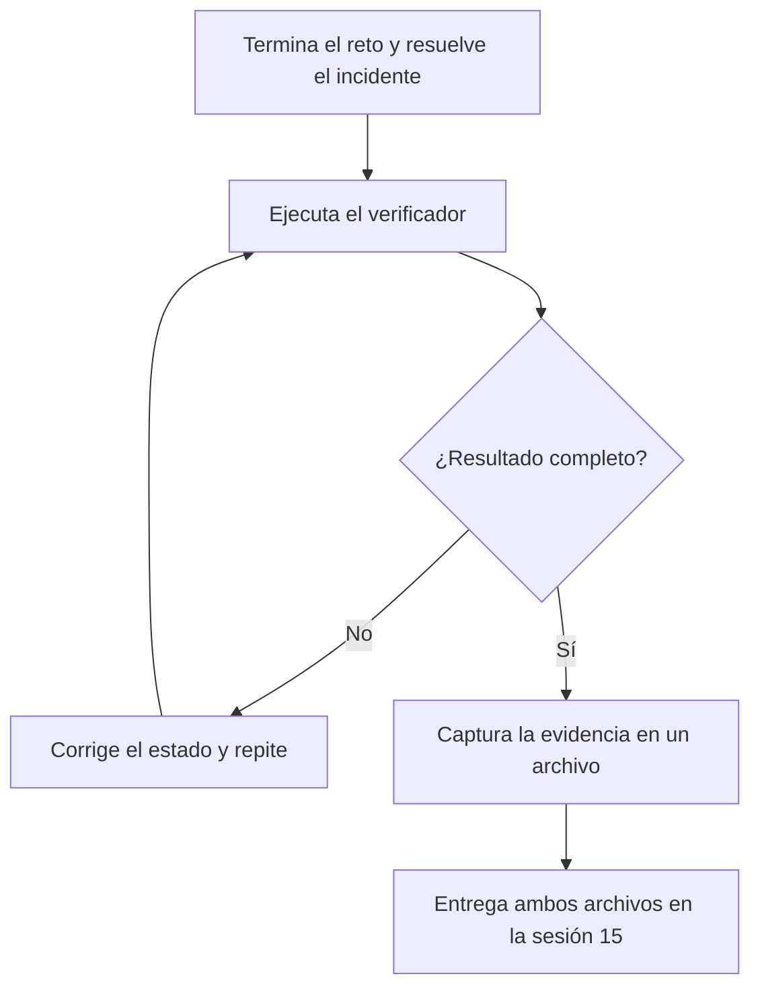

# Entrega de los laboratorios GitOps 1 y 2

**Módulo 8 · Sesión 15 · Tópicos Especiales en Informática**

> En la sesión 15 no hay examen. Entregas la evidencia de que tus dos laboratorios de GitOps
> terminaron en el estado correcto: la salida completa del verificador final de cada uno.

> [!NOTE]
> Fecha de entrega: **sesión 15, sábado 14 de noviembre de 2026**. El mecanismo de envío
> (repositorio, plataforma o correo) se anuncia en clase. Anótalo aquí: `__________`.

---

## 1. Qué entregas

| | Laboratorio 1 | Laboratorio 2 |
|---|---|---|
| Laboratorio | [GitOps desde cero](./laboratorio-gitops-1.md) | [La ruleta de extremo a extremo](./laboratorio-gitops-2.md) |
| Verificador final | `modulo8/laboratorio-gitops-1/verificador-reto1.sh` | `modulo8/laboratorio-gitops-2/verificar-reto.sh` |
| Chequeos | 8 (7 del reto + el incidente del Paso 9) | 15 (13 del reto + 2 del incidente del Paso 10) |
| Incidente a mano | Paso 9 | Paso 10, con el informe `incidentes/<ID>.md` en `main` |
| Meta | `Resultado: 8/8` y su línea `Huella` | `Resultado: 15/15` y su línea `Huella` |
| Archivo a entregar | `entrega-lab1.txt` | `entrega-lab2.txt` |

Cada archivo contiene, en este orden: la fecha, tu usuario, el contexto de `kubectl` y la
salida **completa** del verificador, incluidas las líneas `Resultado: X/Y` y `Huella`.

> [!IMPORTANT]
> El incidente de producción (Paso 9 del laboratorio 1, Paso 10 del laboratorio 2) **no tiene
> solución en el repositorio**: lo resuelves tú, a mano. `preparar-incidente.sh` genera un
> ticket distinto en cada ejecución, y la línea `Huella` sale de ese ticket y de tu clúster.
> Sin incidente resuelto no hay puntaje completo.


*Figura: el verificador califica el estado final; solo capturas la evidencia cuando ya lo viste pasar.*

---

## 2. Cómo capturar la evidencia

Deja el laboratorio en el estado final, con el incidente resuelto: **no lo desmontes antes de capturar**. La
sección «Limpieza» de cada laboratorio va después de la entrega.

### Laboratorio 1

Con el clúster `m08-gitops1` en pie, en una terminal con el entorno del laboratorio:

```bash
source ~/lab-gitops-1/entorno.sh
export GITEA_PASS='la-contraseña-de-montar.sh'
cd ~
{ date -Is; whoami; kubectl config current-context; bash "$LAB_DIR/verificador-reto1.sh"; } 2>&1 | tee entrega-lab1.txt
```

Tarda entre uno y dos minutos: el verificador provoca dos derivas y espera a que se corrijan.

### Laboratorio 2

Con el clúster `gitops2` en pie, en una terminal con el entorno del laboratorio:

```bash
source ~/lab-gitops-2/env.sh
cd ~
{ date -Is; whoami; kubectl config current-context; bash "$MAT/verificar-reto.sh"; } 2>&1 | tee entrega-lab2.txt
```

Sin `--reto`: así califica los 15 chequeos, incluido el incidente.

### Revisa antes de entregar

```bash
tail -n 2 ~/entrega-lab1.txt ~/entrega-lab2.txt
```

Cada archivo debe terminar en sus líneas `Resultado: X/Y` y `Huella: ...`. Si faltan, el
comando se interrumpió: repite la captura.

---

## 3. Cómo se evalúa

- La nota sale de **la puntuación del verificador**. El objetivo es el puntaje completo en
  cada laboratorio (8/8 y 15/15).
- El verificador califica el **estado final** de tu sistema, no los comandos que usaste.
- El profesor puede **volver a ejecutar el verificador** sobre tu clúster o tu repositorio
  para confirmar lo que entregaste.

> [!NOTE]
> Los pesos de cada laboratorio en la nota final los confirma el profesor en clase.

---

## 4. Honestidad académica

- El verificador revisa el estado final del sistema. Quien no construyó el laboratorio no
  puede reproducir ese estado en su propio clúster.
- Tu archivo incluye fecha, usuario y contexto de `kubectl`, y la línea `Huella`, que sale
  de tu ticket y del identificador de tu clúster. Copiar la salida o los comandos de otra
  persona es detectable: su ticket y su `Huella` no son los tuyos.
- El verificador del laboratorio 2 imprime además su propia suma (`Verificador:`): una copia
  editada del verificador se nota.
- Entrega la salida tal como salió. Un `Resultado` menor, entregado como es, es válido;
  una salida editada, no.
- Los atajos que el laboratorio ya señala (suspender la reconciliación, saltar la
  verificación de firmas) hacen que el verificador baje la nota. No los uses.

---

## 5. Si un chequeo falla

Cada línea `[FALLA]` nombra lo que no se cumple. Busca ese texto en el laboratorio, corrige
el estado y vuelve a ejecutar el verificador.

| Laboratorio | Dónde mirar |
|---|---|
| 1 | Paso 8.1 («Calibra el verificador») y el paso que construyó lo que falla (Pasos 1 a 7). Si falla el chequeo 8, relee el ticket y el estado final del Paso 9: el incidente no tiene solución publicada. |
| 2 | Paso 9.3 («Calibra: el atajo que no engaña») y el paso que construyó lo que falla (Pasos 1 a 8). Si fallan los chequeos 14 o 15, relee el ticket y el estado final del Paso 10: el incidente no tiene solución publicada. |

Si la falla persiste, lleva a la sesión 15 la salida del verificador y lo que ya probaste.

---

## 6. Lista de verificación

- [ ] El clúster del laboratorio 1 está en pie y `verificador-reto1.sh` dio su resultado final.
- [ ] El clúster del laboratorio 2 está en pie y `verificar-reto.sh` dio su resultado final.
- [ ] Resolví a mano el incidente de cada laboratorio (y en el laboratorio 2, `incidentes/<ID>.md` está en `main`).
- [ ] `entrega-lab1.txt` empieza con fecha, usuario y contexto, y termina en `Resultado: X/8` y `Huella`.
- [ ] `entrega-lab2.txt` empieza con fecha, usuario y contexto, y termina en `Resultado: X/15` y `Huella`.
- [ ] No edité ninguna salida.
- [ ] Entregué antes del cierre de la sesión 15 (sábado 14 de noviembre de 2026).
- [ ] Solo después de entregar, ejecuté la «Limpieza» de cada laboratorio.

---

**Licencia:** CC BY-NC-SA 4.0 · Si usas o adaptas este material, reconoce la procedencia: «Guía de entrega de los laboratorios GitOps (Módulo 8)», Luis Felipe Ariza Vesga, https://github.com/lfarizav/topicos-especiales. Ver [Licencia y reconocimiento](../README.md#licencia-y-reconocimiento).

_Creado con ❤️ por Luis Felipe Ariza Vesga._
