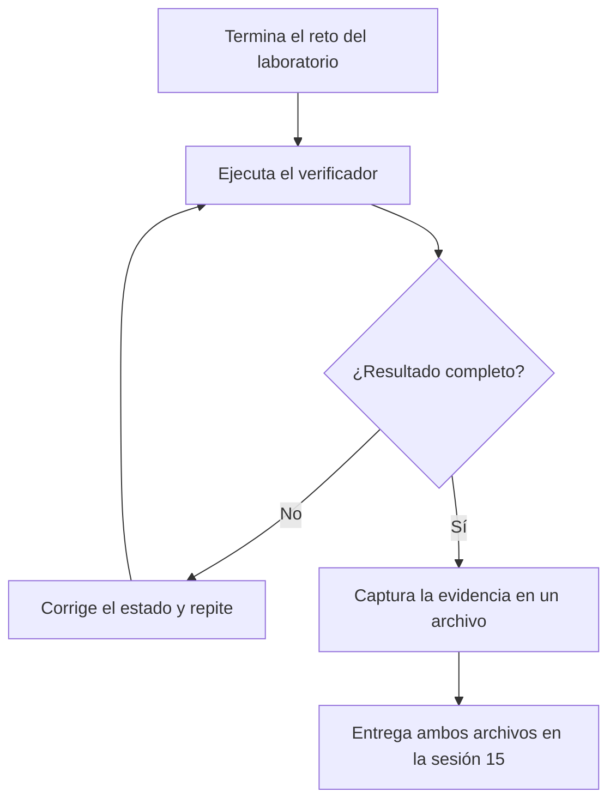

# Entrega de los laboratorios GitOps 1 y 2

**Módulo 8 · Sesión 15 · Tópicos Especiales en Informática**

> En la sesión 15 no hay examen. Entregas la evidencia de que tus dos laboratorios de GitOps
> terminaron en el estado correcto: la salida completa del verificador final de cada uno.

> [!NOTE]
> Fecha de entrega: **sesión 15, sábado 14 de noviembre de 2026**. El mecanismo de envío
> (repositorio, plataforma o correo) se anuncia en clase. Anótalo aquí: `__________`.

---

## 1. Qué entregas

| | Laboratorio 1 | Laboratorio 2 |
|---|---|---|
| Laboratorio | [GitOps desde cero](./laboratorio-gitops-1.md) | [La ruleta de extremo a extremo](./laboratorio-gitops-2.md) |
| Verificador final | `modulo8/laboratorio-gitops-1/verificador-reto1.sh` (Paso 8) | `~/lab-gitops-2/verificar-reto.sh`, que escribes tú en el Paso 9.2 |
| Chequeos | 7 | 13 |
| Meta | `Resultado: 7/7` | `Resultado: 13/13` |
| Archivo a entregar | `entrega-lab1.txt` | `entrega-lab2.txt` |

Cada archivo contiene, en este orden: la fecha, tu usuario, el contexto de `kubectl` y la
salida **completa** del verificador, incluida la línea `Resultado: X/Y`.


*Figura: el verificador califica el estado final; solo capturas la evidencia cuando ya lo viste pasar.*

---

## 2. Cómo capturar la evidencia

Deja el laboratorio en el estado final del reto: **no lo desmontes antes de capturar**. La
sección «Limpieza» de cada laboratorio va después de la entrega.

### Laboratorio 1

Desde la raíz del repositorio del curso, con el clúster `m08-gitops1` en pie:

```bash
cd modulo8/laboratorio-gitops-1
{ date -Is; whoami; kubectl config current-context; bash verificador-reto1.sh; } 2>&1 | tee ../entrega-lab1.txt
```

Tarda entre uno y dos minutos: el verificador provoca dos derivas y espera a que se corrijan.

### Laboratorio 2

Con el clúster del laboratorio 2 en pie y el entorno cargado como en el laboratorio
(`KUBECONFIG` apuntando a `~/lab-gitops-2/kubeconfig`):

```bash
export KUBECONFIG=~/lab-gitops-2/kubeconfig
{ date -Is; whoami; kubectl config current-context; ~/lab-gitops-2/verificar-reto.sh; } 2>&1 | tee entrega-lab2.txt
```

### Revisa antes de entregar

```bash
tail -n 1 entrega-lab1.txt entrega-lab2.txt
```

Cada archivo debe terminar en su línea `Resultado: X/Y`. Si falta, el comando se interrumpió:
repite la captura.

---

## 3. Cómo se evalúa

- La nota sale de **la puntuación del verificador**. El objetivo es el puntaje completo en
  cada laboratorio (7/7 y 13/13).
- El verificador califica el **estado final** de tu sistema, no los comandos que usaste.
- El profesor puede **volver a ejecutar el verificador** sobre tu clúster o tu repositorio
  para confirmar lo que entregaste.

> [!NOTE]
> Los pesos de cada laboratorio en la nota final los confirma el profesor en clase.

---

## 4. Honestidad académica

- El verificador revisa el estado final del sistema. Quien no construyó el laboratorio no
  puede reproducir ese estado en su propio clúster.
- Tu archivo incluye fecha, usuario y contexto de `kubectl`. Copiar la salida de otra
  persona es detectable porque esos datos no coinciden con los tuyos.
- Entrega la salida tal como salió. Un `Resultado` menor, entregado como es, es válido;
  una salida editada, no.
- Los atajos que el laboratorio ya señala (suspender la reconciliación, saltar la
  verificación de firmas) hacen que el verificador baje la nota. No los uses.

---

## 5. Si un chequeo falla

Cada línea `[FALLA]` nombra lo que no se cumple. Busca ese texto en el laboratorio, corrige
el estado y vuelve a ejecutar el verificador.

| Laboratorio | Dónde mirar |
|---|---|
| 1 | Paso 8.1 («Calibra el verificador»), con la salida real de un intento fallido; y el paso que construyó lo que falla (Pasos 1 a 7). La «Solución del reto» queda para después de intentarlo. |
| 2 | Paso 9.3 («Calibra: el atajo que no engaña») y la sección «El objetivo» del Paso 9; el paso que construyó lo que falla (Pasos 1 a 8). La «Solución del reto» queda para después de intentarlo. |

Si la falla persiste, lleva a la sesión 15 la salida del verificador y lo que ya probaste.

---

## 6. Lista de verificación

- [ ] El clúster del laboratorio 1 está en pie y `verificador-reto1.sh` dio su resultado final.
- [ ] El clúster del laboratorio 2 está en pie y `verificar-reto.sh` dio su resultado final.
- [ ] `entrega-lab1.txt` empieza con fecha, usuario y contexto, y termina en `Resultado: X/7`.
- [ ] `entrega-lab2.txt` empieza con fecha, usuario y contexto, y termina en `Resultado: X/13`.
- [ ] No edité ninguna salida.
- [ ] Entregué antes del cierre de la sesión 15 (sábado 14 de noviembre de 2026).
- [ ] Solo después de entregar, ejecuté la «Limpieza» de cada laboratorio.

---

**Licencia:** CC BY-NC-SA 4.0 · Si usas o adaptas este material, reconoce la procedencia: «Guía de entrega de los laboratorios GitOps (Módulo 8)», Luis Felipe Ariza Vesga, https://github.com/lfarizav/topicos-especiales. Ver [Licencia y reconocimiento](../README.md#licencia-y-reconocimiento).

_Creado con ❤️ por Luis Felipe Ariza Vesga._
