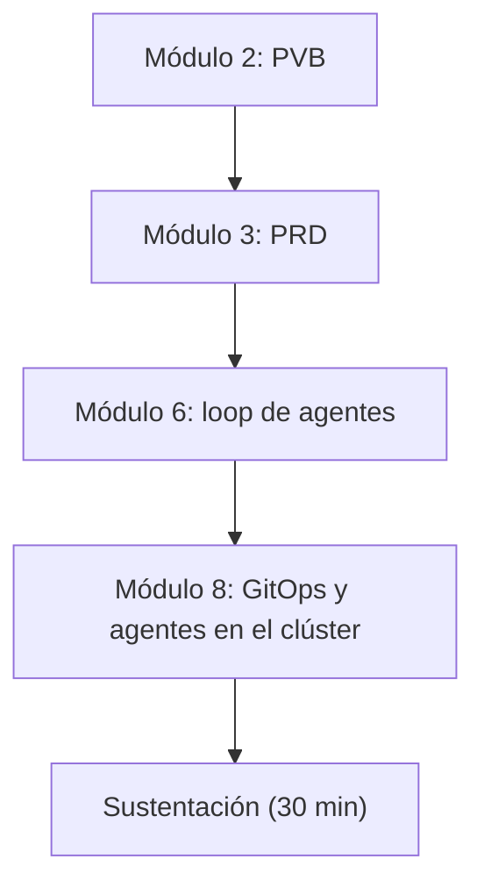

# Sustentación del proyecto final

**Módulo 8 · Trabajo de proyecto final · Tópicos Especiales en Informática**

> Último paso del proyecto final. Presentas en **30 minutos** la solución que tu grupo construyó
> a lo largo del curso: qué problema resuelve, cómo corre en Kubernetes, qué hace su loop de
> agentes y por qué seguirá valiendo cuando salgan modelos mejores.

> [!NOTE]
> El grupo elige su día de presentación. El mecanismo y la fecha de entrega se anuncian en clase.
> Anota aquí la fecha de tu grupo: `__________`.

---

## 1. Dónde estás


*Figura: el proyecto final recorre todo el curso. Hoy lo defiendes completo.*

---

## 2. Reglas

- **30 minutos**, preguntas incluidas. Los tiempos de la sección 3 son una guía; el total no se excede.
- **Todos los integrantes hablan.** Quien no hable no recibe la nota oral.
- **Evidencia, no opinión.** Cada afirmación técnica lleva un comando, un log, un manifiesto o un enlace.
- **Una cifra inventada es un defecto.** Todo dato de mercado, competencia, precio o versión lleva fuente verificable. Tus propias proyecciones se marcan como tales.
- **La tesis del módulo se mantiene:** el agente propone, un humano aprueba, GitOps reconcilia. Tu agente no hace `kubectl apply` por su cuenta.

---

## 3. Qué presentar

| # | Pregunta | Minutos |
| --- | --- | --- |
| 1 | ¿Qué problema resuelve y para quién? | 3 |
| 2 | ¿Cómo es la infraestructura y la arquitectura, y cómo corre en Kubernetes? | 7 |
| 3 | ¿Qué hace el loop de agentes que ustedes implementaron? | 6 |
| 4 | ¿Cómo se compara con otras soluciones? | 4 |
| 5 | ¿Por qué sigue siendo útil cuando salga un modelo mejor? | 3 |
| 6 | ¿Cuál es su ventaja competitiva (moat)? | 2 |
| | Preguntas | 5 |

### 3.1 Problema

- ¿Quién es el usuario y qué le duele hoy?
- ¿Cómo lo resuelve hoy y cuánto le cuesta?
- ¿Con qué métrica sabrás que quedó resuelto? Si cambió algo desde tu PVB, dilo.

### 3.2 Infraestructura y arquitectura

- Un diagrama **real** de tu solución: aplicación, agentes, servidores MCP, repositorio Git, Flux o Argo CD, API de Kubernetes.
- Qué objeto de Kubernetes implementa cada pieza y dónde está su manifiesto.
- Seguridad, con evidencia: RBAC de mínimo privilegio y Pod Security. Tu mejor diapositiva es `kubectl auth can-i --list --as=<ServiceAccount del agente>`.
- El bucle GitOps funcionando: un cambio en Git que se reconcilia en el clúster.

### 3.3 El loop de agentes

Explica lo que construyeron ustedes, no lo que hace el modelo:

- Qué recibe el agente y qué decide en cada vuelta.
- Qué herramientas MCP tiene permitidas (allowlist) y cuáles no.
- Cómo verifica su trabajo y cuándo se detiene.
- Dónde termina la cadena: **un pull request con la evidencia adjunta**, que un humano revisa.

**Demo en vivo de 3 minutos** y una grabación de respaldo. Muestra también un caso en que el agente falla o es frenado por sus límites.

### 3.4 Comparación

Una tabla con **al menos tres alternativas reales**, entre ellas hacerlo a mano o con scripts. Compara tiempo, seguridad, costo y esfuerzo de adopción, con la fuente de cada dato. Escribe **dónde pierde tu solución**: una tabla en la que ganas en todo está incompleta.

### 3.5 Vigencia ante nuevos modelos

La pregunta: *si mañana sale un modelo mejor de ChatGPT, Claude o Gemini, ¿el proyecto deja de servir?*

- Separa dos listas: lo que un modelo mejor absorberá (razonar, escribir mejores comandos) y lo que es tuyo (permisos, allowlist, RBAC, política de aprobación, historial, pruebas, integración con tu clúster).
- **Prueba de cambio de modelo:** cambia de modelo modificando solo configuración y muestra que el sistema sigue funcionando.
- Ten al menos 10 casos de prueba que ejecutas contra cada modelo nuevo.
- No digas «ningún modelo podrá hacerlo»: nadie puede demostrarlo.

### 3.6 Ventaja competitiva (moat)

Elige una o dos ventajas que un competidor con el mismo modelo no copiaría rápido: datos propios, integración y permisos ya resueltos, pruebas y políticas propias, cumplimiento, o ejecución dentro del cliente. Completa y defiende esta frase:

*«Un competidor con el mismo modelo tardaría ___ en igualarnos porque ___.»*

---

## 4. Qué entregas

Un `README.md` en el repositorio de tu grupo, antes de presentar y coherente con lo que muestras:

```markdown
# <Nombre del proyecto>
Grupo: <integrantes> | Fecha de presentación: <día>

1. Problema
2. Arquitectura en Kubernetes (diagrama, manifiestos, seguridad)
3. Loop de agentes
4. Comparación (con fuentes)
5. Vigencia ante nuevos modelos
6. Moat
7. Cómo reproducirlo desde cero
8. Riesgos y cómo los mitigaste
```

---

## 5. Cómo se evalúa

Se evalúa el arco completo y la honestidad del análisis, no solo que la demo funcione.

| Criterio | Puntos |
| --- | --- |
| Problema y usuario | 10 |
| Infraestructura y arquitectura | 20 |
| Loop de agentes y demo | 20 |
| Comparación | 10 |
| Vigencia ante nuevos modelos | 15 |
| Moat | 10 |
| Claridad y trabajo en equipo | 10 |
| `README.md` entregado | 5 |

> [!NOTE]
> Los puntos son una propuesta; el profesor los confirma en clase.

---

_Hecho con ❤️ por Luis Felipe Ariza Vesga._
