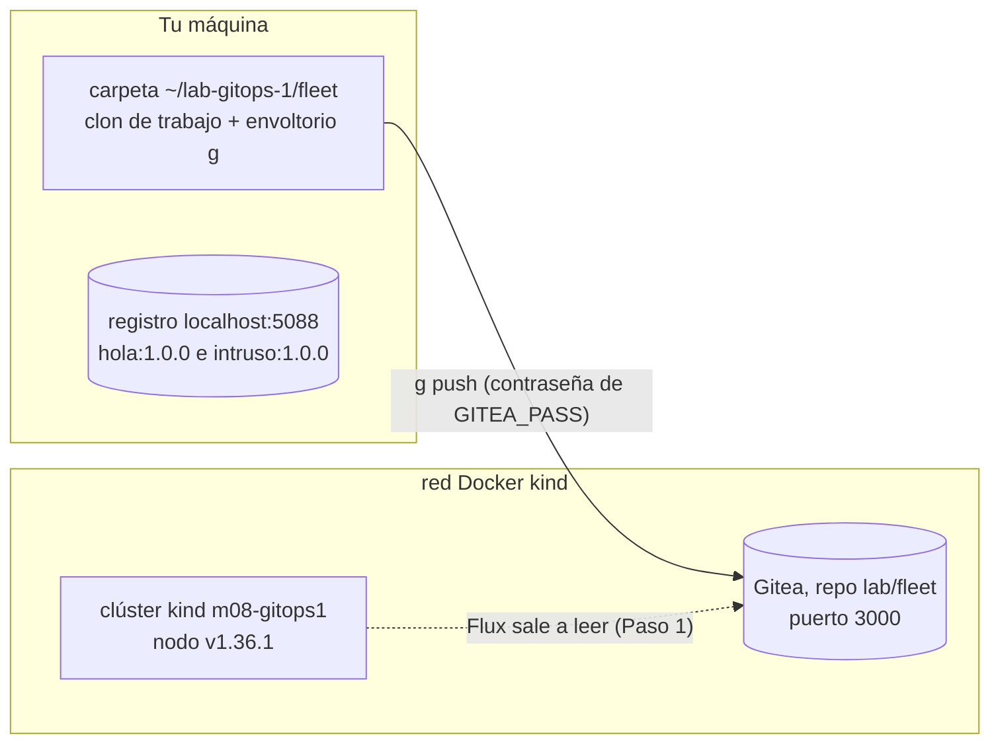
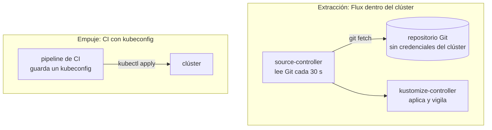
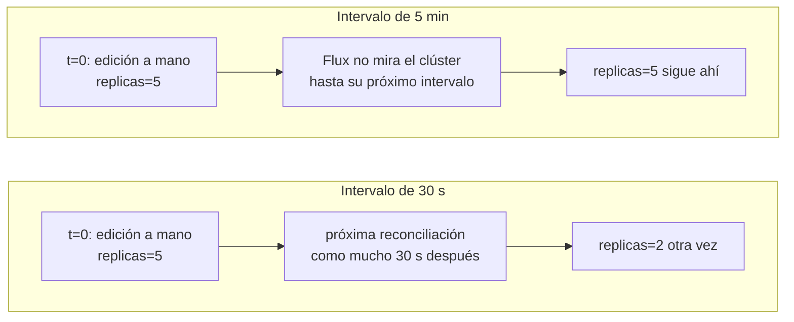
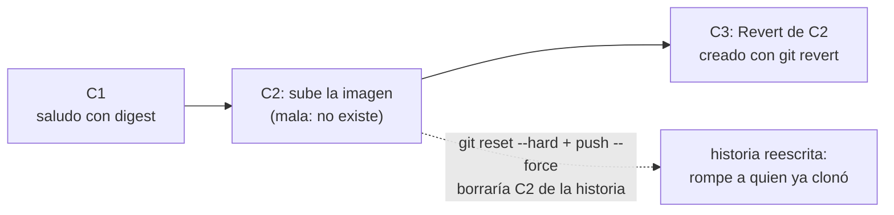
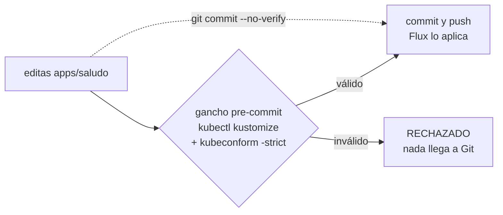
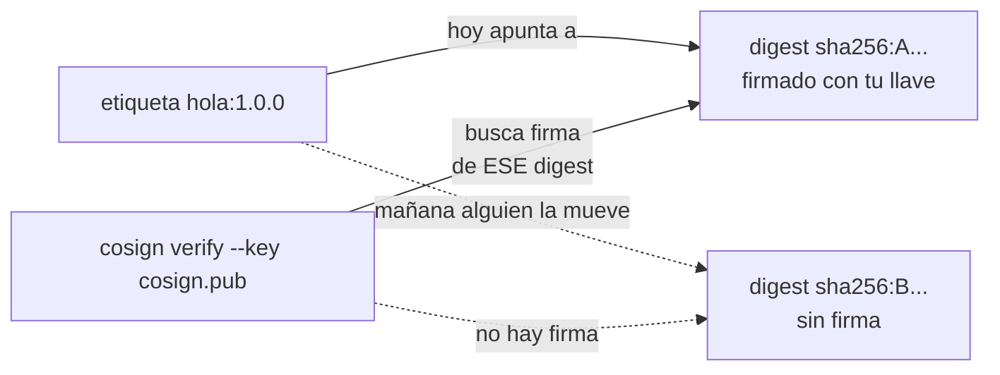
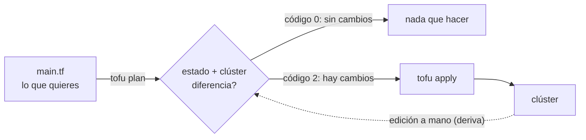

# Laboratorio 1 (Módulo 8) – GitOps desde cero: de Git al clúster, de la firma a la infraestructura

**Módulo 8 · sesión 13 · en clase · 120–140 minutos.** Hasta el módulo 7 tú eras quien
tecleaba `kubectl apply`. Hoy dejas de serlo. Vas a instalar **Flux** de modo que el clúster
salga a buscar su estado deseado en un repositorio Git (el *modelo de extracción*), a
desplegar una aplicación **sin tocar el clúster**, a ver cómo Flux deshace una edición a
mano, a revertir un cambio malo con `git revert`, a poner una **compuerta de CI** en
miniatura con `kustomize` y `kubeconform`, a **firmar una imagen por digest** con `cosign` y
a describir infraestructura con **OpenTofu**. Al final, un verificador califica el estado
de un laboratorio nuevo, igual que el examen.

| Bloque | Paso | Tiempo | ¿Se puede dejar para casa? |
|---|---|---|---|
| Clúster `kind`, Gitea y registro locales; herramientas con SHA-256 verificado | 0 | ~10 min | No |
| Flux se instala a sí mismo desde Git (modelo de extracción) | 1 | ~10 min | No |
| Un cambio declarativo: la aplicación entra por Git | 2 | ~15 min | No |
| Deriva y reconciliación: el intervalo decide | 3 | ~15 min | No |
| Reversa con `git revert` | 4 | ~15 min | No |
| Compuerta de CI en miniatura: `kustomize` + `kubeconform` | 5 | ~15 min | Sí |
| Firmar y verificar una imagen por digest con `cosign` | 6 | ~15 min | Sí |
| OpenTofu: `plan`, `apply` y deriva | 7 | ~15 min | Sí |
| **Reto** estilo examen, calificado por script | 8 | ~25 min | No |

> La idea central de esta sesión cabe en una frase: **en GitOps el repositorio es la única
> puerta de entrada, y todo lo demás es un reconciliador que vigila que el mundo coincida con
> lo que dice Git.** Si lo puedes cambiar sin dejar un commit, no es GitOps. Esta es la
> primera mitad de la tesis del módulo: *el agente propone, un humano aprueba, GitOps
> reconcilia.* Hoy construyes el «GitOps reconcilia»; en la sesión 14 le pones encima al
> agente que propone.

---

## Cómo trabajar este laboratorio

Este laboratorio usa las mismas cuatro técnicas de enseñanza que el del módulo 7. No son
adorno: cambian lo que haces en cada paso.

| Técnica | Lo que te pide | De dónde sale |
|---|---|---|
| **Predice, ejecuta, explica** | Antes de cada bloque marcado **🔮 Predice**, escribe en `predicciones.md` qué crees que va a pasar. Después compara. | PRIMM (Sentance y Waite, 2019) y Predict-Observe-Explain (White y Gunstone, 1992) |
| **Fallo productivo** | Varios pasos te hacen romper algo **a propósito** (una edición a mano, una imagen que no existe, un commit inválido) antes de ver la forma correcta. El error es el material. | Productive Failure (Kapur, 2008) |
| **Andamiaje que se retira** | Los pasos 1 a 7 te dan el comando. El Paso 8 solo te da el objetivo y un script que califica el resultado, igual que el examen. | Efecto del ejemplo resuelto y reversión por experticia (Sweller; Kalyuga et al., 2003) |
| **Práctica de recuperación** | Al final respondes de memoria, sin releer. Recordar cuesta más que releer, y por eso fija más. | Test-Enhanced Learning (Roediger y Karpicke, 2006) |

```bash
mkdir -p ~/lab-gitops-1-notas
echo "# Predicciones del laboratorio 1 (módulo 8)" > ~/lab-gitops-1-notas/predicciones.md
```

Una predicción equivocada que escribiste vale más que una correcta que solo pensaste: es la
que te obliga a revisar tu modelo mental. Nadie la califica.

La carpeta `~/lab-gitops-1-notas` es **tuya**: aquí guardarás copias de los archivos que
escribas (manifiestos, el gancho, el código de OpenTofu). En el Paso 8 el laboratorio se
reconstruye desde cero y esas copias son tu «libreta de examen».

---

## Objetivo

Al terminar vas a poder responder, señalando evidencia en tu terminal:

1. ¿Qué significa «modelo de extracción» y qué prueba, en el clúster, que nadie le empujó
   nada desde fuera?
2. ¿Cómo sabes **quién** escribió un objeto de Kubernetes, y por qué `managedFields` distingue
   un despliegue GitOps de un `kubectl apply` escondido?
3. ¿Cuánto tarda Flux en deshacer una edición a mano, y qué decide ese tiempo?
4. ¿Por qué el rollback también es un commit, y qué se pierde si en su lugar reescribes la
   historia?
5. ¿Qué atrapa una compuerta de CI antes de que el manifiesto llegue a Git, y por qué la
   versión local se puede saltar con `--no-verify`?
6. ¿Por qué se firma el **digest** de una imagen y no su etiqueta, y qué pasa cuando alguien
   mueve la etiqueta?
7. ¿Qué agrega `tofu plan` que `kubectl apply` no tiene, y qué significa su código de salida
   2?

**Requisito:** módulos 5 a 7 completos (sabes crear un clúster `kind`, leer `kubectl get -o
jsonpath` y razonar sobre Deployments, Services y namespaces), y Git en el nivel de
`clone`, `commit`, `push` y `log`.

**Entorno verificado** (el 6 de noviembre de 2026, en la máquina donde se capturaron todas
las salidas): Linux, `kind` v0.33.0, `kubectl` cliente v1.37.0, nodo `kindest/node:v1.36.1`,
Flux 2.10.0, `kubeconform` 0.8.0, `cosign` 3.1.3, OpenTofu 1.12.6 con el proveedor
`hashicorp/kubernetes` 3.5.0, Gitea 1.27.2 y `registry:3`. Las herramientas las baja el
montaje, **fijadas por versión y con la suma SHA-256 del lanzamiento oficial verificada**, a
`~/lab-gitops-1/bin`, sin tocar las que ya tengas. Necesitas Docker sin `sudo`, `kind`,
`kubectl`, `git`, `curl`, `tar`, `unzip`, `sha256sum` y `python3` en el `PATH`, unos
**4 GiB de RAM libres**, los puertos `3088` y `5088` de `127.0.0.1` libres, y salida a
internet durante el montaje y los pasos 2, 5 y 7 (imágenes, esquemas de `kubeconform` y
proveedor de OpenTofu).

Comprueba tus versiones antes de empezar; si difieren, las salidas pueden variar en detalle:

```bash
kind version
kubectl version --client | head -1
docker version --format '{{.Server.Version}}'
git --version
free -g | sed -n 2p
```

**Salida real de esta máquina:**

```
kind v0.33.0 go1.26.7 linux/amd64
Client Version: v1.37.0
29.9.3
git version 2.43.0
Mem:              62          13          28           0          21          48
```

> Todas las salidas marcadas **«Salida real de esta máquina»** se capturaron ejecutando los
> comandos. Los nombres de Pods, IPs, hashes (SHA), digests y tiempos serán **distintos en tu
> máquina**; la forma de la salida no. Después de cada salida hay una o dos frases que dicen
> qué significa **para el principio GitOps** que se está practicando.

---

## Paso 0: Un clúster, un servidor Git y un registro, todo local (10 min)

GitOps necesita tres cosas que en un laboratorio hay que fabricar: un **clúster**, un
**servidor Git** al que el clúster pueda llegar, y un **registro de imágenes** donde firmar.
El script `montar.sh` (en la carpeta `modulo8/laboratorio-gitops-1/` de este repositorio)
las crea todas:



Antes de correr un script que te baja binarios, léelo. Mira qué versiones fija y de dónde las
baja:

```bash
cd modulo8/laboratorio-gitops-1
grep -nE '^(FLUX_V|NODO_IMG|GITEA_IMG)' montar.sh | cut -c1-110
grep -n 'releases/download' montar.sh | cut -c1-100
```

**Salida real de esta máquina:**

```
7:NODO_IMG="kindest/node:v1.36.1@sha256:3489c7674813ba5d8b1a9977baea8a6e553784dab7b84759d1014dbd78f7ebd5"
8:GITEA_IMG="gitea/gitea:1.27.2-rootless@sha256:c7953964c6e8fe532cf7fc3f3efdea1d0b161d7859c47e04f5e05489d494de
12:FLUX_V=2.10.0; KC_V=0.8.0; TOFU_V=1.12.6; COSIGN_V=3.1.3
29:bajar https://github.com/fluxcd/flux2/releases/download/v$FLUX_V/flux_${FLUX_V}_linux_amd64.tar.g
31:bajar https://github.com/yannh/kubeconform/releases/download/v$KC_V/kubeconform-linux-amd64.tar.g
33:bajar https://github.com/opentofu/opentofu/releases/download/v$TOFU_V/tofu_${TOFU_V}_linux_amd64.
35:bajar https://github.com/sigstore/cosign/releases/download/v$COSIGN_V/cosign-linux-amd64 "$W/bin/
```

Cada descarga se compara con una suma SHA-256 escrita en el script; si no coincide, el
montaje se detiene con `ERROR SUMA-SHA256`. Y las imágenes de Gitea, del registro y del nodo
van fijadas por **digest**, no por etiqueta: es el mismo principio que aplicarás en el Paso 6.

La contraseña de Gitea la **inventas tú** y viaja solo en una variable de entorno. No se
escribe en ningún archivo del repositorio ni del laboratorio:

```bash
export GITEA_PASS="$(openssl rand -hex 8)-lab"
bash montar.sh
```

**Salida real de esta máquina:**

```
flux version 2.10.0
v0.8.0
OpenTofu v1.12.6
GitVersion:    v3.1.3
Have a question, bug, or feature request? Let us know! https://kind.sigs.k8s.io/#community 🙂
MONTAJE LISTO. Gitea: http://172.18.0.5:3000/lab/fleet.git  Registro: localhost:5088  Carpeta: /home/lfarizav/lab-gitops-1
```

Si algo falla, el script se detiene con un código que dice **qué** falló (`PUERTO-OCUPADO`,
`CLUSTER-EXISTE`, `SUMA-SHA256`...). Cada terminal nueva que abras necesita el entorno del
laboratorio (el `PATH` con las herramientas fijadas, el kubeconfig privado) y la contraseña:

```bash
source ~/lab-gitops-1/entorno.sh
cd "$LAB_DIR"
kubectl get nodes
docker ps --filter name=gitops1 --format '{{.Names}}  {{.Status}}'
g log --oneline
```

**Salida real de esta máquina:**

```
NAME                        STATUS   ROLES           AGE   VERSION
m08-gitops1-control-plane   Ready    control-plane   28s   v1.36.1
gitops1-registry  Up 2 seconds
gitops1-gitea  Up 9 seconds
m08-gitops1-control-plane  Up 34 seconds
e0cf993 Initial commit
```

Tienes un clúster de un nodo, un Gitea con el repositorio `lab/fleet` (vacío salvo por el
`README` inicial) y un registro. `g` es un envoltorio de `git` sobre el clon
`~/lab-gitops-1/fleet`: la contraseña la lee de `GITEA_PASS`, así que nunca queda guardada.

---

## Paso 1: Flux se instala a sí mismo desde Git (10 min)

En el modelo de **empuje** (push) un pipeline de CI tiene un kubeconfig con permisos de
administrador y ejecuta `kubectl apply` contra el clúster: quien robe el pipeline, tiene el
clúster. En el modelo de **extracción** (pull) es al revés: dentro del clúster corre un
reconciliador que **sale a leer** un repositorio y aplica lo que encuentra. Git no tiene
credenciales del clúster.



🔮 **Predice** (escríbelo en `predicciones.md`): `flux bootstrap` instala Flux **y** lo
registra en Git para que Flux se administre a sí mismo. ¿Cuántos commits crees que va a
dejar en el repositorio `lab/fleet`? ¿Qué archivos estarán en `clusters/m08/flux-system/`?

Primero Flux comprueba que el clúster cumple sus requisitos. Después el arranque:

```bash
flux check --pre
GIP=$(cat ~/lab-gitops-1/gitea.ip)
flux bootstrap git --url=http://$GIP:3000/lab/fleet.git --allow-insecure-http --token-auth \
  --username=lab --password=$GITEA_PASS --branch=main --path=clusters/m08 --interval=30s \
  --author-name=Flux --author-email=flux@example.com --silent < /dev/null
```

**Salida real de esta máquina:**

```
► checking prerequisites
✔ Kubernetes 1.36.1 >=1.35.0-0
✔ prerequisites checks passed
► cloning branch "main" from Git repository "http://172.18.0.5:3000/lab/fleet.git"
✔ cloned repository
► generating component manifests
✔ generated component manifests
✔ committed component manifests to "main" ("8704bb59afaf32d3e0158a43aee31b1d6b26c53f")
► pushing component manifests to "http://172.18.0.5:3000/lab/fleet.git"
► installing components in "flux-system" namespace
✔ installed components
✔ reconciled components
► determining if source secret "flux-system/flux-system" exists
► generating source secret
► applying source secret "flux-system/flux-system"
✔ reconciled source secret
► generating sync manifests
✔ generated sync manifests
✔ committed sync manifests to "main" ("a4403ebc00e23513fa71007dde6fab0b33a8c8fb")
► pushing sync manifests to "http://172.18.0.5:3000/lab/fleet.git"
► applying sync manifests
✔ reconciled sync configuration
✔ GitRepository reconciled successfully
✔ Kustomization reconciled successfully
► confirming components are healthy
✔ helm-controller: deployment ready
✔ kustomize-controller: deployment ready
✔ notification-controller: deployment ready
✔ source-controller: deployment ready
✔ all components are healthy
```

`--token-auth` hace que Flux hable con Gitea por HTTP con usuario y contraseña (sin él
intenta escanear una llave SSH en el puerto 3000, que es HTTP, y se cuelga), y
`--allow-insecure-http` existe porque el Gitea local no tiene TLS. En producción usarías HTTPS
o SSH. Ahora mira qué dejó el arranque, **en Git**, no en el clúster:

```bash
cd ~/lab-gitops-1/fleet
g pull -q --rebase
g log --oneline
ls clusters/m08/flux-system
cat clusters/m08/flux-system/gotk-sync.yaml
```

**Salida real de esta máquina:**

```
a4403eb Add Flux sync manifests
8704bb5 Add Flux v2.10.0 component manifests
e0cf993 Initial commit
gotk-components.yaml
gotk-sync.yaml
kustomization.yaml
# This manifest was generated by flux. DO NOT EDIT.
---
apiVersion: source.toolkit.fluxcd.io/v1
kind: GitRepository
metadata:
  name: flux-system
  namespace: flux-system
spec:
  interval: 30s
  ref:
    branch: main
  secretRef:
    name: flux-system
  url: http://172.18.0.5:3000/lab/fleet.git
---
apiVersion: kustomize.toolkit.fluxcd.io/v1
kind: Kustomization
metadata:
  name: flux-system
  namespace: flux-system
spec:
  interval: 10m0s
  path: ./clusters/m08
  prune: true
  sourceRef:
    kind: GitRepository
    name: flux-system
```

Dos commits de Flux y tres archivos. `gotk-sync.yaml` es el que cierra el círculo: un
`GitRepository` (de dónde leer, cada cuánto) y una `Kustomization` (qué carpeta aplicar). Flux
**se describe a sí mismo en Git**; si borras Flux del clúster y reaplicas esa carpeta, vuelve.
Y ahora, la prueba de que es extracción:

```bash
flux get sources git
flux get kustomizations
kubectl -n flux-system get deploy
```

**Salida real de esta máquina:**

```
NAME       	REVISION          	SUSPENDED	READY	MESSAGE
flux-system	main@sha1:a4403ebc	False    	True 	stored artifact for revision 'main@sha1:a4403ebc'
NAME       	REVISION          	SUSPENDED	READY	MESSAGE
flux-system	main@sha1:a4403ebc	False    	True 	Applied revision: main@sha1:a4403ebc
NAME                      READY   UP-TO-DATE   AVAILABLE   AGE
helm-controller           1/1     1            1           30s
kustomize-controller      1/1     1            1           30s
notification-controller   1/1     1            1           30s
source-controller         1/1     1            1           30s
```

Los cuatro controladores base están disponibles, `flux-system` está en `Ready True` y aplica
`main@sha1:` seguido del commit actual. Nadie ejecutó `kubectl apply` sobre esos manifiestos
de sincronización desde tu terminal después del arranque: el clúster los lee de Git cada 30
segundos.

---

## Paso 2: Un cambio declarativo, la aplicación entra por Git (15 min)

Vas a desplegar una aplicación `saludo` (nginx, 2 réplicas) **sin ejecutar `kubectl apply`**.
Escribes YAML, haces `commit`, haces `push`, y esperas. Los archivos los escribes primero en
tu carpeta de notas y los copias al repositorio, para tenerlos en tu «libreta de examen»:

```bash
mkdir -p ~/lab-gitops-1-notas/saludo
cd ~/lab-gitops-1-notas/saludo
cat > kustomization.yaml <<'YAML'
apiVersion: kustomize.config.k8s.io/v1beta1
kind: Kustomization
resources:
  - namespace.yaml
  - deployment.yaml
  - service.yaml
YAML
cat > namespace.yaml <<'YAML'
apiVersion: v1
kind: Namespace
metadata:
  name: saludo
YAML
cat > deployment.yaml <<'YAML'
apiVersion: apps/v1
kind: Deployment
metadata:
  name: saludo
  namespace: saludo
spec:
  replicas: 2
  selector:
    matchLabels:
      app: saludo
  template:
    metadata:
      labels:
        app: saludo
    spec:
      containers:
        - name: web
          image: nginx:1.29-alpine@sha256:5616878291a2eed594aee8db4dade5878cf7edcb475e59193904b198d9b830de
          ports:
            - containerPort: 80
          readinessProbe:
            httpGet:
              path: /
              port: 80
YAML
cat > service.yaml <<'YAML'
apiVersion: v1
kind: Service
metadata:
  name: saludo
  namespace: saludo
spec:
  selector:
    app: saludo
  ports:
    - port: 80
      targetPort: 80
YAML
ls
```

**Salida real de esta máquina:**

```
deployment.yaml
kustomization.yaml
namespace.yaml
service.yaml
```

Fíjate en la imagen: `nginx:1.29-alpine@sha256:...`. Lleva etiqueta **y** digest. Con el
digest, Kubernetes descarga exactamente esos bytes aunque alguien mueva la etiqueta. Falta
decirle a Flux que vigile esa carpeta. Eso también es YAML y también va a Git; el comando lo
**genera** (`--export`) en vez de aplicarlo:

```bash
cd ~/lab-gitops-1/fleet
mkdir -p apps && cp -r ~/lab-gitops-1-notas/saludo apps/
flux create kustomization apps --source=GitRepository/flux-system --path=./apps/saludo \
  --prune=true --wait=true --interval=5m --export > clusters/m08/apps.yaml
cat clusters/m08/apps.yaml
cp clusters/m08/apps.yaml ~/lab-gitops-1-notas/apps.yaml
```

**Salida real de esta máquina:**

```
---
apiVersion: kustomize.toolkit.fluxcd.io/v1
kind: Kustomization
metadata:
  name: apps
  namespace: flux-system
spec:
  interval: 5m0s
  path: ./apps/saludo
  prune: true
  sourceRef:
    kind: GitRepository
    name: flux-system
  timeout: 2m0s
  wait: true
```

`prune: true` significa que si borras un archivo de Git, Flux borra el objeto del clúster.
`wait: true` significa que la Kustomization no se declara lista hasta que lo que desplegó está
sano. Valida el manifiesto **antes** de comprometerlo (es la semilla de la compuerta del Paso
5) y entonces empuja:

```bash
kubectl kustomize apps/saludo | kubeconform -strict -summary -ignore-missing-schemas -kubernetes-version 1.36.0 -
g add -A && g commit -q -m "feat: app saludo declarada en Git" && g push -q origin main
for i in $(seq 1 40); do kubectl -n saludo get deploy saludo -o jsonpath='{.status.availableReplicas}' 2>/dev/null | grep -qx 2 && break; sleep 3; done
flux get kustomizations
kubectl -n saludo get deploy,pods
```

**Salida real de esta máquina:**

```
Summary: 3 resources found parsing stdin - Valid: 3, Invalid: 0, Errors: 0, Skipped: 0
NAME       	REVISION          	SUSPENDED	READY  	MESSAGE
apps       	                  	False    	Unknown	Reconciliation in progress
flux-system	main@sha1:1f48dac9	False    	True   	Applied revision: main@sha1:1f48dac9
NAME                     READY   UP-TO-DATE   AVAILABLE   AGE
deployment.apps/saludo   2/2     2            2           7s

NAME                          READY   STATUS    RESTARTS   AGE
pod/saludo-587fcd97c5-kr8rp   1/1     Running   0          7s
pod/saludo-587fcd97c5-z6g4g   1/1     Running   0          7s
```

La aplicación está corriendo y tú nunca la aplicaste. La segunda prueba es forense. Cada
objeto de Kubernetes guarda en `managedFields` **qué cliente escribió cada campo**:

```bash
kubectl -n saludo get deploy saludo -o jsonpath='{range .metadata.managedFields[*]}{.manager}{"\n"}{end}'
echo "--- contraste: un ConfigMap creado a mano"
kubectl -n saludo create configmap a-mano --from-literal=x=1
kubectl -n saludo get cm a-mano -o jsonpath='{range .metadata.managedFields[*]}{.manager}{"\n"}{end}'
kubectl -n saludo delete configmap a-mano
```

**Salida real de esta máquina:**

```
kustomize-controller
kube-controller-manager
--- contraste: un ConfigMap creado a mano
configmap/a-mano created
kubectl-create
configmap "a-mano" deleted from saludo namespace
```

El Deployment lo escribió `kustomize-controller` (más `kube-controller-manager`, que solo
actualiza el estado de las réplicas). El ConfigMap lo escribió `kubectl-create`. **Esa
diferencia es lo que el verificador del Paso 8 mide**: un despliegue que «se ve bien» pero
tiene un `kubectl` en `managedFields` violó el principio de que todo entra por Git.

---

## Paso 3: Deriva y reconciliación, el intervalo decide (15 min)

La **deriva** (*drift*) es cualquier diferencia entre lo que dice Git y lo que hay en el
clúster. Flux la corrige, pero **no al instante**: solo mira el clúster cada `interval`. Vas a
medirlo, no a creerlo.



🔮 **Predice:** la Kustomization `apps` tiene `interval: 5m`. Vas a escalar el Deployment a 5
réplicas con `kubectl scale` y a mirarlo 45 segundos después. ¿Cuántas réplicas verás?

```bash
cd ~/lab-gitops-1/fleet
kubectl -n saludo scale deploy saludo --replicas=5
sleep 45
kubectl -n saludo get deploy saludo -o jsonpath='replicas={.spec.replicas}{"\n"}'
```

**Salida real de esta máquina:**

```
deployment.apps/saludo scaled
replicas=5
```

**Fallo productivo.** Tu edición a mano sobrevive porque el intervalo es largo. Eso es
incómodo: durante esos minutos el clúster miente sobre lo que dice Git. El intervalo es una
decisión, y como toda decisión de GitOps **entra por Git**, no por `kubectl edit`:

```bash
sed -i 's/interval: 5m0s/interval: 30s/' clusters/m08/apps.yaml
cp clusters/m08/apps.yaml ~/lab-gitops-1-notas/apps.yaml
g commit -q -am "ops: apps reconcilia cada 30 s" && g push -q origin main
for i in $(seq 1 30); do kubectl -n flux-system get kustomization apps -o jsonpath='{.spec.interval}' | grep -qx 30s && break; sleep 3; done
for i in $(seq 1 30); do kubectl -n saludo get deploy saludo -o jsonpath='{.spec.replicas}' | grep -qx 2 && break; sleep 3; done
kubectl -n flux-system get kustomization apps -o jsonpath='intervalo={.spec.interval}{"\n"}'
kubectl -n saludo get deploy saludo -o jsonpath='replicas={.spec.replicas}{"\n"}'
```

**Salida real de esta máquina:**

```
intervalo=30s
replicas=2
```

Ojo: `replicas` volvió a 2, pero **no** por haber medido la deriva. Un cambio de *revisión* en
Git (tu commit) dispara una reconciliación inmediata. Para medir la deriva de verdad hay que
provocarla sin tocar Git:

```bash
kubectl -n saludo scale deploy saludo --replicas=5; T0=$(date +%s)
until kubectl -n saludo get deploy saludo -o jsonpath='{.spec.replicas}' | grep -qx 2; do sleep 2; done
echo "Flux corrigió la deriva en $(( $(date +%s)-T0 )) s"
```

**Salida real de esta máquina:**

```
deployment.apps/saludo scaled
Flux corrigió la deriva en 30 s
```

El tiempo que midiste está acotado por el intervalo (peor caso: 30 s más lo que tarde en
aplicar). Dos advertencias: `flux reconcile kustomization apps` corrige la deriva al instante,
pero **no cuenta** para medirla, porque se salta el intervalo; y suspender la Kustomization
(`flux suspend`) apaga justo lo que quieres observar. Déjalo correr solo.

---

## Paso 4: Reversa con `git revert`, el rollback también es un cambio (15 min)

Tarde o temprano un cambio **válido pero malo** llega a Git. Aquí es una imagen que no
existe. ¿Cómo se deshace? En GitOps el rollback no es un comando especial: es **otro
commit**.



🔮 **Predice:** vas a empujar un commit que cambia la imagen a `nginx:1.99-alpine-no-existe`.
Pasados 50 segundos, ¿el servicio queda caído? ¿Cuántos Pods habrá, y en qué estado?

```bash
cd ~/lab-gitops-1/fleet && g pull -q --rebase
sed -i -E 's#image: nginx:1.29-alpine@sha256:[0-9a-f]+#image: nginx:1.99-alpine-no-existe#' apps/saludo/deployment.yaml
g commit -q -am "feat: sube la imagen de saludo" && g push -q origin main
sleep 50
kubectl -n saludo get pods
flux get kustomizations apps
```

**Salida real de esta máquina:**

```
NAME                      READY   STATUS             RESTARTS   AGE
saludo-5676c6d557-vzcrh   0/1     ImagePullBackOff   0          22s
saludo-587fcd97c5-lb6gj   1/1     Running            0          2m13s
saludo-587fcd97c5-xhvbc   1/1     Running            0          2m13s
NAME	REVISION          	SUSPENDED	READY  	MESSAGE
apps	main@sha1:fadd9bdc	False    	Unknown	Reconciliation in progress
```

**Fallo productivo.** Un Pod nuevo en `ImagePullBackOff`, y los dos viejos siguen `Running`:
la actualización gradual de Kubernetes protege el servicio mientras el nuevo Pod no esté
listo. Flux, con `wait: true`, se queda en `Reconciliation in progress` esperando que el
despliegue se sane, y no lo hará solo. Ahora la reversa, sin editar nada a mano:

```bash
g revert --no-edit HEAD && g push -q origin main
g log --oneline | head -4
kubectl -n saludo rollout status deploy/saludo --timeout=120s
for i in $(seq 1 40); do kubectl -n flux-system get kustomization apps -o jsonpath='{.status.conditions[?(@.type=="Ready")].status}' | grep -qx True && break; sleep 3; done
kubectl -n saludo get pods
flux get kustomizations apps
```

**Salida real de esta máquina:**

```
[main db79b12] Revert "feat: sube la imagen de saludo"
 Date: Fri Nov 6 20:00:08 2026 -0500
 1 file changed, 1 insertion(+), 1 deletion(-)
db79b12 Revert "feat: sube la imagen de saludo"
f9b00ca feat: sube la imagen de saludo
fadd9bd ops: apps reconcilia cada 30 s
1f48dac feat: app saludo declarada en Git
Waiting for deployment "saludo" rollout to finish: 1 out of 2 new replicas have been updated...
Waiting for deployment spec update to be observed...
Waiting for deployment spec update to be observed...
Waiting for deployment "saludo" rollout to finish: 1 old replicas are pending termination...
deployment "saludo" successfully rolled out
NAME                      READY   STATUS    RESTARTS   AGE
saludo-587fcd97c5-lb6gj   1/1     Running   0          3m58s
saludo-587fcd97c5-xhvbc   1/1     Running   0          3m58s
NAME	REVISION          	SUSPENDED	READY	MESSAGE
apps	main@sha1:db79b12e	False    	True 	Applied revision: main@sha1:db79b12e
```

La historia ahora cuenta toda la verdad: el commit malo **sigue ahí**, y encima está su
reversa (`Revert "feat: sube la imagen de saludo"`). Quien ya clonó el repositorio solo hace
`pull`. Si hubieras reescrito la historia, habrías escondido el error y roto a todos los
demás. El verificador del Paso 8 exige exactamente esto: un commit que diga `This reverts
commit <sha>` y que el commit revertido siga en la historia.

```bash
g log --format='%h %s%n%b' | head -8
```

**Salida real de esta máquina:**

```
db79b12 Revert "feat: sube la imagen de saludo"
This reverts commit f9b00ca35a3b7144755ad9f7c4d3935b1cf32501.

f9b00ca feat: sube la imagen de saludo

fadd9bd ops: apps reconcilia cada 30 s

1f48dac feat: app saludo declarada en Git
```

---

## Paso 5: Compuerta de CI en miniatura, `kustomize` + `kubeconform` (15 min)

El cambio malo del Paso 4 era válido para Kubernetes: la imagen no existía, pero el YAML era
correcto. Otra clase de error es más barata de atrapar: el YAML **inválido**. Una pipeline de
CI lo detecta antes del despliegue. Aquí harás lo mismo en miniatura, con un gancho
`pre-commit` de Git que corre en tu máquina.



El gancho renderiza cada carpeta de `apps/` y la valida contra el esquema de Kubernetes 1.36:

```bash
cd ~/lab-gitops-1/fleet
cat > ~/lab-gitops-1-notas/pre-commit <<'HOOK'
#!/bin/bash
# Compuerta de CI en miniatura: ningun commit entra si el manifiesto renderizado no valida contra el esquema de Kubernetes.
set -eo pipefail
W="$HOME/lab-gitops-1"; export PATH="$W/bin:$PATH"
cd "$(git rev-parse --show-toplevel)"
for d in apps/*/; do
  kubectl kustomize "$d" | kubeconform -strict -summary -ignore-missing-schemas -kubernetes-version 1.36.0 - \
    || { echo "RECHAZADO: $d no pasa kubeconform"; exit 1; }
done
HOOK
cp ~/lab-gitops-1-notas/pre-commit .git/hooks/pre-commit && chmod +x .git/hooks/pre-commit
.git/hooks/pre-commit; echo "gancho sobre el repositorio sano: $?"
```

**Salida real de esta máquina:**

```
Summary: 3 resources found parsing stdin - Valid: 3, Invalid: 0, Errors: 0, Skipped: 0
gancho sobre el repositorio sano: 0
```

🔮 **Predice:** vas a cambiar `replicas: 2` por `replicas: "dos"` (texto entre comillas) y a
intentar un commit. ¿Qué mensaje dará `kubeconform`? Luego harás un error de dedo: el campo
`replicsa` en vez de `replicas`. ¿Lo atrapa también?

```bash
echo "--- 1. tipo equivocado"
sed -i -E 's/^( *replicas:).*/\1 "dos"/' apps/saludo/deployment.yaml
g commit -q -am "invalido"; echo "salida del commit: $?"
g checkout -q -- apps/saludo/deployment.yaml
echo "--- 2. campo que no existe"
sed -i '0,/^spec:/s//spec:\n  replicsa: 2/' apps/saludo/deployment.yaml
g commit -q -am "invalido 2"; echo "salida del commit: $?"
g checkout -q -- apps/saludo/deployment.yaml
echo "--- 3. un cambio valido debe pasar"
sed -i -E 's/^( *replicas:).*/\1 3/' apps/saludo/deployment.yaml
g commit -q -am "ops: tres replicas"; echo "salida del commit: $?"
g reset -q --hard HEAD~1
g log --oneline | head -2
```

**Salida real de esta máquina:**

```
--- 1. tipo equivocado
stdin - Deployment saludo is invalid: problem validating schema. Check JSON formatting: jsonschema validation failed with 'https://raw.githubusercontent.com/yannh/kubernetes-json-schema/master/v1.36.0...
Summary: 3 resources found parsing stdin - Valid: 2, Invalid: 1, Errors: 0, Skipped: 0
RECHAZADO: apps/saludo/ no pasa kubeconform
salida del commit: 1
--- 2. campo que no existe
stdin - Deployment saludo is invalid: problem validating schema. Check JSON formatting: jsonschema validation failed with 'https://raw.githubusercontent.com/yannh/kubernetes-json-schema/master/v1.36.0...
Summary: 3 resources found parsing stdin - Valid: 2, Invalid: 1, Errors: 0, Skipped: 0
RECHAZADO: apps/saludo/ no pasa kubeconform
salida del commit: 1
--- 3. un cambio valido debe pasar
Summary: 3 resources found parsing stdin - Valid: 3, Invalid: 0, Errors: 0, Skipped: 0
salida del commit: 0
db79b12 Revert "feat: sube la imagen de saludo"
f9b00ca feat: sube la imagen de saludo
```

Los dos errores se rechazan **con el motivo exacto** y el cambio válido pasa. Una compuerta que
rechaza todo, o que no rechaza nada, no sirve: por eso se prueban los tres casos. El
`reset --hard HEAD~1` deshizo el commit de prueba **local** (nunca lo empujaste).

**Fallo productivo: la compuerta local se puede saltar.**

```bash
sed -i -E 's/^( *replicas:).*/\1 "dos"/' apps/saludo/deployment.yaml
g commit -q --no-verify -am "invalido, saltando la compuerta"; echo "salida del commit: $?"
g log --oneline | head -1
g reset -q --hard HEAD~1
git status --short | wc -l
```

**Salida real de esta máquina:**

```
salida del commit: 0
7625cc4 invalido, saltando la compuerta
0
```

Con `--no-verify` el commit inválido **entró**. Un gancho en tu máquina es una cortesía, no un
control. La versión real de esta compuerta corre en el **servidor** (un flujo de CI que es
requisito para fusionar), donde nadie puede saltársela. (Lo deshiciste con `reset` antes de
empujar: si lo hubieras empujado, Flux habría intentado aplicar el YAML inválido.)

---

## Paso 6: Firmar y verificar una imagen por digest con `cosign` (15 min)

Una **etiqueta** (`hola:1.0.0`) es un nombre que se puede mover para que apunte a otros
bytes. Un **digest** (`sha256:...`) es el hash de los bytes: no se mueve. Firmar la etiqueta
es firmar un nombre; firmar el digest es firmar el contenido.



El par de llaves va **fuera** del repositorio, en `~/lab-gitops-1/llaves`. La clave privada
nunca entra a Git. Primero lee los digests de las dos imágenes del registro local (`hola` y
`intruso`), y firma solo `hola`:

```bash
REG=localhost:5088
digest() { curl -fsI -H 'Accept: application/vnd.oci.image.index.v1+json, application/vnd.docker.distribution.manifest.v2+json, application/vnd.oci.image.manifest.v1+json' \
  "http://$REG/v2/lab/$1/manifests/$2" | tr -d '\r' | awk -F': ' 'tolower($1)=="docker-content-digest"{print $2}'; }
cd ~/lab-gitops-1/llaves && COSIGN_PASSWORD= cosign generate-key-pair
H=$(digest hola 1.0.0); I=$(digest intruso 1.0.0); echo "hola=$H"; echo "intruso=$I"
COSIGN_PASSWORD= cosign sign --yes --key cosign.key --allow-insecure-registry --use-signing-config=false --tlog-upload=false $REG/lab/hola@$H
cosign verify --key cosign.pub --insecure-ignore-tlog --allow-insecure-registry $REG/lab/hola@$H
```

**Salida real de esta máquina:**

```
Private key written to cosign.key
Public key written to cosign.pub
hola=sha256:7a3ebe5bfd1a4a19797d20b0c0bb39d44393e9a03fd852c0865b0f540d868df0
intruso=sha256:7c8cb692ae09657cbc4a3f3cbd0e8d5a2690ba38386aaaf252dbb060bf5eb2e6
Flag --tlog-upload has been deprecated, prefer using a --signing-config file with no transparency log services
Signing artifact...
Pushing signature to: localhost:5088/lab/hola
WARNING: Skipping tlog verification is an insecure practice that lacks transparency and auditability verification for the signature.

Verification for localhost:5088/lab/hola@sha256:7a3ebe5bfd1a4a19797d20b0c0bb39d44393e9a03fd852c0865b0f540d868df0 --
The following checks were performed on each of these signatures:
  - The cosign claims were validated
  - Existence of the claims in the transparency log was verified offline
  - The signatures were verified against the specified public key

[{"critical":{"identity":{"docker-reference":"localhost:5088/lab/hola@sha256:7a3ebe5bfd1a4a19797d20b0c0bb39d44393e9a03fd852c0865b0f540d868df0"},"image":{"docker-manifest-digest":"sha256:7a3ebe5bfd1a4a...
```

`COSIGN_PASSWORD=` vacía es solo para el laboratorio; en producción la clave privada lleva
contraseña y vive en un gestor de secretos. Las banderas `--tlog-upload=false` e
`--insecure-ignore-tlog` existen porque este laboratorio no usa el registro de transparencia
público de Sigstore; en producción se usa firma *sin llave* (keyless) con ese registro. Ahora
el control negativo: lo que nadie firmó **debe fallar**.

```bash
cosign verify --key cosign.pub --insecure-ignore-tlog --allow-insecure-registry $REG/lab/intruso@$I; echo "salida: $?"
```

**Salida real de esta máquina:**

```
WARNING: Skipping tlog verification is an insecure practice that lacks transparency and auditability verification for the signature.
Error: no signatures found
error during command execution: no signatures found
salida: 10
```

`no signatures found` y salida 10: una verificación que nunca falla no verifica nada.

🔮 **Predice:** vas a hacer lo que haría un atacante con acceso de escritura al registro:
subir la imagen `intruso` **con la etiqueta de `hola`**. Luego verificarás por etiqueta
(`hola:1.0.0`) y por el digest original. ¿Cuál de las dos verificaciones fallará?

```bash
docker tag localhost:5088/lab/hola:1.0.0 localhost:5088/lab/hola:respaldo
docker push -q localhost:5088/lab/hola:respaldo >/dev/null
docker tag localhost:5088/lab/intruso:1.0.0 localhost:5088/lab/hola:1.0.0
docker push -q localhost:5088/lab/hola:1.0.0 >/dev/null
echo "la etiqueta hola:1.0.0 ahora apunta a: $(digest hola 1.0.0)"
echo "--- verificar por ETIQUETA"
cosign verify --key cosign.pub --insecure-ignore-tlog --allow-insecure-registry $REG/lab/hola:1.0.0 2>&1 | grep -E 'Error|verified' | head -2
echo "--- verificar por el DIGEST original"
cosign verify --key cosign.pub --insecure-ignore-tlog --allow-insecure-registry $REG/lab/hola@$H 2>&1 | grep -E 'Error|verified' | head -2
```

**Salida real de esta máquina:**

```
la etiqueta hola:1.0.0 ahora apunta a: sha256:7c8cb692ae09657cbc4a3f3cbd0e8d5a2690ba38386aaaf252dbb060bf5eb2e6
--- verificar por ETIQUETA
Error: no signatures found
--- verificar por el DIGEST original
  - Existence of the claims in the transparency log was verified offline
  - The signatures were verified against the specified public key
```

**La etiqueta se movió; el digest no.** Quien despliega por etiqueta y verifica por etiqueta
ahora ve «sin firma» y se entera. Quien desplegara sin verificar habría corrido el binario del
atacante. Por eso el Paso 2 fijó la imagen de nginx con `@sha256:`. Restaura la etiqueta
original (el verificador del Paso 8 mira el digest **actual** de `hola:1.0.0`):

```bash
docker tag localhost:5088/lab/hola:respaldo localhost:5088/lab/hola:1.0.0
docker push -q localhost:5088/lab/hola:1.0.0 >/dev/null
echo "restaurado: $(digest hola 1.0.0)"
test "$(digest hola 1.0.0)" = "$H" && echo "coincide con el digest firmado"
cp cosign.pub ~/lab-gitops-1-notas/cosign.pub
```

**Salida real de esta máquina:**

```
restaurado: sha256:7a3ebe5bfd1a4a19797d20b0c0bb39d44393e9a03fd852c0865b0f540d868df0
coincide con el digest firmado
```

---

## Paso 7: OpenTofu, `plan`, `apply` y deriva (15 min)

Kubernetes es declarativo, pero **sin memoria**: `kubectl apply` no te dice qué va a pasar
antes. **OpenTofu** (bifurcación abierta de Terraform) describe infraestructura en código,
guarda un **estado** de lo que creó y tiene un `plan` que muestra el efecto antes de hacerlo.



Aquí OpenTofu administra un namespace **distinto** al de Flux (`iac-lab`). Dos dueños para un
mismo objeto pelean entre sí, y el verificador lo comprueba:

```bash
mkdir -p ~/lab-gitops-1/tofu && cd ~/lab-gitops-1/tofu
cat > main.tf <<'TF'
terraform {
  required_providers {
    kubernetes = {
      source  = "hashicorp/kubernetes"
      version = "= 3.5.0"
    }
  }
}

variable "kubeconfig" {
  type = string
}

provider "kubernetes" {
  config_path = var.kubeconfig
}

resource "kubernetes_namespace_v1" "iac" {
  metadata {
    name = "iac-lab"
  }
}

resource "kubernetes_config_map_v1" "ajustes" {
  metadata {
    name      = "ajustes"
    namespace = kubernetes_namespace_v1.iac.metadata[0].name
  }
  data = {
    nivel = "produccion"
  }
}
TF
cp main.tf ~/lab-gitops-1-notas/main.tf
tofu init -input=false -no-color | tail -5
```

**Salida real de esta máquina:**

```
should now work.

If you ever set or change modules or backend configuration for OpenTofu,
rerun this command to reinitialize your working directory. If you forget, other
commands will detect it and remind you to do so if necessary.
```

El proveedor está fijado con `= 3.5.0` (versión exacta) y `init` escribió
`.terraform.lock.hcl` con su hash: igual que el digest en una imagen, fija **qué bytes**.
Ahora el `plan` y el `apply`:

```bash
tofu plan -input=false -no-color -out=plan.bin | tail -4
tofu apply -input=false -no-color plan.bin | tail -3
tofu state list
kubectl get ns iac-lab --show-labels
```

**Salida real de esta máquina:**

```
Saved the plan to: plan.bin

To perform exactly these actions, run the following command to apply:
    tofu apply "plan.bin"
kubernetes_config_map_v1.ajustes: Creation complete after 0s [id=iac-lab/ajustes]

Apply complete! Resources: 2 added, 0 changed, 0 destroyed.
kubernetes_config_map_v1.ajustes
kubernetes_namespace_v1.iac
NAME      STATUS   AGE   LABELS
iac-lab   Active   0s    kubernetes.io/metadata.name=iac-lab
```

🔮 **Predice:** alguien edita el ConfigMap a mano (`nivel` pasa a `manual`). ¿Qué dirá el
`plan`, y qué código de salida tendrá?

```bash
kubectl -n iac-lab patch cm ajustes --type merge -p '{"data":{"nivel":"manual"}}'
tofu plan -input=false -no-color -detailed-exitcode | tail -9; echo "codigo de salida del plan: ${PIPESTATUS[0]}"
tofu apply -input=false -no-color -auto-approve | tail -2
tofu plan -input=false -no-color -detailed-exitcode | tail -3; echo "codigo de salida del plan: ${PIPESTATUS[0]}"
```

**Salida real de esta máquina:**

```
configmap/ajustes patched
        # (1 unchanged block hidden)
    }

Plan: 0 to add, 1 to change, 0 to destroy.

─────────────────────────────────────────────────────────────────────────────

Note: You didn't use the -out option to save this plan, so OpenTofu can't
guarantee to take exactly these actions if you run "tofu apply" now.
codigo de salida del plan: 2

Apply complete! Resources: 0 added, 1 changed, 0 destroyed.

OpenTofu has compared your real infrastructure against your configuration and
found no differences, so no changes are needed.
codigo de salida del plan: 0
```

Con `-detailed-exitcode`: **0** significa «el clúster coincide con el código», **1** «error» y
**2** «hay cambios pendientes». Es la pieza que convierte a OpenTofu en detector de deriva
dentro de una pipeline. A diferencia de Flux, que corrige la deriva **solo** cada intervalo,
OpenTofu la corrige cuando **tú** (o tu pipeline) corre `apply`: son dos modelos de
reconciliación distintos, y por eso cada uno tiene su propio territorio.

---

## Paso 8: Reto estilo examen (25 min)

**Este paso es un laboratorio estilo examen.** No hay comandos: hay un objetivo, un laboratorio
nuevo y un script que califica **el estado final**, no lo que tecleaste. Si te atascas, es el
punto, no un error del laboratorio. La solución está al final del documento.

Primero, el verificador. Es un script de Bash que **no se fía de lo que dices**: lee el
clúster, pregunta a Gitea, **provoca** una deriva y espera a que tu sistema la corrija, intenta
tres commits y verifica firmas. Léelo antes de ejecutarlo: es parte de lo que aprendes. Está
en la misma carpeta que `montar.sh`:

```bash
cd "$LAB_DIR"
grep -n '^c_\|^chequeo' verificador-reto1.sh | cut -c1-120
```

**Salida real de esta máquina:**

```
18:chequeo() {  # $1 = descripción, resto = función que imprime el motivo y sale con 1 si el mundo está mal
27:c_flux() (
42:c_app() (
60:c_deriva() (
80:c_revert() (
98:c_compuerta() (
114:c_cosign() (
129:c_tofu() (
146:chequeo "Flux se instaló desde Git: 4 controladores, fuente en Gitea, ruta clusters/m08, HEAD aplicado" c_flux
147:chequeo "La app saludo entró por Git: Kustomization apps con prune, imagen por digest, sin kubectl"     c_app
148:chequeo "Una edición a mano se deshace sola: intervalo de 60 s o menos, medido"                        c_deriva
149:chequeo "Rollback con git revert: el commit malo sigue en la historia, el clúster se recuperó"         c_revert
150:chequeo "La compuerta pre-commit rechaza tipo y campo inválidos y acepta un cambio válido"             c_compuerta
151:chequeo "cosign: hola firmada por digest, intruso y una llave ajena no verifican"                      c_cosign
152:chequeo "OpenTofu: plan vacío, deriva detectada con código 2 y reparada por apply"                     c_tofu
```

### 8.1 Calibra el verificador contra el laboratorio que acabas de construir

Un verificador que nunca viste dar `7/7` no es de fiar, y uno que nunca viste **fallar** tampoco.
Ejecútalo contra tu laboratorio completo (tarda entre uno y dos minutos: provoca dos derivas y espera a que se corrijan):

```bash
bash verificador-reto1.sh
```

**Salida real de esta máquina:**

```
Reto 1 (módulo 8, GitOps) en el clúster m08-gitops1
  [OK]    Flux se instaló desde Git: 4 controladores, fuente en Gitea, ruta clusters/m08, HEAD aplicado
  [OK]    La app saludo entró por Git: Kustomization apps con prune, imagen por digest, sin kubectl
  [OK]    Una edición a mano se deshace sola: intervalo de 60 s o menos, medido
            -> deriva corregida en 22 s con intervalo 30s
  [OK]    Rollback con git revert: el commit malo sigue en la historia, el clúster se recuperó
  [OK]    La compuerta pre-commit rechaza tipo y campo inválidos y acepta un cambio válido
  [OK]    cosign: hola firmada por digest, intruso y una llave ajena no verifican
  [OK]    OpenTofu: plan vacío, deriva detectada con código 2 y reparada por apply
Resultado: 7/7
```

Ahora rómpelo a propósito. Quita la compuerta del Paso 5 y vuelve a calificar:

```bash
mv ~/lab-gitops-1/fleet/.git/hooks/pre-commit ~/lab-gitops-1/fleet/.git/hooks/pre-commit.apagado
bash verificador-reto1.sh
```

**Salida real de esta máquina:**

```
Reto 1 (módulo 8, GitOps) en el clúster m08-gitops1
  [OK]    Flux se instaló desde Git: 4 controladores, fuente en Gitea, ruta clusters/m08, HEAD aplicado
  [OK]    La app saludo entró por Git: Kustomization apps con prune, imagen por digest, sin kubectl
  [OK]    Una edición a mano se deshace sola: intervalo de 60 s o menos, medido
            -> deriva corregida en 30 s con intervalo 30s
  [OK]    Rollback con git revert: el commit malo sigue en la historia, el clúster se recuperó
  [FALLA] La compuerta pre-commit rechaza tipo y campo inválidos y acepta un cambio válido
            -> se aceptó un Deployment con replicas de tipo texto
  [OK]    cosign: hola firmada por digest, intruso y una llave ajena no verifican
  [OK]    OpenTofu: plan vacío, deriva detectada con código 2 y reparada por apply
Resultado: 6/7
```

`6/7`, con el motivo en la línea que falla: el verificador no mira que el archivo del gancho
exista, mira que **un commit inválido sea rechazado**. Calificar estado final es exactamente
esto.

### 8.2 El laboratorio del reto

Borra todo y monta un laboratorio **nuevo**, vacío de lo que hiciste:

```bash
bash desmontar.sh
bash montar.sh
source ~/lab-gitops-1/entorno.sh
bash verificador-reto1.sh
```

**Salida real de esta máquina:**

```
Deleted nodes: ["m08-gitops1-control-plane"]
DESMONTAJE LISTO
flux version 2.10.0
v0.8.0
OpenTofu v1.12.6
GitVersion:    v3.1.3
MONTAJE LISTO. Gitea: http://172.18.0.5:3000/lab/fleet.git  Registro: localhost:5088  Carpeta: /home/lfarizav/lab-gitops-1
Reto 1 (módulo 8, GitOps) en el clúster m08-gitops1
  [FALLA] Flux se instaló desde Git: 4 controladores, fuente en Gitea, ruta clusters/m08, HEAD aplicado
            -> source-controller no está disponible
  [FALLA] La app saludo entró por Git: Kustomization apps con prune, imagen por digest, sin kubectl
            -> la Kustomization apps no existe o no está Ready
  [FALLA] Una edición a mano se deshace sola: intervalo de 60 s o menos, medido
            -> no existe la Kustomization apps
  [FALLA] Rollback con git revert: el commit malo sigue en la historia, el clúster se recuperó
            -> no hay ningún commit creado con git revert en main
  [FALLA] La compuerta pre-commit rechaza tipo y campo inválidos y acepta un cambio válido
            -> no hay Deployment bajo apps/
  [FALLA] cosign: hola firmada por digest, intruso y una llave ajena no verifican
            -> faltan cosign.pub o cosign.key en /home/lfarizav/lab-gitops-1/llaves
  [FALLA] OpenTofu: plan vacío, deriva detectada con código 2 y reparada por apply
            -> la versión del proveedor no está fijada con =
Resultado: 0/7
```

`0/7`: es el punto de partida. Todo lo demás es tuyo. Tus archivos de `~/lab-gitops-1-notas`
(manifiestos, gancho, código de OpenTofu, llave pública) sobrevivieron, porque están fuera de
`~/lab-gitops-1`.

### El objetivo

En el laboratorio nuevo, deja el sistema en este estado. **Tienes 25 minutos.** Reutiliza tus
notas: en el examen también tendrás las tuyas y la documentación oficial.

1. **Flux** instalado desde Git: los cuatro controladores disponibles, la fuente apuntando a
   `lab/fleet` en Gitea, ruta `clusters/m08`, y el último commit de `main` aplicado.
2. La aplicación `saludo` entra **solo por Git**: Kustomization `apps` con `prune: true`,
   2 réplicas o más, imagen fijada por digest, y ningún `kubectl` en `managedFields`.
3. Una edición a mano se **deshace sola** en 60 segundos o menos de intervalo (el verificador
   escala el Deployment por ti y cronometra).
4. Existe un **`git revert`** en `main` de un cambio que tocó `apps/`; el commit revertido
   sigue en la historia y el clúster quedó sano, sin Pods en `ImagePullBackOff`.
5. El clon `fleet` tiene una **compuerta `pre-commit`** que rechaza un tipo equivocado y un
   campo inexistente, y deja pasar un cambio válido.
6. `hola` firmada **por digest** con una llave que **no** está dentro del repositorio; `intruso`
   y una llave ajena no verifican.
7. **OpenTofu** con el proveedor fijado con `=`, `.terraform.lock.hcl`, el namespace `iac-lab`
   y el ConfigMap `ajustes` con `nivel=produccion`, plan vacío; y ese namespace **no** lo
   gestiona Flux.

**Trampas que el verificador detecta y castiga:** aplicar la app con `kubectl apply`
(aparece en `managedFields`), subir el intervalo con `kubectl edit` en vez de Git, reescribir
la historia con `reset --hard` y `push --force` en vez de `git revert`, firmar la etiqueta en
vez del digest, guardar `cosign.key` dentro de `fleet`, o dejar que Flux y OpenTofu gestionen el
mismo namespace. Todas hacen desaparecer el síntoma y dejan el sistema peor protegido de lo que
parece. Eso no es arreglar.

Cuando creas que terminaste:

```bash
bash "$LAB_DIR/verificador-reto1.sh"
```

El objetivo es `Resultado: 7/7`.

---

## Limpieza (3 min)

El desmontaje borra solo lo que creó el montaje: el clúster `m08-gitops1`, los contenedores
`gitops1-gitea` y `gitops1-registry`, las etiquetas locales `localhost:5088/lab/*` y la carpeta
`~/lab-gitops-1`. Tus notas (`~/lab-gitops-1-notas`) se quedan.

```bash
cd "$LAB_DIR"
bash desmontar.sh
kind get clusters
docker ps --filter name=gitops1 --format '{{.Names}}'
ls -d ~/lab-gitops-1 2>&1 | tail -1
```

**Salida real de esta máquina:**

```
Deleted nodes: ["m08-gitops1-control-plane"]
DESMONTAJE LISTO
ruleta
ls: cannot access '/home/lfarizav/lab-gitops-1': No such file or directory
```

---

## Síntesis: qué hiciste y qué demostraste

| Paso | Lo que hiciste | La evidencia que dejaste |
|---|---|---|
| 1 | Instalaste Flux desde un repositorio | Dos commits de Flux en Git y `gotk-sync.yaml`: el clúster lee, nadie le empuja |
| 2 | Desplegaste `saludo` solo con `commit` y `push` | `managedFields`: `kustomize-controller` sí, `kubectl` no |
| 3 | Mediste la deriva | La edición a mano sobrevivió con 5 min de intervalo y se deshizo con 30 s |
| 4 | Revertiste un cambio malo | Un commit `Revert`, con el malo todavía en la historia |
| 5 | Pusiste una compuerta de CI | Dos commits inválidos rechazados, uno válido aceptado, y `--no-verify` como límite |
| 6 | Firmaste por digest | `verify` OK por digest, `no signatures found` por etiqueta movida |
| 7 | Declaraste infraestructura en código | `plan` con código 2 ante la deriva, 0 tras el `apply` |
| 8 | Reconstruiste todo sin guía | `Resultado: 7/7` |

> Esta es la primera mitad de la tesis del módulo. **El agente propone, un humano aprueba,
> GitOps reconcilia.** Hoy construiste la tercera pieza y viste por qué funciona: porque lo
> único que puede cambiar el clúster es un commit, un commit se puede revisar, y un commit se
> puede revertir.

---

## Recupera sin mirar (5 min, en clase o en casa)

Cierra el documento y responde en `predicciones.md`, de memoria:

1. Dibuja la diferencia entre empuje y extracción. ¿Qué credencial NO existe en el
   repositorio en el modelo de extracción?
2. ¿Qué campo de un objeto de Kubernetes te dice quién lo escribió, y qué valor tendría un
   Deployment que alguien aplicó a escondidas?
3. Con un intervalo de 5 minutos, ¿por qué la edición a mano sobrevivió y por qué volvió a 2
   réplicas cuando empujaste un commit?
4. ¿Por qué `git revert` y no `git reset --hard` más un `push --force`?
5. ¿Qué dos errores de YAML atrapó la compuerta, y qué puede hacer que un commit inválido
   igual entre?
6. Si alguien mueve la etiqueta `hola:1.0.0`, ¿qué verificación falla y cuál sigue pasando?
7. ¿Qué significan los códigos 0 y 2 de `tofu plan -detailed-exitcode`?

Compara con los pasos. Lo que no pudiste recordar es lo que vale la pena repasar.

---

## Cómo conecta con el resto del curso

- **Módulo 7 (CKS):** Kyverno decidió en el clúster qué Pods entran; hoy la compuerta decide
  qué manifiestos llegan a Git. Falta cerrar el círculo: un controlador de admisión que
  **verifique la firma** de `cosign` antes de aceptar una imagen (ver «Para profundizar»).
- **Módulo 5 y 6:** el Deployment con `readinessProbe` y la actualización gradual son lo que
  protegió el servicio durante el commit malo del Paso 4.
- **Sesión 14, laboratorio 2:** la ruleta de extremo a extremo parte de este mismo andamiaje
  (Gitea, Flux, firma) y le suma CI, automatización de imágenes, observabilidad y un agente
  de IA. El agente tiene un destino fijo: un pull request con evidencia, nunca un
  `kubectl apply`.
- **Proyecto final:** la guía de entrega (`guia-entrega-proyecto-final.md`) te pide un
  despliegue reproducible desde Git; este laboratorio es la mecánica de ese despliegue.

---

## Para profundizar

Retos opcionales, en orden de dificultad:

1. Cambia el Paso 3 para que `apps` tenga `interval: 10m` mientras la fuente se sondea cada
   30 s, y mide de nuevo. Explica, citando la documentación de Flux, por qué un cambio de
   revisión reconcilia al instante pero una deriva a mano espera al intervalo.
2. Mueve la compuerta del Paso 5 a un servidor: un flujo de trabajo de CI (por ejemplo
   GitHub Actions) que corra `kubectl kustomize` y `kubeconform -strict` en cada solicitud de
   cambio y se declare requisito para fusionar. Compara qué evita que el gancho local no puede
   evitar.
3. Haz que el clúster rechace imágenes sin firma: instala un controlador de admisión que
   verifique las firmas de `cosign` (por ejemplo Kyverno `verifyImages`) con la llave pública
   del Paso 6, y prueba que `lab/intruso` queda fuera.

Fuentes de los pasos (consulta la documentación oficial antes de confiar en una bandera):

- OpenGitOps, *GitOps Principles*: los cuatro principios (declarativo, versionado e
  inmutable, extraído automáticamente, reconciliado continuamente) que practicaste en los
  pasos 1 a 4. <https://opengitops.dev/>
- Flux, *Bootstrap with a generic Git server*: `flux bootstrap git` con `--token-auth` y
  `--allow-insecure-http`, Paso 1.
  <https://fluxcd.io/flux/installation/bootstrap/generic-git-server/>
- Flux, *Kustomization API*: los campos `interval`, `prune`, `wait` y `suspend` de los pasos 2
  y 3. <https://fluxcd.io/flux/components/kustomize/kustomizations/>
- Git, documentación de `git-revert`: un revert registra un commit nuevo que deshace uno
  anterior, el rollback del Paso 4. <https://git-scm.com/docs/git-revert>
- kubeconform, README: las banderas `-strict`, `-ignore-missing-schemas` y
  `-kubernetes-version` de la compuerta del Paso 5. <https://github.com/yannh/kubeconform>
- Sigstore, *Signing containers with cosign*: firmar y verificar una imagen por digest, Paso 6.
  <https://docs.sigstore.dev/cosign/signing/signing_with_containers/>
- OpenTofu, documentación: `tofu init`, `plan`, `apply` y `-detailed-exitcode`, Paso 7.
  <https://opentofu.org/docs/>
- kind, *Quick start*: crear un clúster con `--image` y `--kubeconfig`, usado por el
  montaje. <https://kind.sigs.k8s.io/docs/user/quick-start/>

---

## Solución del reto (no la leas antes de intentarlo)

Una posible solución, en el orden de los siete objetivos. Se escribió reutilizando los archivos
de `~/lab-gitops-1-notas` que dejaste en los pasos 2, 3, 5, 6 y 7.

```bash
source ~/lab-gitops-1/entorno.sh
cd ~/lab-gitops-1/fleet

# 1. Flux desde Git, con intervalo de 30 s
GIP=$(cat ~/lab-gitops-1/gitea.ip)
flux bootstrap git --url=http://$GIP:3000/lab/fleet.git --allow-insecure-http --token-auth \
  --username=lab --password=$GITEA_PASS --branch=main --path=clusters/m08 --interval=30s \
  --author-name=Flux --author-email=flux@example.com --silent < /dev/null
g pull -q --rebase

# 2 y 3. La app y su Kustomization (con interval: 30s) entran por Git
mkdir -p apps && cp -r ~/lab-gitops-1-notas/saludo apps/
cp ~/lab-gitops-1-notas/apps.yaml clusters/m08/apps.yaml
g add -A && g commit -q -m "feat: app saludo declarada en Git" && g push -q origin main
for i in $(seq 1 40); do kubectl -n saludo get deploy saludo -o jsonpath='{.status.availableReplicas}' 2>/dev/null | grep -qx 2 && break; sleep 3; done

# 4. Un cambio malo y su git revert
sed -i -E 's#image: nginx:1.29-alpine@sha256:[0-9a-f]+#image: nginx:1.99-alpine-no-existe#' apps/saludo/deployment.yaml
g commit -q -am "feat: sube la imagen de saludo" && g push -q origin main
sleep 40
g revert --no-edit HEAD && g push -q origin main
kubectl -n saludo rollout status deploy/saludo --timeout=120s

# 5. La compuerta
cp ~/lab-gitops-1-notas/pre-commit .git/hooks/pre-commit && chmod +x .git/hooks/pre-commit

# 6. cosign, por digest
REG=localhost:5088
H=$(curl -fsI -H 'Accept: application/vnd.oci.image.index.v1+json, application/vnd.docker.distribution.manifest.v2+json, application/vnd.oci.image.manifest.v1+json' \
  "http://$REG/v2/lab/hola/manifests/1.0.0" | tr -d '\r' | awk -F': ' 'tolower($1)=="docker-content-digest"{print $2}')
(cd ~/lab-gitops-1/llaves && COSIGN_PASSWORD= cosign generate-key-pair \
  && COSIGN_PASSWORD= cosign sign --yes --key cosign.key --allow-insecure-registry --use-signing-config=false --tlog-upload=false $REG/lab/hola@$H)

# 7. OpenTofu
mkdir -p ~/lab-gitops-1/tofu && cp ~/lab-gitops-1-notas/main.tf ~/lab-gitops-1/tofu/
(cd ~/lab-gitops-1/tofu && tofu init -input=false -no-color >/dev/null && tofu apply -input=false -no-color -auto-approve | tail -1)

bash "$LAB_DIR/verificador-reto1.sh"
```

**Salida real de esta máquina:**

```
► cloning branch "main" from Git repository "http://172.18.0.5:3000/lab/fleet.git"
✔ cloned repository
► generating component manifests
✔ generated component manifests
✔ committed component manifests to "main" ("8d75a19191014c71bb69864adfc1e28564e38e86")
► pushing component manifests to "http://172.18.0.5:3000/lab/fleet.git"
► installing components in "flux-system" namespace
✔ installed components
✔ reconciled components
► determining if source secret "flux-system/flux-system" exists
► generating source secret
► applying source secret "flux-system/flux-system"
✔ reconciled source secret
► generating sync manifests
✔ generated sync manifests
✔ committed sync manifests to "main" ("b0aa5b7ee1553c16388b4b1bbcd353417b17984b")
► pushing sync manifests to "http://172.18.0.5:3000/lab/fleet.git"
► applying sync manifests
✔ reconciled sync configuration
◎ waiting for GitRepository "flux-system/flux-system" to be reconciled
✔ GitRepository reconciled successfully
◎ waiting for Kustomization "flux-system/flux-system" to be reconciled
✔ Kustomization reconciled successfully
► confirming components are healthy
✔ helm-controller: deployment ready
✔ kustomize-controller: deployment ready
✔ notification-controller: deployment ready
✔ source-controller: deployment ready
✔ all components are healthy
[main b23caed] Revert "feat: sube la imagen de saludo"
 Date: Fri Nov 6 20:05:31 2026 -0500
 1 file changed, 1 insertion(+), 1 deletion(-)
Waiting for deployment "saludo" rollout to finish: 1 out of 2 new replicas have been updated...
Waiting for deployment spec update to be observed...
Waiting for deployment spec update to be observed...
Waiting for deployment "saludo" rollout to finish: 1 old replicas are pending termination...
deployment "saludo" successfully rolled out
Private key written to cosign.key
Public key written to cosign.pub
Flag --tlog-upload has been deprecated, prefer using a --signing-config file with no transparency log services
Pushing signature to: localhost:5088/lab/hola
Signing artifact...
Apply complete! Resources: 2 added, 0 changed, 0 destroyed.
Reto 1 (módulo 8, GitOps) en el clúster m08-gitops1
  [OK]    Flux se instaló desde Git: 4 controladores, fuente en Gitea, ruta clusters/m08, HEAD aplicado
  [OK]    La app saludo entró por Git: Kustomization apps con prune, imagen por digest, sin kubectl
  [OK]    Una edición a mano se deshace sola: intervalo de 60 s o menos, medido
            -> deriva corregida en 31 s con intervalo 30s
  [OK]    Rollback con git revert: el commit malo sigue en la historia, el clúster se recuperó
  [OK]    La compuerta pre-commit rechaza tipo y campo inválidos y acepta un cambio válido
  [OK]    cosign: hola firmada por digest, intruso y una llave ajena no verifican
  [OK]    OpenTofu: plan vacío, deriva detectada con código 2 y reparada por apply
Resultado: 7/7
```

**Licencia:** CC BY-NC-SA 4.0 · Si usas o adaptas este material, reconoce la procedencia: «Laboratorio 1 (Módulo 8) – GitOps desde cero: de Git al clúster, de la firma a la infraestructura», Luis Felipe Ariza Vesga, https://github.com/lfarizav/topicos-especiales. Ver [Licencia y reconocimiento](../README.md#licencia-y-reconocimiento).

_Creado con ❤️ por Luis Felipe Ariza Vesga._
