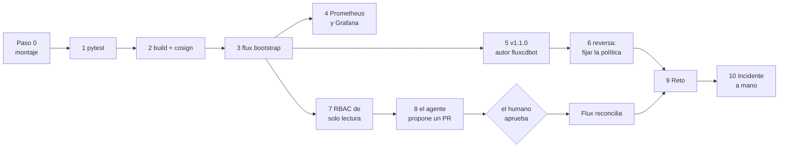
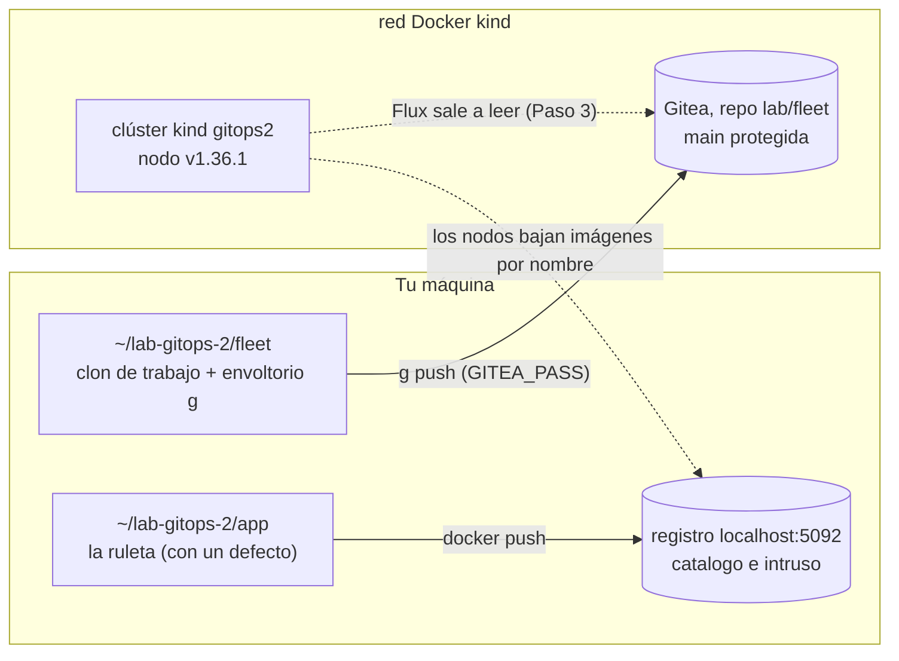
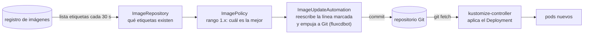
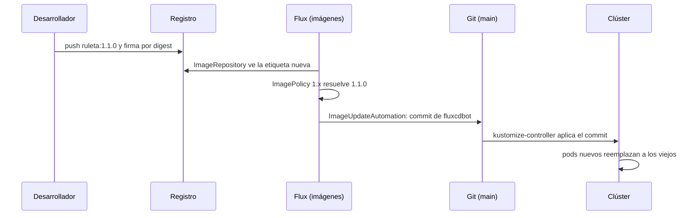
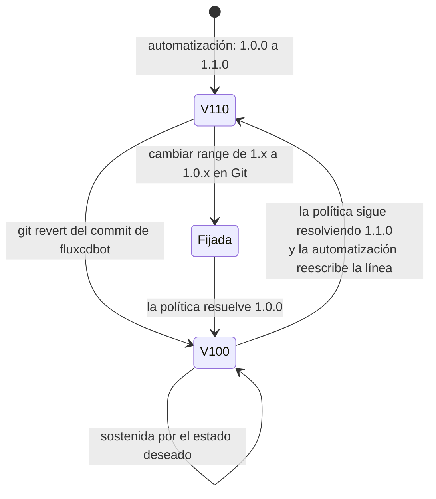
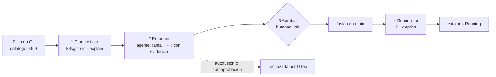

# Laboratorio 2 (Módulo 8) – La ruleta de extremo a extremo y el agente que propone

**Módulo 8 · sesión 14 · en clase · 160–185 minutos.** En el laboratorio 1 construiste la
mecánica de GitOps con una aplicación de juguete. Hoy la usas con una aplicación de verdad, la
**ruleta** (una pequeña aplicación web en Flask que gira entre 2 y 10 valores), y recorres todo
su ciclo de vida: una prueba automática que protege el código, una imagen construida y
**firmada por digest**, Flux que se instala desde Git, una versión nueva (`v1.1.0`, de fondo
blanco) que **Flux detecta y confirma solo**, un tablero de Grafana que muestra la transición
y una reversa que, si la haces a medias, **se deshace sola**. Con esos cimientos en pie le
pones encima la IA: **K8sGPT** diagnostica, un agente abre un *pull request* con evidencia, y
**tú, el humano, apruebas**. Al final, un verificador califica el estado de un sistema que
alguien más dañó, igual que el examen, y un último incidente, que nadie te explica, lo
resuelves a mano.

| Bloque | Paso | Tiempo | ¿Se puede dejar para casa? |
|---|---|---|---|
| Clúster `kind`, Gitea y registro locales; herramientas con SHA-256 verificado | 0 | ~10 min | No |
| La red de seguridad: `pytest` en verde sin tocar las pruebas | 1 | ~10 min | No |
| Construir `v1.0.0` y firmarla por digest con `cosign` | 2 | ~15 min | No |
| `flux bootstrap`, y la ruleta entra por Git con automatización de imágenes | 3 | ~15 min | No |
| Observabilidad: Prometheus ve la ruleta y Grafana tiene sus paneles | 4 | ~15 min | Sí |
| `v1.1.0` blanca: el desarrollador solo cambia código, Flux hace el resto | 5 | ~10 min | No |
| Reversa: `git revert` solo no basta, se fija la política | 6 | ~15 min | No |
| El sandbox del agente: una ServiceAccount de solo lectura, por Git | 7 | ~10 min | No |
| El agente propone, el humano aprueba, GitOps reconcilia | 8 | ~20 min | No |
| **Reto** estilo examen, calificado por script | 9 | ~25 min | No |
| **Incidente** en producción, a mano y calificado por el mismo script | 10 | ~20–25 min | No |

> La tesis del módulo cabe en una línea: **el agente propone, un humano aprueba, GitOps
> reconcilia.** El laboratorio 1 construyó la tercera pieza. Hoy construyes las otras dos y ves
> por qué ninguna de las tres funciona sola: sin cimientos (pruebas, firma, observabilidad,
> reversa que sobrevive) el agente solo acelera los errores.



---

## Cómo trabajar este laboratorio

Este laboratorio usa las mismas cuatro técnicas de enseñanza que el laboratorio 1.

| Técnica | Lo que te pide | De dónde sale |
|---|---|---|
| **Predice, ejecuta, explica** | Antes de cada bloque marcado **🔮 Predice**, escribe en `predicciones.md` qué crees que va a pasar. Después compara. | PRIMM (Sentance y Waite, 2019) y Predict-Observe-Explain (White y Gunstone, 1992) |
| **Fallo productivo** | Varios pasos te hacen romper algo **a propósito** (una prueba recortada, una bandera que ya no existe, un `git revert` a medias, un agente que se aprueba solo) antes de ver la forma correcta. El error es el material. | Productive Failure (Kapur, 2008) |
| **Andamiaje que se retira** | Los pasos 1 a 8 te dan el comando. El Paso 9 solo te da el objetivo y un script que califica el resultado, igual que el examen. El Paso 10 no te da ni el comando ni la causa: solo los síntomas. | Efecto del ejemplo resuelto y reversión por experticia (Sweller; Kalyuga et al., 2003) |
| **Práctica de recuperación** | Al final respondes de memoria, sin releer. Recordar cuesta más que releer, y por eso fija más. | Test-Enhanced Learning (Roediger y Karpicke, 2006) |

```bash
mkdir -p ~/lab-gitops-2-notas && cd ~/lab-gitops-2-notas
echo "# Predicciones del laboratorio 2 (módulo 8)" > predicciones.md
```
**Salida real de esta máquina:**

```

```

Una predicción equivocada que escribiste vale más que una correcta que solo pensaste: es la
que te obliga a revisar tu modelo mental. Nadie la califica.

---

## Objetivo

Al terminar vas a poder responder, señalando evidencia en tu terminal:

1. ¿Por qué el `pytest` es la primera compuerta del ciclo, y qué atajo (editar las pruebas)
   detecta el calificador aunque `pytest` quede en verde?
2. ¿Por qué se firma el **digest** de una imagen y no su etiqueta, y cómo sabes que tu
   verificación controla algo (una imagen `intruso` nunca firmada)?
3. ¿Qué tres objetos de Flux (`ImageRepository`, `ImagePolicy`, `ImageUpdateAutomation`) hacen
   que una versión nueva llegue al clúster sin que nadie toque Git, y qué línea del
   Deployment es lo único que la automatización sabe reescribir?
4. ¿Cómo ves la transición de `v1.0.0` a `v1.1.0` en Prometheus y Grafana, y por qué un
   `ServiceMonitor` existente puede no ser leído por nadie?
5. ¿Por qué `git revert` **solo** no revierte una versión desplegada por automatización, y
   qué cambio en Git sí lo sostiene?
6. ¿Qué puede y qué no puede hacer una ServiceAccount de solo lectura, y cómo lo demuestras
   con `kubectl auth can-i`?
7. ¿Qué parte del trabajo del agente es determinista (K8sGPT sin `--explain`), dónde entraría
   un modelo de lenguaje, y qué mecanismo impide que el agente apruebe su propio cambio?
8. Dado un incidente con varias causas y solo síntomas, ¿cómo lo investigas con la evidencia
   que ya sabes leer (Git, Prometheus, `kubectl`, K8sGPT) y cómo dejas una corrección que
   un verificador no pueda confundir con un atajo?

**Requisito:** el laboratorio 1 (Flux, `git revert`, `cosign` por digest) y los módulos 5 a 7.
Este laboratorio **no usa claves de API de ningún servicio**: el agente es un script
determinista, y K8sGPT corre sin `--explain`.

**Entorno verificado** (el 6 de noviembre de 2026, en la máquina donde se capturaron las
salidas): Linux, Docker 29.9.3, `kind` v0.33.0, `kubectl` cliente v1.37.0, nodo
`kindest/node:v1.36.1`, Flux 2.10.0, `cosign` 3.1.3, K8sGPT 0.4.41, Gitea 1.27.2 y
`registry:3`. El montaje baja las herramientas **fijadas por versión y con la suma SHA-256
del lanzamiento oficial verificada** a `~/lab-gitops-2/bin`, sin tocar las que ya tengas.
Necesitas Docker sin `sudo`, `kind`, `kubectl`, `git`, `curl`, `tar`, `sha256sum` y `python3`
con `venv` en el `PATH`, unos **8 GiB de RAM libres** (la pila de monitoreo es pesada), los
puertos `3092` y `5092` de `127.0.0.1` libres, y salida a internet durante el montaje y los
pasos 2 y 4 (imágenes y paquetes). El laboratorio crea el clúster `gitops2` y los
contenedores `gitops2-gitea` y `gitops2-registry`; no toca ningún otro.

Comprueba tus versiones antes de empezar; si difieren, las salidas pueden variar en detalle:

```bash
kind version
kubectl version --client | head -1
docker version --format '{{.Server.Version}}'
git --version
free -g | sed -n 2p
```
**Salida real de esta máquina:**

```
kind v0.33.0 go1.26.7 linux/amd64
Client Version: v1.37.0
29.9.3
git version 2.43.0
Mem:              62          12          38           0          11          49
```

> Todas las salidas marcadas **«Salida real de esta máquina»** se capturaron ejecutando los
> comandos. Los nombres de Pods, IPs, hashes (SHA), digests y tiempos serán **distintos en tu
> máquina**; la forma de la salida no.

---

## Paso 0: Un clúster, un servidor Git, un registro y la ruleta, todo local (10 min)

El script `montar.sh` (en `modulo8/laboratorio-gitops-2/` de este repositorio) crea lo mismo
que el del laboratorio 1 y algo más: un usuario `agente` en Gitea (con su propio *token*), una
**rama `main` protegida** (solo `lab` empuja y fusiona, y toda fusión exige una aprobación de
otra persona), una copia de la ruleta con un defecto sembrado y los scripts del agente.



La contraseña de Gitea la **inventas tú** y viaja solo en una variable de entorno. No se
escribe en ningún archivo del repositorio. Corre el montaje (tarda un minuto; guarda su
registro completo en `~/lab-gitops-2-notas/montar.log` y aquí solo vemos el final). Si aún no
tienes el repositorio, clónalo primero (`git clone https://github.com/lfarizav/topicos-especiales.git ~/topicos-especiales`);
si lo tienes en otra carpeta, haz `cd` a su carpeta `modulo8` en lugar de la que aparece abajo.

```bash
mkdir -p ~/lab-gitops-2-notas
cd ~/topicos-especiales/modulo8
export GITEA_PASS="${GITEA_PASS:-$(head -c 15 /dev/urandom | base64 | tr -d '/+=')}"
echo "GITEA_PASS tiene ${#GITEA_PASS} caracteres"
export MAT="$PWD/laboratorio-gitops-2"
"$MAT/montar.sh" > ~/lab-gitops-2-notas/montar.log 2>&1; echo "montaje rc=$?"
tail -n 4 ~/lab-gitops-2-notas/montar.log
```
**Salida real de esta máquina:**

```
GITEA_PASS tiene 22 caracteres
montaje rc=0
kubectl cluster-info --context kind-gitops2 --kubeconfig /home/lfarizav/lab-gitops-2/kubeconfig
Have a question, bug, or feature request? Let us know! https://kind.sigs.k8s.io/#community 🙂
MONTAJE LISTO. Gitea: http://172.18.0.9:3000/lab/fleet.git  Registro: localhost:5092  Carpeta: /home/lfarizav/lab-gitops-2
```

Si algo falla, el script se detiene con un código que dice **qué** falló (`PUERTO-OCUPADO`,
`CONTRASENA`, `SUMA-SHA256`, `SUSTRATO-SIN-RUTA-A-GITEA`...) y qué hacer después: corrige la
causa y **vuelve a correr el mismo `montar.sh`**. Es repetible: si encuentra un montaje anterior
(completo o a medias) lo desmonta y empieza de cero, así que no necesitas limpiar a mano. El
archivo `~/lab-gitops-2/env.sh` se escribe al principio del montaje, no al final. Cada terminal nueva que abras
necesita el entorno del laboratorio y la contraseña (`export GITEA_PASS=...` con la **misma**
que usaste en el montaje):

```bash
source ~/lab-gitops-2/env.sh
kubectl get nodes
docker ps --filter name=gitops2 --format '{{.Names}}  {{.Ports}}'
flux --version; cosign version 2>&1 | grep GitVersion; k8sgpt version
```
**Salida real de esta máquina:**

```
NAME                    STATUS   ROLES           AGE   VERSION
gitops2-control-plane   Ready    control-plane   36s   v1.36.1
gitops2-registry  127.0.0.1:5092->5000/tcp
gitops2-gitea  2222/tcp, 127.0.0.1:3092->3000/tcp
gitops2-control-plane  127.0.0.1:43347->6443/tcp
flux version 2.10.0
GitVersion:    v3.1.3
k8sgpt: 0.4.41 (3644ecf), built at: unknown
```

Todos los bloques de este laboratorio empiezan con `source ~/lab-gitops-2/env.sh`. Eso
define `W` (la carpeta del laboratorio), el `PATH` con las herramientas fijadas y el
kubeconfig **privado** (`~/lab-gitops-2/kubeconfig`), de modo que nunca toques otro clúster
por accidente. Y `g` es un envoltorio de `git` sobre el clon `~/lab-gitops-2/fleet`:

```bash
git config --show-origin --get-all credential.helper
cat ~/lab-gitops-2/bin/g
```
**Salida real de esta máquina:**

```
file:/home/lfarizav/.gitconfig	store
#!/bin/bash
: "${GITEA_PASS:?haga export GITEA_PASS antes}"
W="$HOME/lab-gitops-2"
exec git -C "$W/fleet" -c credential.helper= -c credential.helper='!f() { echo username=lab; echo "password=$GITEA_PASS"; }; f' "$@"
```

La contraseña la lee de `GITEA_PASS` y ignora el `credential.helper` global (el primero que
imprimió el comando, `store`), que podría guardar la contraseña de otro laboratorio para la
misma IP y hacer fallar el primer `push`.

---

## Paso 1: La red de seguridad, `pytest` en verde sin tocar las pruebas (10 min)

Un ciclo de vida empieza antes de Git: con una prueba que dice si el código sirve. La ruleta
vive en `~/lab-gitops-2/app`. Su regla: gira entre **2 y 10 valores**. El montaje le sembró un
defecto (una cortesía para que diagnostiques en lugar de leer la respuesta). No lo busques
leyendo el código: corre las pruebas y deja que ellas te lo digan.

🔮 **Predice:** hay 17 pruebas. ¿Cuántas fallan, y qué te dice el *nombre* de las que fallan
sobre dónde está el defecto?

```bash
cd ~/lab-gitops-2/app
"$HOME/lab-gitops-2/venv/bin/pytest" -q -p no:cacheprovider 2>&1 | tail -n 9
```
**Salida real de esta máquina:**

```

tests/test_ruleta.py:18: AssertionError
=========================== short test summary info ============================
FAILED tests/test_api.py::test_girar_con_un_valor_da_400 - AssertionError: as...
FAILED tests/test_ruleta.py::test_fuera_de_rango_se_rechaza[0] - AssertionErr...
FAILED tests/test_ruleta.py::test_fuera_de_rango_se_rechaza[1] - AssertionErr...
FAILED tests/test_ruleta.py::test_fuera_de_rango_se_rechaza[11] - Failed: DID...
FAILED tests/test_ruleta.py::test_fuera_de_rango_se_rechaza[50] - AssertionEr...
5 failed, 12 passed in 0.07s
```

Cinco rojas, y todas hablan de **límites**: los valores 0, 1, 11 y 50, y la API con un solo
valor. El código acepta algo que la regla rechaza.

**Fallo productivo.** La tentación es borrar o recortar las pruebas incómodas. Pruébalo: el
calificador no mira si `pytest` queda en verde, mira la huella SHA-256 de la carpeta `tests/`
contra la que dejó el montaje.

```bash
cd ~/lab-gitops-2/app
cp tests/test_ruleta.py ~/lab-gitops-2/.test_ruleta.bak
sed -i 's/\[0, 1, 11, 50\]/[0]/' tests/test_ruleta.py
bash ~/lab-gitops-2/comprobar/t1.sh; echo "exit=$?"
cp ~/lab-gitops-2/.test_ruleta.bak tests/test_ruleta.py
```
**Salida real de esta máquina:**

```
FALLA: las pruebas fueron modificadas; arregle el codigo, no las pruebas
exit=1
```

Restauraste el archivo en la última línea. Arregla el **código**: el límite superior está
mal escrito.

```bash
cd ~/lab-gitops-2/app
grep -n "MAX_VALORES = " ruleta.py
sed -i 's/MAX_VALORES = 2, 11/MAX_VALORES = 2, 10/' ruleta.py
"$HOME/lab-gitops-2/venv/bin/pytest" -q -p no:cacheprovider | tail -n 2
bash ~/lab-gitops-2/comprobar/t1.sh; echo "exit=$?"
```
**Salida real de esta máquina:**

```
4:MIN_VALORES, MAX_VALORES = 2, 11
.................                                                        [100%]
17 passed in 0.06s
ok
exit=0
```

`17 passed` y `ok`. El calificador `t1.sh` exige tres cosas: 17 pruebas en verde, `tests/`
intacta y que `validar()` rechace listas de 1 y de 11 valores. Es la primera vez que ves el
patrón que se repite en el laboratorio: **un calificador mira el estado, no el camino**.

---

## Paso 2: Construir `v1.0.0` y firmarla por digest con `cosign` (15 min)

Con las pruebas en verde, la imagen. El `Dockerfile` es multietapa y corre con un usuario sin
privilegios. Se construye, se sube al registro local y se pregunta al **registro** (no a tu
Docker local) cuál es el digest, la huella inmutable del contenido:

```bash
source ~/lab-gitops-2/env.sh
cd ~/lab-gitops-2/app
docker build -q --provenance=false --build-arg VERSION=1.0.0 -t localhost:5092/ruleta:1.0.0 .
docker push localhost:5092/ruleta:1.0.0 | tail -n 1
D=localhost:5092/ruleta@$(digest_de ruleta 1.0.0)
echo "$D"
```
**Salida real de esta máquina:**

```
sha256:9c9678c0af96abbf79b829da6b482128b643a4591a8513b19be3f5d69634c2b5
1.0.0: digest: sha256:9c9678c0af96abbf79b829da6b482128b643a4591a8513b19be3f5d69634c2b5 size: 2189
localhost:5092/ruleta@sha256:9c9678c0af96abbf79b829da6b482128b643a4591a8513b19be3f5d69634c2b5
```

La llave la generas tú, **fuera de cualquier carpeta de Git** (`~/lab-gitops-2/llaves`), y la
llave privada jamás se confirma. Sin contraseña, solo porque es una llave desechable de
laboratorio:

```bash
source ~/lab-gitops-2/env.sh
cd ~/lab-gitops-2/llaves
COSIGN_PASSWORD="" cosign generate-key-pair
ls -l cosign.key cosign.pub | awk '{print $1, $5, $NF}'
```
**Salida real de esta máquina:**

```
Private key written to cosign.key
Public key written to cosign.pub
-rw------- 653 cosign.key
-rw-r--r-- 178 cosign.pub
```

🔮 **Predice:** vas a firmar el digest con las banderas que usaste en el laboratorio 1
(`--tlog-upload=false`). ¿Qué esperas que pase con `cosign` 3.1.3?

```bash
source ~/lab-gitops-2/env.sh
cd ~/lab-gitops-2/llaves
D=localhost:5092/ruleta@$(digest_de ruleta 1.0.0)
COSIGN_PASSWORD="" cosign sign --yes --key cosign.key --allow-insecure-registry --tlog-upload=false "$D" 2>&1 | cut -c1-230
```
**Salida real de esta máquina:**

```
Flag --tlog-upload has been deprecated, prefer using a --signing-config file with no transparency log services
Error: --tlog-upload=false is not supported with --signing-config or --use-signing-config. Provide a signing config with --signing-config without a transparency log service, which can be created with `cosign signing-config create`
error during command execution: --tlog-upload=false is not supported with --signing-config or --use-signing-config. Provide a signing config with --signing-config without a transparency log service, which can be created with `cosi
```

**Fallo productivo.** `cosign` 3 prefiere una *signing config* y rechaza la bandera vieja
cuando se usa sola. Como el registro habla HTTP y no hay red de Sigstore en el laboratorio, se
le dice que no use la configuración pública (`--use-signing-config=false`) y que no suba nada
al registro de transparencia. En producción usarías firma sin llaves con identidad OIDC; la
llave desechable es el sustituto honesto.

```bash
source ~/lab-gitops-2/env.sh
cd ~/lab-gitops-2/llaves
D=localhost:5092/ruleta@$(digest_de ruleta 1.0.0)
COSIGN_PASSWORD="" cosign sign --yes --key cosign.key --allow-insecure-registry --use-signing-config=false --tlog-upload=false "$D" 2>&1 | tail -n 2
curl -s localhost:5092/v2/ruleta/tags/list
```
**Salida real de esta máquina:**

```
Signing artifact...
Pushing signature to: localhost:5092/ruleta
{"name":"ruleta","tags":["1.0.0","sha256-9c9678c0af96abbf79b829da6b482128b643a4591a8513b19be3f5d69634c2b5"]}
```

La firma quedó guardada **en el registro**, como una etiqueta más (`sha256-...`) pegada al
digest que firmaste. Ahora la prueba que da sentido a la firma: una verificación que nunca
falla no controla nada. El montaje subió una imagen `intruso` que **nunca se firmó**.

```bash
source ~/lab-gitops-2/env.sh
cd ~/lab-gitops-2/llaves
D=localhost:5092/ruleta@$(digest_de ruleta 1.0.0)
cosign verify --key cosign.pub --insecure-ignore-tlog --allow-insecure-registry "$D" 2>&1 | tail -n 5 | cut -c1-200; echo "exit=${PIPESTATUS[0]}"
DI=$(curl -fsI -H 'Accept: application/vnd.oci.image.index.v1+json,application/vnd.oci.image.manifest.v1+json,application/vnd.docker.distribution.manifest.v2+json' http://127.0.0.1:5092/v2/intruso/manifests/1.0.0 | tr -d '\r' | awk -F': ' 'tolower($1)=="docker-content-digest"{print $2}')
cosign verify --key cosign.pub --insecure-ignore-tlog --allow-insecure-registry localhost:5092/intruso@$DI 2>&1 | tail -n 2; echo "exit=${PIPESTATUS[0]}"
bash ~/lab-gitops-2/comprobar/t2.sh; echo "exit=$?"
```
**Salida real de esta máquina:**

```
  - The cosign claims were validated
  - Existence of the claims in the transparency log was verified offline
  - The signatures were verified against the specified public key

[{"critical":{"identity":{"docker-reference":"localhost:5092/ruleta@sha256:9c9678c0af96abbf79b829da6b482128b643a4591a8513b19be3f5d69634c2b5"},"image":{"docker-manifest-digest":"sha256:9c9678c0af96abbf
exit=0
Error: no signatures found
error during command execution: no signatures found
exit=10
ok
exit=0
```

La imagen firmada sale con `exit=0`. La `intruso` sale con `no signatures found` y `exit=10`.
Se firma el **digest**, nunca la etiqueta: una etiqueta se puede mover a otra imagen, un digest
no. Guarda este dato, porque en el Paso 5 verás una limitación honesta de Flux.

---

## Paso 3: `flux bootstrap`, y la ruleta entra por Git con automatización de imágenes (15 min)

Haz que el clúster se gobierne solo desde Git. Igual que en el laboratorio 1, pero con una
diferencia: esta vez Flux instala **dos controladores más**, los de imágenes
(`image-reflector-controller` e `image-automation-controller`). Sin ellos no existirían los
tipos `ImageRepository`, `ImagePolicy` ni `ImageUpdateAutomation`.



🔮 **Predice:** vas a repetir el `flux bootstrap` del laboratorio 1 con una bandera menos
(sin `--token-auth`) y con un límite de 40 segundos. ¿Qué crees que pasa?

```bash
source ~/lab-gitops-2/env.sh
timeout 40 flux bootstrap git --url="http://$GIP:3000/lab/fleet.git" --allow-insecure-http \
  --username=lab --password "$GITEA_PASS" --branch=main --path=clusters/m08 \
  --components-extra=image-reflector-controller,image-automation-controller \
  --author-name=Flux --author-email=flux@example.com --interval=30s --silent < /dev/null 2>&1 | tail -n 6
echo "exit=${PIPESTATUS[0]}"
```
**Salida real de esta máquina:**

```
► pushing component manifests to "http://172.18.0.9:3000/lab/fleet.git"
► installing components in "flux-system" namespace
✔ installed components
✔ reconciled components
► determining if source secret "flux-system/flux-system" exists
► generating source secret
exit=124
```

**Fallo productivo.** `exit=124` es el código de `timeout`: se colgó en
`generating source secret`. Sin `--token-auth`, Flux intenta escanear una llave SSH al puerto
3000, que es HTTP. Los controladores sí quedaron instalados; lo que falta es el registro de
Flux en Git. Repite con la bandera correcta:

```bash
source ~/lab-gitops-2/env.sh
flux bootstrap git --url="http://$GIP:3000/lab/fleet.git" --allow-insecure-http \
  --username=lab --password "$GITEA_PASS" --token-auth --branch=main --path=clusters/m08 \
  --components-extra=image-reflector-controller,image-automation-controller \
  --author-name=Flux --author-email=flux@example.com --interval=30s --silent < /dev/null 2>&1 | tail -n 16
echo "exit=${PIPESTATUS[0]}"
```
**Salida real de esta máquina:**

```
✔ committed sync manifests to "main" ("fa8d6955ed8a6da783d4001754f911b564ec9924")
► pushing sync manifests to "http://172.18.0.9:3000/lab/fleet.git"
► applying sync manifests
✔ reconciled sync configuration
◎ waiting for GitRepository "flux-system/flux-system" to be reconciled
✔ GitRepository reconciled successfully
◎ waiting for Kustomization "flux-system/flux-system" to be reconciled
✔ Kustomization reconciled successfully
► confirming components are healthy
✔ helm-controller: deployment ready
✔ image-automation-controller: deployment ready
✔ image-reflector-controller: deployment ready
✔ kustomize-controller: deployment ready
✔ notification-controller: deployment ready
✔ source-controller: deployment ready
✔ all components are healthy
exit=0
```

Seis controladores sanos. Mira, otra vez, qué dejó el arranque **en Git**:

```bash
source ~/lab-gitops-2/env.sh
g pull -q origin main
git -C "$W/fleet" ls-tree -r --name-only HEAD
sed -n '1,40p' "$W/fleet/clusters/m08/flux-system/gotk-sync.yaml"
```
**Salida real de esta máquina:**

```
README.md
clusters/m08/flux-system/gotk-components.yaml
clusters/m08/flux-system/gotk-sync.yaml
clusters/m08/flux-system/kustomization.yaml
# This manifest was generated by flux. DO NOT EDIT.
---
apiVersion: source.toolkit.fluxcd.io/v1
kind: GitRepository
metadata:
  name: flux-system
  namespace: flux-system
spec:
  interval: 30s
  ref:
    branch: main
  secretRef:
    name: flux-system
  url: http://172.18.0.9:3000/lab/fleet.git
---
apiVersion: kustomize.toolkit.fluxcd.io/v1
kind: Kustomization
metadata:
  name: flux-system
  namespace: flux-system
spec:
  interval: 10m0s
  path: ./clusters/m08
  prune: true
  sourceRef:
    kind: GitRepository
    name: flux-system
```

Ahora la ruleta. El material trae una plantilla (`~/lab-gitops-2/plantilla`) con el
`Deployment`, el `Service` y los tres objetos de imágenes. Dos líneas importan:

```bash
source ~/lab-gitops-2/env.sh
grep -n 'image:' "$W/plantilla/apps/ruleta/deployment.yaml"
cat "$W/plantilla/apps/ruleta/imagepolicy.yaml"
```
**Salida real de esta máquina:**

```
23:          image: gitops2-registry:5000/ruleta:1.0.0 # {"$imagepolicy": "flux-system:ruleta"}
apiVersion: image.toolkit.fluxcd.io/v1
kind: ImagePolicy
metadata:
  name: ruleta
  namespace: flux-system
spec:
  imageRepositoryRef:
    name: ruleta
  policy:
    semver:
      range: 1.x
```

La línea `image:` lleva el comentario `# {"$imagepolicy": "flux-system:ruleta"}`. Ese marcador
(un *setter*) es **lo único que la automatización sabe reescribir**. Y la política dice
`range: 1.x`: cualquier versión de la línea 1 sirve, y gana la más alta.

Copia la plantilla al repositorio de flota, confirma y empuja. No ejecutes `kubectl apply`:

```bash
source ~/lab-gitops-2/env.sh
g pull -q --rebase origin main
cp -r "$W/plantilla/apps" "$W/plantilla/clusters" "$W/fleet/"
g add -A && g commit -qm "feat: ruleta v1.0.0 con automatizacion de imagenes" && g push -q origin main
until kubectl -n flux-system get kustomization ruleta >/dev/null 2>&1; do sleep 3; done
kubectl -n flux-system wait kustomization/ruleta --for=condition=Ready --timeout=4m
flux get kustomizations
flux get image policy
kubectl -n ruleta get pods -o custom-columns=NAME:.metadata.name,IMAGE:.spec.containers[0].image,PHASE:.status.phase
```
**Salida real de esta máquina:**

```
kustomization.kustomize.toolkit.fluxcd.io/ruleta condition met
NAME       	REVISION          	SUSPENDED	READY	MESSAGE
flux-system	main@sha1:8555de81	False    	True 	Applied revision: main@sha1:8555de81
ruleta     	main@sha1:8555de81	False    	True 	Applied revision: main@sha1:8555de81
NAME  	IMAGE                       	TAG  	READY	MESSAGE
ruleta	gitops2-registry:5000/ruleta	1.0.0	True 	Latest image tag for gitops2-registry:5000/ruleta resolved to 1.0.0
NAME                      IMAGE                                PHASE
ruleta-65fb77cf47-46g24   gitops2-registry:5000/ruleta:1.0.0   Running
ruleta-65fb77cf47-5jchc   gitops2-registry:5000/ruleta:1.0.0   Running
```

`flux-system` y `ruleta` en `Ready True`, la política resolvió `1.0.0` (la única etiqueta que
existe) y dos pods corren la imagen del registro. Nadie tecleó `kubectl apply`:

```bash
bash ~/lab-gitops-2/comprobar/t3.sh; echo "exit=$?"
```
**Salida real de esta máquina:**

```
ok
exit=0
```

`t3.sh` revisa, entre otras cosas, que `managedFields` del Deployment tenga a
`kustomize-controller` y **no** a `kubectl`, la misma prueba de quién escribió el objeto que
usaste en el laboratorio 1.

---

## Paso 4: Observabilidad, Prometheus ve la ruleta y Grafana tiene sus paneles (15 min)

También la pila de monitoreo entra por Git: `kube-prometheus-stack` como `HelmRelease` de
Flux, más un `ServiceMonitor` que le dice a Prometheus que extraiga `/metrics` de la ruleta
y dos paneles de Grafana (uno del propio Flux y uno de la ruleta, que muestra los pods **por
versión** durante la transición del Paso 5). Antes de copiar nada, mira el detalle que más
sorprende:

```bash
source ~/lab-gitops-2/env.sh
grep -n 'serviceMonitorSelectorNilUsesHelmValues' "$W/observabilidad/monitoring/controllers/kube-prometheus-stack/release.yaml"
cat "$W/observabilidad/monitoring/configs/servicemonitor-ruleta.yaml"
```
**Salida real de esta máquina:**

```
31:        serviceMonitorSelectorNilUsesHelmValues: false  # tomar también el ServiceMonitor de ruleta
apiVersion: monitoring.coreos.com/v1
kind: ServiceMonitor
metadata:
  name: ruleta
spec:
  namespaceSelector:
    matchNames: [ruleta]
  selector:
    matchLabels: {app: ruleta}
  endpoints:
    - {port: http, path: /metrics, interval: 15s}
```

Por defecto, Prometheus solo toma los `ServiceMonitor` que llevan la etiqueta de **su propia**
versión de Helm. Con `serviceMonitorSelectorNilUsesHelmValues: false` toma también el de la
ruleta. Sin esa línea el `ServiceMonitor` existe y **nadie lo lee**: el síntoma es
«0 objetivos» sin ningún error.

Este paso baja muchas imágenes y tarda varios minutos. Si tu máquina o tu red son lentas,
empuja el commit y sigue con el Paso 5 mientras Flux trabaja, y califica al final:

```bash
source ~/lab-gitops-2/env.sh
g pull -q --rebase origin main
cp -r "$W/observabilidad/monitoring" "$W/fleet/"
cp "$W/observabilidad/monitoring.yaml" "$W/fleet/clusters/m08/"
g add -A && g commit -qm "feat: observabilidad (kube-prometheus-stack, ServiceMonitor y paneles)" && g push -q origin main
until kubectl -n flux-system get kustomization monitoring-controllers monitoring-configs >/dev/null 2>&1; do sleep 3; done
kubectl -n flux-system wait kustomization/monitoring-controllers kustomization/monitoring-configs --for=condition=Ready --timeout=15m
```
**Salida real de esta máquina:**

```
kustomization.kustomize.toolkit.fluxcd.io/monitoring-controllers condition met
kustomization.kustomize.toolkit.fluxcd.io/monitoring-configs condition met
```

Cuando esté listo, pregunta a Prometheus (a través del *proxy* de la API de Kubernetes, sin
abrir puertos) si ve los dos pods de la ruleta, qué versión reporta cada uno y si Grafana
está sana:

```bash
source ~/lab-gitops-2/env.sh
P=/api/v1/namespaces/monitoring/services/kube-prometheus-stack-prometheus:9090/proxy/api/v1/query
objetivos() { kubectl get --raw "$P?query=count(up%7Bnamespace%3D%22ruleta%22%7D%3D%3D1)" | python3 -c 'import json,sys;r=json.load(sys.stdin)["data"]["result"];print(r[0]["value"][1] if r else 0)'; }
until [ "$(objetivos)" = 2 ]; do sleep 5; done
echo "objetivos de la ruleta con up==1: $(objetivos)"
kubectl get --raw "$P?query=ruleta_info" | python3 -c 'import json,sys;[print(r["metric"]["pod"], "version", r["metric"]["version"]) for r in json.load(sys.stdin)["data"]["result"]]'
kubectl -n monitoring get configmap -l grafana_dashboard=1 -o name
kubectl get --raw /api/v1/namespaces/monitoring/services/kube-prometheus-stack-grafana:80/proxy/api/health; echo
```
**Salida real de esta máquina:**

```
objetivos de la ruleta con up==1: 2
ruleta-65fb77cf47-5jchc version 1.0.0
ruleta-65fb77cf47-46g24 version 1.0.0
configmap/flux-grafana-dashboards-h82bfhf4h8
configmap/ruleta-grafana-dashboard-9bc48ct457
{
  "database": "ok",
  "version": "13.3.0",
  "commit": "6f8ce3c693b493043ebcd4787566d2b6b118b0f0"
}
```

Dos objetivos, una serie `ruleta_info` por pod con la etiqueta `version`, dos paneles
(`flux-grafana-dashboards` y `ruleta-grafana-dashboard`) y Grafana respondiendo. Si quieres
verlo con tus ojos, `kubectl -n monitoring port-forward svc/kube-prometheus-stack-grafana
3000:80` y abre `http://localhost:3000` (usuario `admin`; la contraseña la generó el chart y está en el Secret
`kube-prometheus-stack-grafana`: `kubectl -n monitoring get secret kube-prometheus-stack-grafana -o jsonpath='{.data.admin-password}' | base64 -d`).

```bash
bash ~/lab-gitops-2/comprobar/t4.sh; echo "exit=$?"
```
**Salida real de esta máquina:**

```
ok
exit=0
```

---

## Paso 5: `v1.1.0` blanca, el desarrollador solo cambia código y Flux hace el resto (10 min)

Ahora el desarrollador cambia **una sola cosa**: el color vive únicamente en
`static/tema.css` (`v1.0.0` fondo negro, `v1.1.0` fondo blanco). Construye la `1.1.0`, súbela
y fírmala por digest. **No toques el repositorio de flota y no ejecutes `flux reconcile`.**



🔮 **Predice:** ¿cuántos segundos pasan entre tu `docker push` y los pods nuevos listos?
Escribe un número antes de mirar.

```bash
source ~/lab-gitops-2/env.sh
cd "$W/app"
sed -i 's/--fondo: #000000;/--fondo: #ffffff;/; s/--texto: #ffffff;/--texto: #111111;/' static/tema.css
cat static/tema.css
docker build -q --provenance=false --build-arg VERSION=1.1.0 -t localhost:5092/ruleta:1.1.0 . > /dev/null
docker push localhost:5092/ruleta:1.1.0 | tail -n 1
D=localhost:5092/ruleta@$(digest_de ruleta 1.1.0)
date +%s > "$W/t0"
cd "$W/llaves" && COSIGN_PASSWORD="" cosign sign --yes --key cosign.key --allow-insecure-registry --use-signing-config=false --tlog-upload=false "$D" 2>&1 | tail -n 1
```
**Salida real de esta máquina:**

```
/* El único sitio donde vive el color. v1.0.0 = fondo negro; v1.1.0 = fondo blanco (#ffffff y texto #111111). */
:root {
  --fondo: #ffffff;
  --texto: #111111;
}
1.1.0: digest: sha256:4cf09122e7fa3398bed8afc4d127c7606adf35337ada2843a4fcad3fb85be577 size: 2189
Signing artifact...
```

Y ahora, solo mirar. Este bloque cronometra cada eslabón de la cadena:

```bash
source ~/lab-gitops-2/env.sh
T0=$(( $(cat "$W/t0") ))
t() { echo "T+$(( $(date +%s) - T0 ))s  $*"; }
until [ "$(kubectl -n flux-system get imagepolicy ruleta -o jsonpath='{.status.latestRef.tag}')" = 1.1.0 ]; do sleep 2; done
t "la ImagePolicy resuelve 1.1.0"
until [ "$(git -C "$W/fleet" -c credential.helper= ls-remote "http://$GIP:3000/lab/fleet.git" refs/heads/main | cut -c1-7)" != "$(git -C "$W/fleet" rev-parse --short=7 HEAD)" ]; do sleep 2; done
t "hay un commit nuevo en Git"
until [ "$(kubectl -n ruleta get deploy ruleta -o jsonpath='{.spec.template.spec.containers[0].image}')" = gitops2-registry:5000/ruleta:1.1.0 ]; do sleep 2; done
t "el Deployment ya pide 1.1.0 (Flux aplicó el commit)"
kubectl -n ruleta rollout status deploy/ruleta --timeout=3m | tail -n 1
t "los pods nuevos están listos"
```
**Salida real de esta máquina:**

```
T+2s  la ImagePolicy resuelve 1.1.0
T+2s  hay un commit nuevo en Git
T+29s  el Deployment ya pide 1.1.0 (Flux aplicó el commit)
deployment "ruleta" successfully rolled out
T+31s  los pods nuevos están listos
```

Compara con tu predicción. El tiempo lo decide la suma de los intervalos de la cadena
(sondeo del registro, automatización, sondeo de Git), no la velocidad de tu máquina. Mira la
evidencia en Git y en los pods:

```bash
source ~/lab-gitops-2/env.sh
g pull -q origin main
git -C "$W/fleet" log --format='%h %an  %s' | head -n 4
git -C "$W/fleet" show HEAD -- apps/ruleta/deployment.yaml | grep -E '^[-+] +image:'
kubectl -n ruleta get pods -o custom-columns=NAME:.metadata.name,IMAGE:.spec.containers[0].image,IMAGEID:.status.containerStatuses[0].imageID
kubectl get --raw /api/v1/namespaces/ruleta/services/ruleta:80/proxy/static/tema.css | grep -- '--fondo'
```
**Salida real de esta máquina:**

```
bc71365 fluxcdbot  chore(ruleta): gitops2-registry:5000/ruleta:1.0.0 -> gitops2-registry:5000/ruleta:1.1.0
6cb92af Alumno del laboratorio  feat: observabilidad (kube-prometheus-stack, ServiceMonitor y paneles)
8555de8 Alumno del laboratorio  feat: ruleta v1.0.0 con automatizacion de imagenes
fa8d695 Flux  Add Flux sync manifests
-          image: gitops2-registry:5000/ruleta:1.0.0 # {"$imagepolicy": "flux-system:ruleta"}
+          image: gitops2-registry:5000/ruleta:1.1.0 # {"$imagepolicy": "flux-system:ruleta"}
NAME                      IMAGE                                IMAGEID
ruleta-65fb77cf47-46g24   gitops2-registry:5000/ruleta:1.0.0   gitops2-registry:5000/ruleta@sha256:9c9678c0af96abbf79b829da6b482128b643a4591a8513b19be3f5d69634c2b5
ruleta-779b64b6f6-c4rnr   gitops2-registry:5000/ruleta:1.1.0   gitops2-registry:5000/ruleta@sha256:4cf09122e7fa3398bed8afc4d127c7606adf35337ada2843a4fcad3fb85be577
ruleta-779b64b6f6-wrtxn   gitops2-registry:5000/ruleta:1.1.0   gitops2-registry:5000/ruleta@sha256:4cf09122e7fa3398bed8afc4d127c7606adf35337ada2843a4fcad3fb85be577
  --fondo: #ffffff;
```

El commit lo escribió **`fluxcdbot`**, no tú, y solo cambió la línea marcada. Durante unos
segundos conviven un pod viejo (`1.0.0`) y dos nuevos (`1.1.0`): es la actualización gradual de
Kubernetes, y es lo que el panel de Grafana de la ruleta dibuja «por versión». Cada `IMAGEID`
termina en el digest que firmaste. La página servida ya es blanca.

**Una limitación honesta.** La automatización de Flux **no verifica firmas**: despliega lo que
la política resuelva, esté firmado o no. Compruébalo en la API del propio clúster:

```bash
source ~/lab-gitops-2/env.sh
echo "campos de ImagePolicy.spec:";  kubectl explain imagepolicy.spec 2>&1 | grep -E '^  [a-zA-Z]+' | awk '{print "  " $1}'
echo "campos de ImageRepository.spec:"; kubectl explain imagerepository.spec 2>&1 | grep -E '^  [a-zA-Z]+' | awk '{print "  " $1}'
kubectl explain imagepolicy.spec.verify 2>&1 | tail -n 1
```
**Salida real de esta máquina:**

```
campos de ImagePolicy.spec:
  digestReflectionPolicy
  enum:
  filterTags
  imageRepositoryRef
  interval
  policy
  suspend
campos de ImageRepository.spec:
  accessFrom
  certSecretRef
  exclusionList
  image
  insecure
  interval
  provider
  enum:
  proxySecretRef
  secretRef
  serviceAccountName
  suspend
  timeout
error: field "verify" does not exist
```

Ningún campo de verificación (el último comando termina en `field "verify" does not exist`).
Quien verifica es **tu calificador**, y por eso exige que los pods corran *exactamente* el
digest firmado. En el Reto verás qué pasa cuando alguien publica una versión sin firma.

```bash
bash ~/lab-gitops-2/comprobar/t5.sh; echo "exit=$?"
```
**Salida real de esta máquina:**

```
ok
exit=0
```

---

## Paso 6: Reversa, `git revert` solo no basta, se fija la política (15 min)

Un compañero reporta que la página blanca molesta: hay que volver a la `1.0.0`. En el
laboratorio 1 el rollback era `git revert`. Pruébalo aquí.



🔮 **Predice:** vas a revertir el commit de `fluxcdbot` y a mirar el Deployment durante un
minuto y medio. ¿Qué imagen crees que tendrá al final?

```bash
source ~/lab-gitops-2/env.sh
g pull -q --rebase origin main
g -c user.name=Alumno -c user.email=alumno@example.com revert --no-edit HEAD | tail -n 1
g push -q origin main
for i in $(seq 1 30); do
  echo "$(kubectl -n ruleta get deploy ruleta -o jsonpath='{.spec.template.spec.containers[0].image}') | politica=$(kubectl -n flux-system get imagepolicy ruleta -o jsonpath='{.status.latestRef.tag}')"
  sleep 3
done | uniq
g pull -q origin main
git -C "$W/fleet" log --format='%h %an  %s' | head -n 4
```
**Salida real de esta máquina:**

```
 1 file changed, 2 insertions(+), 2 deletions(-)
gitops2-registry:5000/ruleta:1.1.0 | politica=1.1.0
gitops2-registry:5000/ruleta:1.0.0 | politica=1.1.0
gitops2-registry:5000/ruleta:1.1.0 | politica=1.1.0
872ea19 fluxcdbot  chore(ruleta): gitops2-registry:5000/ruleta:1.0.0 -> gitops2-registry:5000/ruleta:1.1.0
d197296 Alumno  Revert "chore(ruleta): gitops2-registry:5000/ruleta:1.0.0 -> gitops2-registry:5000/ruleta:1.1.0"
bc71365 fluxcdbot  chore(ruleta): gitops2-registry:5000/ruleta:1.0.0 -> gitops2-registry:5000/ruleta:1.1.0
6cb92af Alumno del laboratorio  feat: observabilidad (kube-prometheus-stack, ServiceMonitor y paneles)
```

**Fallo productivo.** El Deployment bajó a `1.0.0` un momento, pero **la política seguía
resolviendo `1.1.0`**: esa etiqueta existe y cumple el rango `1.x`. En el siguiente intervalo
la automatización reescribió la línea, y el historial lo cuenta: tu `Revert` y, encima,
otro commit de `fluxcdbot` que deshace tu revert. La automatización no te desobedece: el
estado deseado de la política **no cambió**. Un rollback que no cambia el estado deseado no
es un rollback.

Lo que sí funciona es cambiar la política **en Git**, fijando el rango a `1.0.x`. Entonces la
`ImagePolicy` resuelve `1.0.0` y la propia automatización escribe el commit de vuelta:

```bash
source ~/lab-gitops-2/env.sh
g pull -q --rebase origin main
sed -i 's/range: 1.x/range: 1.0.x/' "$W/fleet/apps/ruleta/imagepolicy.yaml"
g commit -qam "chore(policy): fijar ruleta a 1.0.x (rollback)" && g push -q origin main
until [ "$(kubectl -n flux-system get imagepolicy ruleta -o jsonpath='{.status.latestRef.tag}')" = 1.0.0 ]; do sleep 3; done
until [ "$(kubectl -n ruleta get deploy ruleta -o jsonpath='{.spec.template.spec.containers[0].image}')" = gitops2-registry:5000/ruleta:1.0.0 ]; do sleep 3; done
kubectl -n ruleta rollout status deploy/ruleta --timeout=3m | tail -n 1
```
**Salida real de esta máquina:**

```
deployment "ruleta" successfully rolled out
```

Ahora la prueba de que **sobrevive**: espera más de dos intervalos de la automatización y
mira si algo vuelve a moverse.

```bash
source ~/lab-gitops-2/env.sh
sleep 75
g pull -q origin main
git -C "$W/fleet" log --format='%h %an  %s' | head -n 4
kubectl -n ruleta get pods -o custom-columns=NAME:.metadata.name,IMAGE:.spec.containers[0].image
kubectl get --raw /api/v1/namespaces/ruleta/services/ruleta:80/proxy/static/tema.css | grep -- '--fondo'
bash ~/lab-gitops-2/comprobar/t6.sh; echo "exit=$?"
```
**Salida real de esta máquina:**

```
1dc2c8b fluxcdbot  chore(ruleta): gitops2-registry:5000/ruleta:1.1.0 -> gitops2-registry:5000/ruleta:1.0.0
3c6ed7c Alumno del laboratorio  chore(policy): fijar ruleta a 1.0.x (rollback)
872ea19 fluxcdbot  chore(ruleta): gitops2-registry:5000/ruleta:1.0.0 -> gitops2-registry:5000/ruleta:1.1.0
d197296 Alumno  Revert "chore(ruleta): gitops2-registry:5000/ruleta:1.0.0 -> gitops2-registry:5000/ruleta:1.1.0"
NAME                      IMAGE
ruleta-65fb77cf47-f28ww   gitops2-registry:5000/ruleta:1.0.0
ruleta-65fb77cf47-xnrzq   gitops2-registry:5000/ruleta:1.0.0
  --fondo: #000000;
ok
exit=0
```

El commit de `fluxcdbot` dice `1.1.0 -> 1.0.0`, ningún commit nuevo apareció, los pods siguen en
`1.0.0` y la página volvió a ser negra. `t6.sh` castiga los atajos: **suspender** la
automatización (apaga el control en lugar de usarlo), **borrarla**, **borrar la etiqueta
`1.1.0`** del registro (borra evidencia) o `kubectl edit` (Flux lo deshace). Y exige haber
esperado dos intervalos después del último commit antes de dar el rollback por bueno.

---

## Paso 7: El sandbox del agente, una ServiceAccount de solo lectura, por Git (10 min)

Antes de que un agente toque el clúster hay que decidir **qué puede hacer**. Empieza por ver
por qué no basta con «darle tu kubeconfig»:

```bash
source ~/lab-gitops-2/env.sh
kubectl auth can-i delete pods -n tienda
kubectl auth can-i '*' '*' --all-namespaces
```
**Salida real de esta máquina:**

```
yes
yes
```

**Fallo productivo.** Eres administrador: `yes` y `yes`. Un agente con tu kubeconfig puede
borrarlo todo. El agente necesita **su propia identidad**, con permisos mínimos, y como todo
lo demás, esa identidad **entra por Git** y la gestiona Flux. Reglas: solo los verbos `get`,
`list` y `watch`; sobre pods, eventos, servicios, Deployments y poco más; **nunca**
`secrets`, `pods/exec` ni un verbo de escritura.

```bash
source ~/lab-gitops-2/env.sh
g pull -q --rebase origin main
mkdir -p "$W/fleet/apps/agentes"
cat > "$W/fleet/apps/agentes/rbac.yaml" <<'EOF'
apiVersion: v1
kind: Namespace
metadata:
  name: agentes
---
apiVersion: v1
kind: ServiceAccount
metadata:
  name: agente
  namespace: agentes
---
apiVersion: rbac.authorization.k8s.io/v1
kind: ClusterRole
metadata:
  name: agente-lectura
rules:
  - apiGroups: [""]
    resources: [pods, pods/log, events, services, endpoints, namespaces, nodes, configmaps, persistentvolumeclaims]
    verbs: [get, list, watch]
  - apiGroups: [apps]
    resources: [deployments, replicasets, statefulsets, daemonsets]
    verbs: [get, list, watch]
  - apiGroups: [networking.k8s.io]
    resources: [ingresses, networkpolicies]
    verbs: [get, list, watch]
---
apiVersion: rbac.authorization.k8s.io/v1
kind: ClusterRoleBinding
metadata:
  name: agente-lectura
roleRef: {apiGroup: rbac.authorization.k8s.io, kind: ClusterRole, name: agente-lectura}
subjects:
  - {kind: ServiceAccount, name: agente, namespace: agentes}
EOF
printf 'apiVersion: kustomize.config.k8s.io/v1beta1\nkind: Kustomization\nresources:\n  - rbac.yaml\n' > "$W/fleet/apps/agentes/kustomization.yaml"
cat > "$W/fleet/clusters/m08/agentes.yaml" <<'EOF'
apiVersion: kustomize.toolkit.fluxcd.io/v1
kind: Kustomization
metadata: {name: agentes, namespace: flux-system}
spec:
  interval: 30s
  prune: true
  sourceRef: {kind: GitRepository, name: flux-system}
  path: ./apps/agentes
EOF
g add -A && g commit -qm "feat(agentes): ServiceAccount de solo lectura" && g push -q origin main
until kubectl -n flux-system get kustomization agentes >/dev/null 2>&1; do sleep 3; done
kubectl -n flux-system wait kustomization/agentes --for=condition=Ready --timeout=3m
```
**Salida real de esta máquina:**

```
kustomization.kustomize.toolkit.fluxcd.io/agentes condition met
```

La prueba se hace **como la cuenta del agente**, no como tú: `--as=system:serviceaccount:agentes:agente`.
Sin esa bandera, `can-i` evalúa tu cuenta de administrador y responde `yes` a todo.

```bash
source ~/lab-gitops-2/env.sh
SA=system:serviceaccount:agentes:agente
for v in "get pods -n tienda" "list deployments.apps -n tienda" "list events -n tienda" "patch deployments.apps -n tienda" "delete pods -n tienda" "get secrets -n tienda" "create pods/exec -n tienda"; do
  printf '%-36s -> ' "$v"; kubectl auth can-i $v --as=$SA
done
kubectl get clusterrole agente-lectura -o jsonpath='{.metadata.labels.kustomize\.toolkit\.fluxcd\.io/name}{"\n"}'
bash ~/lab-gitops-2/comprobar/t7.sh; echo "exit=$?"
```
**Salida real de esta máquina:**

```
get pods -n tienda                   -> yes
list deployments.apps -n tienda      -> yes
list events -n tienda                -> yes
patch deployments.apps -n tienda     -> no
delete pods -n tienda                -> no
get secrets -n tienda                -> no
create pods/exec -n tienda           -> no
agentes
ok
exit=0
```

Lee, pero no escribe, no lee secretos y no entra a un contenedor. La etiqueta
`kustomize.toolkit.fluxcd.io/name: agentes` demuestra que el rol lo gestiona Flux, no un
`kubectl` a escondidas. Esta es la capa de **RBAC**: acota lo que el servidor de la API
*responde*. Una lista de herramientas permitidas (*allowlist*, como la de kagent) es otra capa
distinta, que acota lo que el agente puede *pedir*. Hacen falta las dos.

---

## Paso 8: El agente propone, el humano aprueba, GitOps reconcilia (20 min)

Otro equipo (la tienda) publica en Git un cambio con un error: un Deployment `catalogo` cuya
imagen apunta a una etiqueta que no existe. El flujo completo tiene cuatro momentos:
**diagnosticar, proponer, aprobar, reconciliar**.



### 8.1 Otro equipo rompe algo

```bash
source ~/lab-gitops-2/env.sh
bash "$W/agente/inyectar-falla.sh"
until kubectl -n tienda get pods 2>/dev/null | grep -Eq 'ErrImagePull|ImagePullBackOff'; do sleep 3; done
kubectl -n tienda get pods
```
**Salida real de esta máquina:**

```
Cambio de tienda publicado en main.
NAME                       READY   STATUS         RESTARTS   AGE
catalogo-7df779fb4-78m9z   0/1     ErrImagePull   0          3s
```

### 8.2 Diagnosticar con K8sGPT, sin modelo y sin claves

K8sGPT corre sus analizadores integrados contra el estado vivo del clúster. **Sin `--explain`
no llama a ningún modelo ni a ningún servicio externo**: es determinista. La IA de K8sGPT solo
entra con `--explain`, que necesita una clave de API que este laboratorio no usa.

```bash
source ~/lab-gitops-2/env.sh
k8sgpt analyze --help | grep -E -- '--explain|--filter|--output'
k8sgpt analyze --filter=Pod --namespace=tienda --output=json --no-cache
```
**Salida real de esta máquina:**

```
  -e, --explain                  Explain the problem to me
  -f, --filter strings           Filter for these analyzers (e.g. Pod, PersistentVolumeClaim, Service, ReplicaSet)
  -i, --interactive              Enable interactive mode that allows further conversation with LLM about the problem. Works only with --explain flag
  -o, --output string            Output format (text, json) (default "text")
{
  "provider": "",
  "errors": null,
  "status": "ProblemDetected",
  "problems": 1,
  "results": [
    {
      "kind": "Pod",
      "name": "tienda/catalogo-7df779fb4-78m9z",
      "error": [
        {
          "Text": "rpc error: code = NotFound desc = failed to pull and unpack image \"gitops2-registry:5000/catalogo:9.9.9\": failed to resolve reference \"gitops2-registry:5000/catalogo:9.9.9\": gitops2-registry:5000/catalogo:9.9.9: not found",
          "KubernetesDoc": "",
          "Sensitive": []
        }
      ],
      "details": "",
      "parentObject": "Deployment/catalogo"
    }
  ]
}
```

Un problema, con el texto exacto del error y la etiqueta inexistente. (Según cuántos segundos hayan
pasado, el texto puede empezar con `Back-off pulling image ...: ErrImagePull:` y el nombre del Pod
será distinto; lo que importa es `catalogo:9.9.9` y `not found`.) Un LLM entraría **aquí**
a explicar la causa en lenguaje natural, pero el hallazgo ya está, y es evidencia
reproducible: el mismo comando da el mismo resultado.

### 8.3 La identidad del agente, y su techo

El humano (tú) genera el kubeconfig del agente con un *token* de una hora de la ServiceAccount
del Paso 7. Verifica que esa identidad ve el problema pero **no puede actuar** sobre él:

```bash
source ~/lab-gitops-2/env.sh
bash "$W/agente/agente-kubeconfig.sh"
export AG="KUBECONFIG=$W/agente.kubeconfig"
env $AG kubectl -n tienda get pods
env $AG kubectl -n tienda delete deploy catalogo
env $AG kubectl auth whoami
```
**Salida real de esta máquina:**

```
kubeconfig del agente listo: /home/lfarizav/lab-gitops-2/agente.kubeconfig
NAME                       READY   STATUS         RESTARTS   AGE
catalogo-7df779fb4-78m9z   0/1     ErrImagePull   0          3s
Error from server (Forbidden): deployments.apps "catalogo" is forbidden: User "system:serviceaccount:agentes:agente" cannot delete resource "deployments" in API group "apps" in the namespace "tienda"
ATTRIBUTE                                           VALUE
Username                                            system:serviceaccount:agentes:agente
UID                                                 a9f25a7e-773f-4573-9bb7-6e50118e4f81
Groups                                              [system:serviceaccounts system:serviceaccounts:agentes system:authenticated]
Extra: authentication.kubernetes.io/credential-id   [JTI=21a30874-2cf2-4f7e-b006-df96a6131274]
```

Ve los pods, `Forbidden` al intentar borrar, y `whoami` confirma que es
`system:serviceaccount:agentes:agente`. El agente **puede ver pero no tocar**. Su única vía
para arreglar algo es proponer un cambio en Git.

### 8.4 El agente propone

El agente de ejemplo (`agente/agente.sh`) es un script **determinista y sin modelo**. Hace
exactamente cinco cosas: corre el triage con el kubeconfig de solo lectura, busca en el
registro una etiqueta que sí existe, abre una rama, cambia **una** línea y abre un *pull
request* con la evidencia en el cuerpo. Al final intenta fusionarlo él mismo.

```bash
source ~/lab-gitops-2/env.sh
bash "$W/agente/agente.sh"
```
**Salida real de esta máquina:**

```
== 1. Triage determinista: k8sgpt analyze SIN --explain (ningun modelo, ninguna llamada externa)
{
  "provider": "",
  "errors": null,
  "status": "ProblemDetected",
  "problems": 1,
  "results": [
    {
      "kind": "Pod",
      "name": "tienda/catalogo-7df779fb4-78m9z",
      "error": [
        {
          "Text": "rpc error: code = NotFound desc = failed to pull and unpack image \"gitops2-registry:5000/catalogo:9.9.9\": failed to resolve reference \"gitops2-registry:5000/catalogo:9.9.9\": gitops2-registry:5000/catalogo:9.9.9: not found",
          "KubernetesDoc": "",
          "Sensitive": []
        }
      ],
      "details": "",
      "parentObject": "Deployment/catalogo"
    }
  ]
}
Hallazgo: la imagen gitops2-registry:5000/catalogo:9.9.9 no se puede bajar
== 2. Causa: la etiqueta no existe en el registro (aqui entraria el LLM a explicar)
{"name":"catalogo","tags":["1.0.0"]}
== 3. Rama y cambio minimo en Git (el agente nunca toca el clúster)
 apps/tienda/deployment.yaml | 2 +-
 1 file changed, 1 insertion(+), 1 deletion(-)
remote:
remote: Create a new pull request for 'agente/arreglo-catalogo':
remote:   http://127.0.0.1:3092/lab/fleet/pulls/new/agente/arreglo-catalogo
remote:
== 4. PR con evidencia (el agente redacta; el humano decide)
PR abierto: http://127.0.0.1:3092/lab/fleet/pulls/1
== 5. Prueba de limites: el agente intenta fusionar su propio PR
respuesta al intento de autofusion: HTTP 405 (se espera 403 o 405; cualquier 2xx seria un fallo de la proteccion)
Ahora le toca al humano: revisar el diff, aprobar y fusionar.
```

El paso 5 dice `HTTP 405`: Gitea rechazó la autofusión. Un agente real con LLM (kagent,
HolmesGPT, `k8sgpt analyze --explain`, un asistente de código) se conecta en los mismos dos
puntos: explicar la causa (paso 2) y redactar el cambio (paso 4). El flujo, los permisos y la
compuerta humana son idénticos; aquí no se ejecutó ninguno porque el laboratorio no usa claves
de API.

### 8.5 El humano revisa

Ahora te toca a ti. Lee el cuerpo del PR y, sobre todo, **el diff**: una línea.

```bash
source ~/lab-gitops-2/env.sh
N=$(curl -s -u "lab:$GITEA_PASS" "$API/repos/lab/fleet/pulls?state=open" | python3 -c 'import json,sys;print([p["number"] for p in json.load(sys.stdin) if p["head"]["ref"].startswith("agente/")][0])')
echo "PR número $N"
curl -s -u "lab:$GITEA_PASS" "$API/repos/lab/fleet/pulls/$N" | python3 -c 'import json,sys;p=json.load(sys.stdin);print(p["title"]);print(p["body"][:900])'
echo "----- diff"
curl -s -u "lab:$GITEA_PASS" "$API/repos/lab/fleet/pulls/$N.diff"
```
**Salida real de esta máquina:**

```
PR número 1
fix(tienda): catalogo apunta a una etiqueta que existe
## Que encontre
`k8sgpt analyze --filter=Pod --namespace=tienda` (sin --explain, determinista) reporta un Pod que no puede bajar la imagen `gitops2-registry:5000/catalogo:9.9.9`.

## Evidencia
```json
{
 "provider": "",
 "errors": null,
 "status": "ProblemDetected",
 "problems": 1,
 "results": [
  {
   "kind": "Pod",
   "name": "tienda/catalogo-7df779fb4-78m9z",
   "error": [
    {
     "Text": "rpc error: code = NotFound desc = failed to pull and unpack image \"gitops2-registry:5000/catalogo:9.9.9\": failed to resolve reference \"gitops2-registry:5000/catalogo:9.9.9\": gitops2-registry:5000/catalogo:9.9.9: not found",
     "KubernetesDoc": "",
     "Sensitive": []
    }
   ],
   "details": "",
   "parentObject": "Deployment/catalogo"
  }
 ]
}
```
- Etiquetas que SI existen en el registro para `gitops2-registry:5000/catalogo`: `1.0.0` (digest `sha256:7a3ebe5bfd1a4a19797d20b0c0bb39d44393e
----- diff
diff --git a/apps/tienda/deployment.yaml b/apps/tienda/deployment.yaml
index d5bfcde..786d510 100644
--- a/apps/tienda/deployment.yaml
+++ b/apps/tienda/deployment.yaml
@@ -14,5 +14,5 @@ spec:
     spec:
       containers:
         - name: catalogo
-          image: gitops2-registry:5000/catalogo:9.9.9
+          image: gitops2-registry:5000/catalogo:1.0.0
           command: ["sleep", "3600"]
```

### 8.6 La compuerta humana

🔮 **Predice:** `main` exige una aprobación de **otra persona** y solo `lab` puede fusionar.
Si intentas fusionar sin aprobar, ¿qué responde Gitea? Y si el agente intenta aprobar su
propio PR, ¿qué responde?

```bash
source ~/lab-gitops-2/env.sh
N=$(curl -s -u "lab:$GITEA_PASS" "$API/repos/lab/fleet/pulls?state=open" | python3 -c 'import json,sys;print([p["number"] for p in json.load(sys.stdin) if p["head"]["ref"].startswith("agente/")][0])')
echo "humano, sin aprobar:"
curl -s -w ' [HTTP %{http_code}]\n' -u "lab:$GITEA_PASS" -X POST "$API/repos/lab/fleet/pulls/$N/merge" -H 'Content-Type: application/json' -d '{"Do":"merge"}'
echo "agente, aprobándose a sí mismo:"
curl -s -w ' [HTTP %{http_code}]\n' -X POST "$API/repos/lab/fleet/pulls/$N/reviews" -H "Authorization: token $(cat "$W/llaves/agente.token")" -H 'Content-Type: application/json' -d '{"event":"APPROVED"}'
```
**Salida real de esta máquina:**

```
humano, sin aprobar:
{"message":"Does not have enough approvals","url":"http://127.0.0.1:3092/api/swagger"} [HTTP 405]
agente, aprobándose a sí mismo:
{"message":"approve your own pull is not allowed","url":"http://127.0.0.1:3092/api/swagger"} [HTTP 422]
```

**Fallo productivo, dos veces.** Ni tú, sin aprobar, ni el agente, aprobándose solo, pueden
saltarse la regla. Esa es la «tercera capa» del sandbox: no solo lo que el agente puede
*ver* (RBAC) y *pedir* (allowlist), sino quién puede *dar el visto bueno*.

### 8.7 El humano aprueba, GitOps reconcilia

```bash
source ~/lab-gitops-2/env.sh
N=$(curl -s -u "lab:$GITEA_PASS" "$API/repos/lab/fleet/pulls?state=open" | python3 -c 'import json,sys;print([p["number"] for p in json.load(sys.stdin) if p["head"]["ref"].startswith("agente/")][0])')
curl -s -o /dev/null -w 'aprobar [HTTP %{http_code}]\n' -u "lab:$GITEA_PASS" -X POST "$API/repos/lab/fleet/pulls/$N/reviews" -H 'Content-Type: application/json' -d '{"event":"APPROVED","body":"Revise el diff y la evidencia de k8sgpt"}'
curl -s -o /dev/null -w 'fusionar [HTTP %{http_code}]\n' -u "lab:$GITEA_PASS" -X POST "$API/repos/lab/fleet/pulls/$N/merge" -H 'Content-Type: application/json' -d '{"Do":"merge"}'
until [ "$(kubectl -n tienda get deploy catalogo -o jsonpath='{.status.availableReplicas}')" = 1 ]; do sleep 3; done
kubectl -n tienda get pods
g pull -q origin main
git -C "$W/fleet" log --format='%h %an  %s' | head -n 3
env KUBECONFIG="$W/agente.kubeconfig" k8sgpt analyze --filter=Pod --namespace=tienda --output=json --no-cache | grep -E '"status"|"problems"'
bash ~/lab-gitops-2/comprobar/t8.sh; echo "exit=$?"
```
**Salida real de esta máquina:**

```
aprobar [HTTP 200]
fusionar [HTTP 200]
NAME                        READY   STATUS    RESTARTS   AGE
catalogo-85ccf66bcb-hk5hs   1/1     Running   0          3s
40cfa44 lab  Merge pull request 'fix(tienda): catalogo apunta a una etiqueta que existe' (#1) from agente/arreglo-catalogo into main
b6a1808 agente  fix(tienda): catalogo usa gitops2-registry:5000/catalogo:1.0.0 (la etiqueta 9.9.9 no existe)
1340d62 Equipo tienda  feat(tienda): desplegar catalogo
  "status": "OK",
  "problems": 0,
ok
exit=0
```

Mira el historial: el commit del `agente`, la fusión de `lab`, y un Pod `Running` que **nadie
aplicó con `kubectl`**: lo aplicó Flux. K8sGPT, con la cuenta del agente, ya reporta
`"problems": 0`. Esa es la tesis del módulo completa: el agente propuso, un humano aprobó,
GitOps reconcilió.

---

## Paso 9: Reto estilo examen (25 min)

**Este paso es un laboratorio estilo examen.** No hay comandos: hay un objetivo, un sistema
que alguien más tocó y un script que califica **el estado final**, no lo que tecleaste. Si te
atascas, es el punto, no un error del laboratorio. La solución está al final del documento.

### 9.1 El compañero «ayuda»

Un compañero amplía el rango de la política otra vez a toda la línea `1.x` y publica una
`v1.2.0` **sin firmar**. Recuerda lo del Paso 5: Flux no verifica firmas.

```bash
source ~/lab-gitops-2/env.sh
bash "$MAT/preparar-reto.sh"
```
**Salida real de esta máquina:**

```
Reto preparado: ruleta:1.2.0 está en el registro SIN firma y la política vuelve a permitir 1.x.
```

### 9.2 El verificador

El verificador **ya está en el repositorio**, junto al montaje: `$MAT/verificar-reto.sh`. No
lo escribes tú y no lo editas: es la regla del examen, y una regla que el examinado puede
reescribir no mide nada. Léelo antes de ejecutarlo; es parte de lo que aprendes. No se fía
de lo que dices: lee el clúster, pregunta a Gitea y al registro, verifica firmas con tu llave
pública y espera dos intervalos de la automatización. Con `--reto` ejecuta los 13 chequeos de
este paso; sin argumentos ejecuta además los del Paso 10.

```bash
source ~/lab-gitops-2/env.sh
grep -n '^chequeo "' "$MAT/verificar-reto.sh" | head -n 13 | cut -c1-150
```
**Salida real de esta máquina:**

```
47:chequeo "Los seis controladores de Flux están disponibles" c_flux
48:chequeo "La ImagePolicy resuelve 1.1.0, la versión más nueva FIRMADA" c_politica
49:chequeo "El rango de la política ya no es 1.x y está escrito en Git (no en el clúster)" c_rango
50:chequeo "Todos los pods corren ruleta:1.1.0 y el Deployment está completo" c_pods
51:chequeo "Los pods corren el digest que firmaste, verificado con cosign.pub" c_digest
52:chequeo "La etiqueta 1.2.0 sigue en el registro (no se borró la evidencia)" c_evidencia
53:chequeo "La 1.2.0 sigue SIN firma (no se firmó para taparla)" c_sin_firma
54:chequeo "La automatización existe, está en Git y no está suspendida" c_automatizacion
55:chequeo "Git (main) fija 1.1.0 en el Deployment" c_git
56:chequeo "Pasaron 2 intervalos de la automatización desde el último commit de apps/ruleta" c_aguanta
57:chequeo "El agente sigue sin poder parchear Deployments (el RBAC no se tocó)" c_rbac
58:chequeo "La rama main sigue protegida: solo lab empuja y fusiona, con 1 aprobación" c_proteccion
59:chequeo "catalogo (Paso 8) sigue disponible: el reto no deshizo el trabajo anterior" c_catalogo
```

Abre el archivo completo en tu editor y lee las funciones `c_*`: cada una es la definición
exacta de lo que se te pide. Ahora califícate; el reto está recién preparado, así que parte
de un estado dañado.

```bash
source ~/lab-gitops-2/env.sh
sleep 45
bash "$MAT/verificar-reto.sh" --reto
```
**Salida real de esta máquina:**

```
  [OK]    Los seis controladores de Flux están disponibles
  [FALLA] La ImagePolicy resuelve 1.1.0, la versión más nueva FIRMADA
  [FALLA] El rango de la política ya no es 1.x y está escrito en Git (no en el clúster)
  [FALLA] Todos los pods corren ruleta:1.1.0 y el Deployment está completo
  [FALLA] Los pods corren el digest que firmaste, verificado con cosign.pub
  [OK]    La etiqueta 1.2.0 sigue en el registro (no se borró la evidencia)
  [OK]    La 1.2.0 sigue SIN firma (no se firmó para taparla)
  [OK]    La automatización existe, está en Git y no está suspendida
  [FALLA] Git (main) fija 1.1.0 en el Deployment
  [FALLA] Pasaron 2 intervalos de la automatización desde el último commit de apps/ruleta
  [OK]    El agente sigue sin poder parchear Deployments (el RBAC no se tocó)
  [OK]    La rama main sigue protegida: solo lab empuja y fusiona, con 1 aprobación
  [OK]    catalogo (Paso 8) sigue disponible: el reto no deshizo el trabajo anterior
Resultado: 7/13
```

`7/13`: es tu punto de partida, y cada línea `[FALLA]` es una pista. Vuelve a ejecutarlo
cuando quieras; no cambia nada.

```bash
source ~/lab-gitops-2/env.sh
bash "$MAT/verificar-reto.sh" --reto
```
**Salida real de esta máquina:**

```
  [OK]    Los seis controladores de Flux están disponibles
  [FALLA] La ImagePolicy resuelve 1.1.0, la versión más nueva FIRMADA
  [FALLA] El rango de la política ya no es 1.x y está escrito en Git (no en el clúster)
  [FALLA] Todos los pods corren ruleta:1.1.0 y el Deployment está completo
  [FALLA] Los pods corren el digest que firmaste, verificado con cosign.pub
  [OK]    La etiqueta 1.2.0 sigue en el registro (no se borró la evidencia)
  [OK]    La 1.2.0 sigue SIN firma (no se firmó para taparla)
  [OK]    La automatización existe, está en Git y no está suspendida
  [FALLA] Git (main) fija 1.1.0 en el Deployment
  [FALLA] Pasaron 2 intervalos de la automatización desde el último commit de apps/ruleta
  [OK]    El agente sigue sin poder parchear Deployments (el RBAC no se tocó)
  [OK]    La rama main sigue protegida: solo lab empuja y fusiona, con 1 aprobación
  [OK]    catalogo (Paso 8) sigue disponible: el reto no deshizo el trabajo anterior
Resultado: 7/13
```

### 9.3 Calibra: el atajo que no engaña

Un verificador que nunca viste fallar no es de fiar. Prueba el atajo más tentador: **suspender
la automatización** para que deje de desplegar lo que no te gusta.

```bash
source ~/lab-gitops-2/env.sh
flux suspend image update ruleta
bash "$MAT/verificar-reto.sh" --reto | grep -E 'FALLA|Resultado'
flux resume image update ruleta
```
**Salida real de esta máquina:**

```
► suspending image update automation ruleta in flux-system namespace
✔ image update automation suspended
  [FALLA] La ImagePolicy resuelve 1.1.0, la versión más nueva FIRMADA
  [FALLA] El rango de la política ya no es 1.x y está escrito en Git (no en el clúster)
  [FALLA] Todos los pods corren ruleta:1.1.0 y el Deployment está completo
  [FALLA] Los pods corren el digest que firmaste, verificado con cosign.pub
  [FALLA] La automatización existe, está en Git y no está suspendida
  [FALLA] Git (main) fija 1.1.0 en el Deployment
  [FALLA] Pasaron 2 intervalos de la automatización desde el último commit de apps/ruleta
Resultado: 6/13
► resuming image update automation ruleta in flux-system namespace
✔ image update automation resumed
◎ waiting for ImageUpdateAutomation reconciliation
✔ ImageUpdateAutomation ruleta reconciliation completed
✔ repository up-to-date
```

Suspender apaga el control en lugar de usarlo: el chequeo de la automatización se suma a los
que ya fallaban, y los pods siguen sin ser `1.1.0`. Ya reanudaste la automatización.

### El objetivo

Deja el sistema en este estado. **Tienes 25 minutos.** Reutiliza lo que hiciste en los
pasos 3 y 6.

1. Los seis controladores de Flux están disponibles.
2. La `ImagePolicy` resuelve **`1.1.0`**, la versión más nueva **firmada**.
3. El rango de la política **ya no es `1.x`** y está escrito **en Git**, no en el clúster.
4. Todos los pods de la ruleta corren `1.1.0` y el Deployment está completo.
5. Los pods corren el **digest que firmaste**, verificado con `cosign.pub`.
6. La etiqueta `1.2.0` **sigue en el registro** (no se borra la evidencia) y **sigue sin
   firma** (no se firma para taparla).
7. La automatización existe, está en Git y **no está suspendida**; Git (`main`) fija `1.1.0`
   en el Deployment; y pasaron **dos intervalos** desde el último commit de `apps/ruleta`.
8. El agente sigue sin poder parchear Deployments, la rama `main` sigue protegida y
   `catalogo` sigue disponible: el reto no deshizo el trabajo anterior.

**Trampas que el verificador detecta y castiga:** suspender o borrar la automatización,
borrar la etiqueta `1.2.0`, firmar la `1.2.0` para que pase, cambiar el rango con
`kubectl edit` en vez de Git, tocar el RBAC del agente o debilitar la protección de `main`.
Todas hacen desaparecer el síntoma y dejan el sistema peor protegido de lo que parece.
Eso no es arreglar.

Cuando creas que terminaste:

```bash
source ~/lab-gitops-2/env.sh
bash "$MAT/verificar-reto.sh" --reto
```

El objetivo es `Resultado: 13/13`. Con eso terminas el Paso 9; el Paso 10 es otro examen
sobre el sistema que acabas de dejar en pie.

---

## Paso 10: Incidente en producción, a mano (20–25 min)

**Este paso no tiene solución.** Ni en este documento, ni en la sección del final, ni en un
comando que puedas copiar. Los pasos 1 a 9 te enseñaron a **hacer** cosas con una guía al
lado; aquí demuestras que sabes **decidir** qué hacer. Es el examen: un sistema en
producción falla, recibes el ticket de la guardia con los **síntomas**, y tienes que
averiguar las causas, corregirlas por el camino correcto y dejar evidencia. Cómo lo haces lo
decides tú; lo único que se califica es el **estado final**.

> El ticket, las causas y los valores cambian en **cada corrida y para cada alumno**. Los
> comandos o las capturas de un compañero no te sirven, y el verificador lo comprueba.

### 10.1 Abre el incidente

Parte del Paso 9 terminado (`Resultado: 13/13` con `--reto`). Este es el **único** comando
de este paso que te damos. Se ejecuta **una sola vez**: un segundo intento no abre otro
incidente y queda registrado.

```bash
source ~/lab-gitops-2/env.sh
bash "$MAT/preparar-incidente.sh"
```
**Salida real de esta máquina:**

```
============================================================
 TICKET INC-fdb748                          prioridad: ALTA
 Abierto: 2026-11-07 23:13    Reporta: guardia de operaciones
============================================================
 Síntomas (lo que se observa, no la causa):
  1. En Grafana, el panel de la ruleta quedó vacío. Prometheus
     ya no muestra objetivos de la ruleta con up==1.
  2. Auditoría de seguridad: la identidad del agente (Paso 7)
     ya no cumple lo que se acordó que podía hacer.
  3. El K8sGPT de la guardia reporta un hallazgo nuevo en el
     namespace tienda.
 Nadie reconoce haber tocado el clúster a mano.
 Su trabajo: Paso 10 del laboratorio (estado requerido y reglas).
 Su ficha secreta quedó en /home/lfarizav/lab-gitops-2/.incidente; no la comparta.
============================================================
```

Tu ficha del incidente (un código aleatorio) queda en `~/lab-gitops-2/.incidente`, fuera
del repositorio. No la compartas, no la borres, no la edites.

### 10.2 El problema

Recibiste tres síntomas, no tres causas. Cuántas causas hay, dónde viven y si están
relacionadas es parte del trabajo. Una pista de método, no de contenido: **nadie dice haber
tocado el clúster a mano**, así que la historia de lo que pasó está donde el laboratorio te
enseñó que está. Los pasos 3 a 8 te dieron todas las herramientas necesarias; ninguna es
nueva.

### 10.3 El estado que debes dejar

Deja el sistema en este estado. **Tienes 25 minutos.**

1. Prometheus vuelve a ver **los dos objetivos** de la ruleta con `up==1`.
2. La identidad del agente vuelve a ser la del Paso 7: puede **leer** en el namespace
   `tienda` y no puede **escribir, borrar, leer secretos ni entrar a un contenedor**, ni
   en el clúster ni en lo que dice Git.
3. K8sGPT, con los filtros de Pods y Services en el namespace `tienda`, reporta **cero
   problemas**, y `catalogo` sigue existiendo y disponible, **con** su Service.
4. Todo lo anterior está **escrito en Git (`main`)** y aplicado por Flux: el clúster y el
   repositorio dicen lo mismo, y ninguna `Kustomization` de Flux está suspendida.
5. Dejas en `main` un informe `incidentes/<ID del ticket>.md` de **al menos 5 líneas con
   contenido** que cite el **ID del ticket** y el **SHA corto (7 caracteres) del commit que
   causó el incidente**: la causa, escrita por ti con evidencia.
6. El historial de `main` conserva el commit sospechoso (no se reescribe la historia) y la
   protección de `main` sigue exactamente como la dejó el montaje.

### 10.4 Reglas, y las trampas que el verificador detecta y castiga

Se trabaja como en producción: **el cambio entra por Git** y lo aplica Flux. El repositorio
es la fuente de verdad; el clúster es su reflejo.

**Trampas que el verificador detecta y castiga:** arreglar el clúster con `kubectl` en vez
de Git (Flux lo deshace y, además, Git queda mal); suspender una `Kustomization` de Flux;
borrar la ficha `~/lab-gitops-2/.incidente` (o el registro del incidente en el clúster);
volver a ejecutar `preparar-incidente.sh` buscando otra versión del problema; borrar el
`Service` o el `ServiceMonitor` para que el síntoma desaparezca; quitarle al agente lo que
sí debe poder hacer; reescribir la historia con un empuje forzado; debilitar la protección
de `main`; reutilizar el informe o los valores de un compañero. Todas hacen desaparecer el
síntoma y dejan el sistema peor protegido de lo que parece. Eso no es arreglar.

### 10.5 El verificador, y la huella

Es el mismo verificador de siempre, ahora **sin** `--reto`: los 13 chequeos del Paso 9 más
**dos** del incidente, con un motivo breve cuando uno falla (el motivo describe el estado
que observa; no te dice qué teclear). Recién abierto el incidente se ve así:

```bash
source ~/lab-gitops-2/env.sh
bash "$MAT/verificar-reto.sh"
```
**Salida real de esta máquina:**

```
  [OK]    Los seis controladores de Flux están disponibles
  [OK]    La ImagePolicy resuelve 1.1.0, la versión más nueva FIRMADA
  [OK]    El rango de la política ya no es 1.x y está escrito en Git (no en el clúster)
  [OK]    Todos los pods corren ruleta:1.1.0 y el Deployment está completo
  [OK]    Los pods corren el digest que firmaste, verificado con cosign.pub
  [OK]    La etiqueta 1.2.0 sigue en el registro (no se borró la evidencia)
  [OK]    La 1.2.0 sigue SIN firma (no se firmó para taparla)
  [OK]    La automatización existe, está en Git y no está suspendida
  [OK]    Git (main) fija 1.1.0 en el Deployment
  [OK]    Pasaron 2 intervalos de la automatización desde el último commit de apps/ruleta
  [FALLA] El agente sigue sin poder parchear Deployments (el RBAC no se tocó)
  [OK]    La rama main sigue protegida: solo lab empuja y fusiona, con 1 aprobación
  [OK]    catalogo (Paso 8) sigue disponible: el reto no deshizo el trabajo anterior
  [FALLA] Incidente (Paso 10): el sistema volvió al estado correcto, en Git y en el clúster
          motivo: en Git, el rol del agente concede verbos de escritura: ['patch', 'update'] sobre ['deployments']
  [FALLA] Incidente (Paso 10): la corrección es legítima (ticket íntegro, una sola corrida, historial y protección intactos, informe escrito)
          motivo: en main no hay un informe incidentes/INC-fdb748.md
Resultado: 12/15
Huella: (se calcula solo con el incidente resuelto)
Verificador: 7025b0bdefc6
```

Cuando el incidente esté resuelto, el verificador cerrará con `Resultado: 15/15` y una línea
**`Huella`**: los 12 primeros caracteres del SHA-256 de tu ficha secreta más el UID de tu
clúster. Es distinta para cada alumno y para cada corrida, no se puede calcular sin tu ficha
ni tu clúster, y es lo que entregas junto al resultado. El profesor la recalcula con el
mismo verificador sobre tu máquina en la sustentación; la de un compañero no coincide con tu
clúster. Junto a ella, el verificador imprime la suma de **sí mismo** (`Verificador:`), para
que se note si lo editaste.

El verificador espera hasta dos minutos a que Flux y Prometheus converjan antes de declarar
un fallo del clúster: investiga, corrige, y solo entonces califícate.

---

## Limpieza (3 min)

El desmontaje borra solo lo que creó el montaje: el clúster `gitops2`, los contenedores
`gitops2-gitea` y `gitops2-registry`, las etiquetas locales `localhost:5092/*`, la carpeta
`~/lab-gitops-2` (con la ficha del incidente del Paso 10). Tus notas (`~/lab-gitops-2-notas`) se quedan. No toca ningún otro clúster.

```bash
source ~/lab-gitops-2/env.sh   # define MAT, la carpeta del material (donde sea que clonaste)
bash "$MAT/desmontar.sh"
kind get clusters
docker ps --filter name=gitops2 --format '{{.Names}}'
ls -d ~/lab-gitops-2 2>&1 | tail -1
```
**Salida real de esta máquina:**

```
Deleted nodes: ["gitops2-control-plane"]
TEARDOWN LISTO
m08-gitops1
ruleta
ls: cannot access '/home/lfarizav/lab-gitops-2': No such file or directory
```

---

## Síntesis: qué hiciste y qué demostraste

| Paso | Lo que hiciste | La evidencia que dejaste |
|---|---|---|
| 1 | Arreglaste el código, no las pruebas | `17 passed`, y `t1.sh` rechazó la prueba recortada |
| 2 | Firmaste por digest | `verify` OK por digest; `intruso` sin firma sale con código 10 |
| 3 | Instalaste Flux con los controladores de imágenes | `flux bootstrap` sin `--token-auth` se cuelga; con él, seis controladores sanos |
| 4 | Observaste la ruleta | 2 objetivos con `up==1`, `ruleta_info` por versión, paneles de Grafana |
| 5 | Publicaste `v1.1.0` sin tocar Git | Commit de `fluxcdbot`; cada `IMAGEID` es el digest firmado |
| 6 | Revertiste de verdad | `git revert` solo fue deshecho por la automatización; el rango `1.0.x` en Git sí se sostuvo |
| 7 | Acotaste al agente con RBAC | `can-i`: lee pods, `no` a `patch`, `delete`, `secrets` y `exec` |
| 8 | Cerraste el bucle con IA | K8sGPT sin modelo, PR con evidencia, `405` a la autofusión, fusión humana, Flux reconcilia |
| 9 | Corregiste el daño de un compañero | `Resultado: 13/13` |
| 10 | Resolviste a mano un incidente de varias causas, solo con síntomas | `Resultado: 15/15`, la `Huella` y tu informe `incidentes/<ID>.md` |

> **El agente propone, un humano aprueba, GitOps reconcilia.** Hoy viste que las tres frases
> descansan en cimientos: pruebas, firma, observabilidad y una reversa que se sostiene por el
> estado deseado. El agente sin eso solo es más rápido para equivocarse.

---

## Recupera sin mirar (5 min, en clase o en casa)

Cierra el documento y responde en `predicciones.md`, de memoria:

1. ¿Qué mira el calificador del Paso 1 para saber que no tocaste las pruebas, y por qué no le
   basta con que `pytest` esté en verde?
2. ¿Por qué se firma el digest y no la etiqueta? ¿Qué código de salida da `cosign verify` de
   una imagen que nunca firmaste?
3. ¿Qué dos bloques de Flux hacen falta para que una versión nueva se despliegue sola, y qué
   línea del Deployment reescribe la automatización?
4. ¿Por qué `git revert` solo fue deshecho en el Paso 6? ¿Qué cambió que sí lo sostuvo?
5. Un `ServiceMonitor` existe pero Prometheus tiene 0 objetivos. ¿Qué línea de configuración
   revisas primero?
6. ¿Qué diferencia hay entre acotar al agente con RBAC y acotarlo con una allowlist de
   herramientas? ¿Cuál impide que se apruebe a sí mismo?
7. ¿Qué parte del triage es determinista y en qué punto entraría un modelo de lenguaje?
8. En el Reto, ¿por qué Flux desplegó una imagen sin firma, y qué dos cambios en Git la
   dejaron fuera?

9. Sin mirar el Paso 10: ¿por qué el verificador exige que la corrección esté en Git y no solo en
   el clúster, y qué le pasó a cada atajo que se te ocurrió?

Compara con los pasos. Lo que no pudiste recordar es lo que vale la pena repasar.

---

## Cómo conecta con el resto del curso

- **Laboratorio 1:** la mecánica (extracción, `managedFields`, deriva, `git revert`, firma por
  digest) es la base. Hoy cambió una cosa: el rollback de una versión desplegada por
  automatización se sostiene en la política, no en el commit.
- **Módulo 7 (CKS):** el RBAC mínimo y la firma de imágenes del CKS son exactamente las dos
  primeras capas del sandbox del agente. Falta una tercera en el clúster: un controlador de
  admisión que **verifique la firma** antes de aceptar una imagen (ver «Para profundizar»).
- **Módulos 5 y 6:** la `readinessProbe` y la actualización gradual son lo que mantuvo la
  ruleta sirviendo mientras convivían pods de dos versiones.
- **Proyecto final:** la sustentación pide un agente operando dentro de sus límites, con la
  evidencia de que no puede salirse de ellos. `kubectl auth can-i --as=...` y el `405` de la
  autofusión son dos de tus mejores diapositivas.

---

## Para profundizar

Retos opcionales, en orden de dificultad:

1. Mide el límite de la automatización: en el Paso 6 haz solo `git revert`, anota cuántos
   segundos tarda la automatización en deshacerlo y compáralo con el intervalo de 30 s de
   `ImageUpdateAutomation`.
2. Busca con `kubectl explain imagepolicy.spec` y `kubectl explain imagerepository.spec` un
   campo que verifique firmas: en la API v1 de Flux v2.10.0 no hay ninguno. Propón en una
   frase dónde pondrías la compuerta de verificación (por ejemplo en el admisor del clúster)
   y por qué no basta con firmar en CI.
3. Sustituye `agente.sh` por un agente real con LLM (kagent o HolmesGPT) con una clave que
   **tú** tengas: conserva la ServiceAccount de solo lectura, la lista de herramientas
   permitidas y la compuerta humana del PR, y compara su PR con el del script.

Fuentes de los pasos (consulta la documentación oficial antes de confiar en una bandera):

- Flux, *Automate image updates to Git*: `ImageRepository`, `ImagePolicy` e
  `ImageUpdateAutomation`, pasos 3, 5 y 6. <https://fluxcd.io/flux/guides/image-update/>
- Flux, *flux bootstrap git*: `--token-auth`, `--allow-insecure-http` y
  `--components-extra`, Paso 3. <https://fluxcd.io/flux/cmd/flux_bootstrap_git/>
- Flux, *Monitoring with Prometheus and Grafana*: Paso 4.
  <https://fluxcd.io/flux/monitoring/>
- Sigstore, *Signing containers with cosign*: firmar y verificar por digest, Paso 2.
  <https://docs.sigstore.dev/cosign/signing/signing_with_containers/>
- K8sGPT, documentación: analizadores y la bandera `--explain`, Paso 8.
  <https://docs.k8sgpt.ai/>
- K8sGPT, *Releases* (v0.4.41). <https://github.com/k8sgpt-ai/k8sgpt/releases>
- Kubernetes, *Using RBAC Authorization*: roles de solo lectura y `kubectl auth can-i`,
  Paso 7. <https://kubernetes.io/docs/reference/access-authn-authz/rbac/>
- Gitea, documentación: ramas protegidas y la API de *pull requests*, Paso 8.
  <https://docs.gitea.com/>
- OpenGitOps, *GitOps Principles*. <https://opengitops.dev/>

---

## Solución del reto (no la leas antes de intentarlo)

La causa: la política quedó en `1.x`, así que Flux desplegó la `1.2.0` sin firma. La solución
no es firmar la `1.2.0` ni borrarla, sino **fijar el rango en Git** a la línea que sí está
firmada, y dejar que la propia automatización escriba el commit de vuelta.

```bash
source ~/lab-gitops-2/env.sh
g pull -q --rebase origin main
sed -i -E 's/^( *range:).*/\1 1.1.x/' "$W/fleet/apps/ruleta/imagepolicy.yaml"
g commit -qam "chore(policy): fijar ruleta a 1.1.x (la 1.2.0 no esta firmada)" && g push -q origin main
until [ "$(kubectl -n flux-system get imagepolicy ruleta -o jsonpath='{.status.latestRef.tag}')" = 1.1.0 ]; do sleep 3; done
until [ "$(kubectl -n ruleta get deploy ruleta -o jsonpath='{.spec.template.spec.containers[0].image}')" = gitops2-registry:5000/ruleta:1.1.0 ]; do sleep 3; done
kubectl -n ruleta rollout status deploy/ruleta --timeout=3m | tail -n 1
sleep 75
bash "$MAT/verificar-reto.sh" --reto
```
**Salida real de esta máquina:**

```
deployment "ruleta" successfully rolled out
  [OK]    Los seis controladores de Flux están disponibles
  [OK]    La ImagePolicy resuelve 1.1.0, la versión más nueva FIRMADA
  [OK]    El rango de la política ya no es 1.x y está escrito en Git (no en el clúster)
  [OK]    Todos los pods corren ruleta:1.1.0 y el Deployment está completo
  [OK]    Los pods corren el digest que firmaste, verificado con cosign.pub
  [OK]    La etiqueta 1.2.0 sigue en el registro (no se borró la evidencia)
  [OK]    La 1.2.0 sigue SIN firma (no se firmó para taparla)
  [OK]    La automatización existe, está en Git y no está suspendida
  [OK]    Git (main) fija 1.1.0 en el Deployment
  [OK]    Pasaron 2 intervalos de la automatización desde el último commit de apps/ruleta
  [OK]    El agente sigue sin poder parchear Deployments (el RBAC no se tocó)
  [OK]    La rama main sigue protegida: solo lab empuja y fusiona, con 1 aprobación
  [OK]    catalogo (Paso 8) sigue disponible: el reto no deshizo el trabajo anterior
Resultado: 13/13
```

Para ver que el verificador también falla sobre un sistema por lo demás correcto, simula el
daño colateral que un «arreglo» descuidado deja: alguien le da permisos de edición al agente
(Flux no lo borra, porque ese objeto no está en Git). Después lo retiras y vuelves a `13/13`.

```bash
source ~/lab-gitops-2/env.sh
kubectl create clusterrolebinding agente-escritura --clusterrole=edit --serviceaccount=agentes:agente
bash "$MAT/verificar-reto.sh" --reto | grep -E 'FALLA|Resultado'
kubectl delete clusterrolebinding agente-escritura
bash "$MAT/verificar-reto.sh" --reto | grep -E 'FALLA|Resultado'
```
**Salida real de esta máquina:**

```
clusterrolebinding.rbac.authorization.k8s.io/agente-escritura created
  [FALLA] El agente sigue sin poder parchear Deployments (el RBAC no se tocó)
Resultado: 12/13
clusterrolebinding.rbac.authorization.k8s.io "agente-escritura" deleted
Resultado: 13/13
```

**Licencia:** CC BY-NC-SA 4.0 · Si usas o adaptas este material, reconoce la procedencia: «Laboratorio 2 (Módulo 8) – La ruleta de extremo a extremo y el agente que propone», Luis Felipe Ariza Vesga, https://github.com/lfarizav/topicos-especiales. Ver [Licencia y reconocimiento](../README.md#licencia-y-reconocimiento).

_Creado con ❤️ por Luis Felipe Ariza Vesga._
